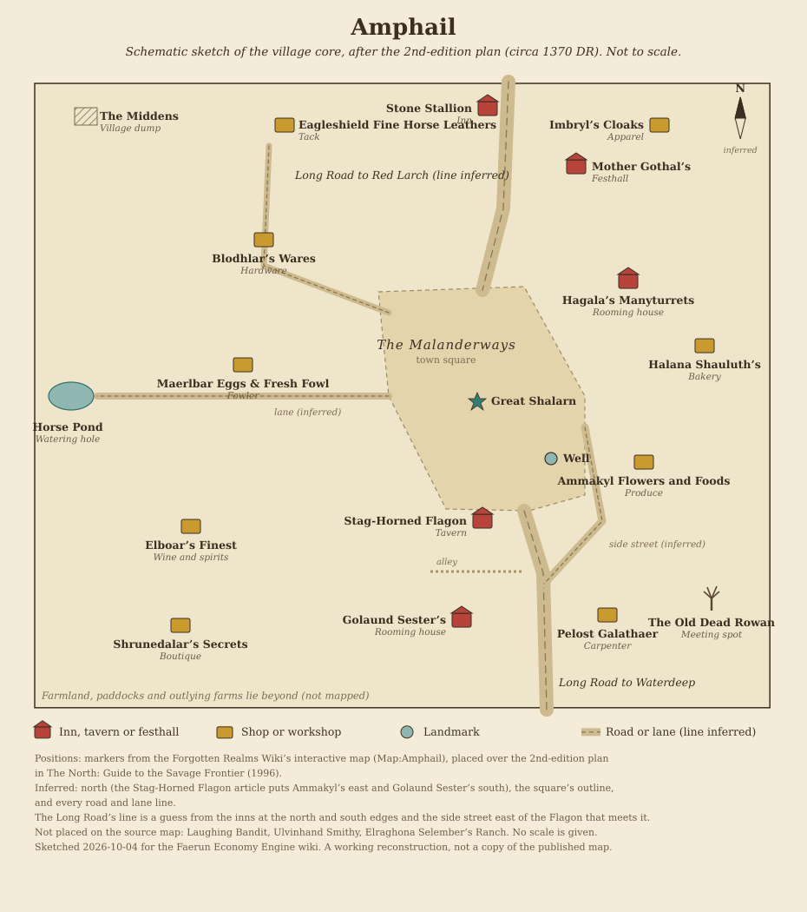
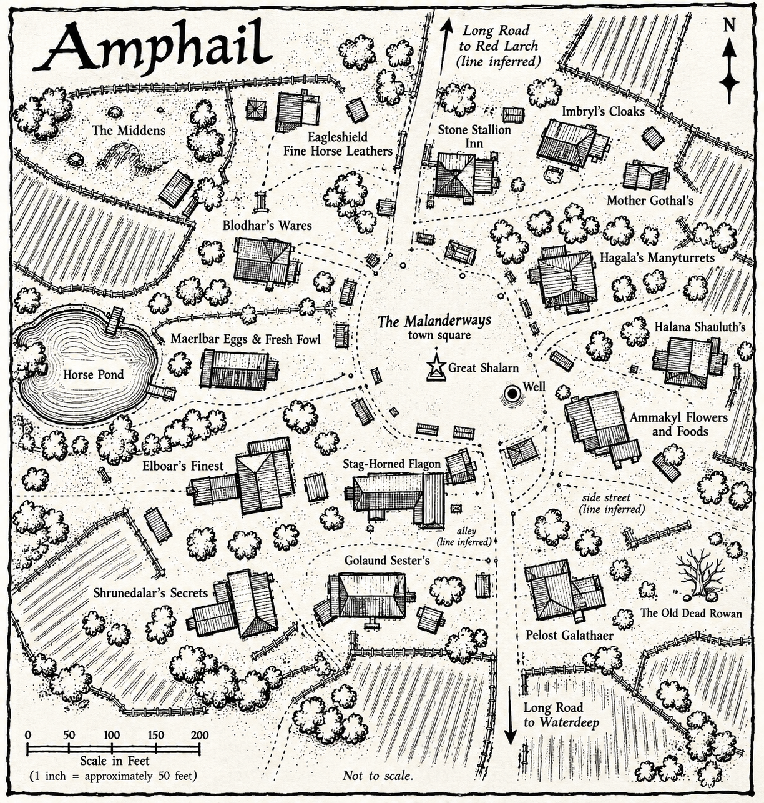

# Amphail

[Location index](../../README.md)

**Region:** Dessarin Valley, on its western edge along the Long Road north of Waterdeep (engine region `Dessarin Valley`, zone `dessarin`)  
**Settlement type:** Village; horse-breeding and farming community  
**Reference period:** 1372 DR lore (2nd- and 3rd-edition sources), with a 1485 DR ruler; 1492 DR planning baseline  
**Evidence reviewed:** 2026-10-04  
**Engine ID:** `amphail`

This entry paraphrases the [Forgotten Realms Wiki article][frwiki] (a secondary
source). Most of its trade and business detail comes from 2nd-edition books
(1993 and 1996) and a 3rd-edition web enhancement (2006). Only the 1485 DR
Lord Warder comes from a 5th-edition source. Nothing here is verified for
1492 DR unless stated.

## Overview

Amphail is a village on the Long Road between Waterdeep and Red Larch. It
takes its name from Amphail the Just, one of Waterdeep's early warlords, who
held estates there; his ghost is said to walk its streets. Its main business
is growing food for Waterdeep, and it is famous for its horses.
[Source][frwiki], citing *The North: Guide to the Savage Frontier* (1996), p. 4,
and *Volo's Guide to the North* (1993), p. 13.

## Geography

- On the Long Road, between Waterdeep and Red Larch.
- **Region classification: Dessarin Valley.** Reasoning, decided 2026-10-04 (A6):
  - The [Forgotten Realms Wiki: Dessarin Valley][dv] article lists Amphail
    among the valley's villages, citing *Princes of the Apocalypse* (2015),
    p. 31. That book is set around 1491 DR, the closest source to the
    1492 DR baseline. The same article gives the Long Road as the valley's
    western edge, which puts Amphail on its boundary.
  - *Volo's Guide to the North* (1993) is organized in regional chapters in
    the order Savage Frontier, The Dessarin, The Coast, The Frozenfar, The
    Interior and the Delimbiyr Vale ([wiki contents list][vgn]). Amphail is
    on pp. 13 to 18 and Red Larch, a Dessarin village, on p. 79, with entries
    apparently alphabetical, so Amphail almost certainly opens The Dessarin
    chapter. This is inferred from page numbers; the book itself was not
    checked.
  - The Amphail infobox's "Sword Coast North" is the wiki's broad label for
    the whole region and would apply equally to Red Larch and Goldenfields,
    so it does not separate Amphail from the Dessarin group.
  - Political ties to Waterdeep in 1372 DR (guards from Rassalantar, a Lord
    Warder loyal to Waterdeep, stud farms owned by Waterdhavian nobles) are
    recorded as relationships, not as grounds to regroup the village.
- About three days' ride north of Waterdeep (*Volo's Guide to the North*,
  p. 13; *Princes of the Apocalypse*, 2015, p. 31).
- Landmark: the Horse Pond.
- Engine: `routes.json` lists Amphail as a stop on The Long Road (between
  Red Larch and Waterdeep), but `get_settlement` reported only one neighbour,
  a 7.6-mile wilderness track ("Amphail Trail") to Amphail Road Junction.
  Routes are reviewed in a later phase.

## Population

| Figure | Scope | Year | Source cited by the wiki |
| --- | --- | --- | --- |
| 600 | Village | Undated (2nd edition) | *The North* (1996), p. 4 |
| 850 | Village (600) and outlying farms (250) | Circa 1372 DR | *Environs of Waterdeep* web enhancement (2006), p. 8 |

The 2006 source gives races as humans 64%, shield dwarves 10%, elves 10%,
lightfoot halflings 5%, half-elves 5%, gnomes 3%, half-orcs 2%, others 1%.
The chief deity is Chauntea.

Demographics standard update (2026-10-15): recorded as **quantified** in
`faerun/data/demographics.py` for circa 1372 DR village plus farms; no separate
1492 DR racial breakdown was found.

**Engine:** 850 residents since 2026-10-04 (A5), adopting the circa 1372 DR
count of village plus farms as a planning scenario, recorded in
[populations.py](../../../faerun/data/populations.py). The earlier 900 gazetteer
estimate is kept as the comparison. No 1492 DR count was found. Dropping
below 900 moved Amphail from the engine's "small town" tier to "village",
which matches the sources, and removed its inferred Farmers' and Millers'
Guild chapter. The population basis takes effect when the server next loads.

## Economy and Trade

| Direction | Goods (wiki infobox) |
| --- | --- |
| Imports | None listed |
| Exports | Agricultural produce, fine horses |

- Main trade: growing food for Waterdeep.
- Horses: Amphail grays, glossy black chargers and the showy "Amphail fancy"
  favoured by Sword Coast nobles (the fancy is from the *Neverwinter* video
  game, 2013). The village smells of horse manure in warm months.
- Breeders are mainly the wealthier landowners. The largest is the Roaringhorn
  family of Waterdeep; others are the Amcathra, Ilzimmer, Jhansczil and Tarm
  families and individual breeders Rorth Baldasker, Ohm Oglyntyr and
  Elraghona Selember.
- The Eagleshield family are not breeders: they make tack and run a farm
  that treats sick animals.
- The Stag-Horned Flagon brews a dense, dark barley beer popular with locals
  and visitors, and a spicy purple mushroom wine (*Volo's Guide to the North*,
  p. 18).

## Government and Defense

- Led by a Lord Warder: Briiathor Alougarr in 1372 DR, loyal to Piergeiron of
  Waterdeep (*The North*, p. 71); Dauner Ilzimmer in 1485 DR (*Storm King's
  Thunder*, 2016, p. 72). Who holds the post in 1492 DR is unverified.
- No standing militia. Waterdhavian guards patrol from Rassalantar.

## Notable Inhabitants

From the wiki's "Inhabitants of Amphail" category and the Amphail and
business articles, read 2026-10-04. Paraphrased; publications are those the
wiki cites, not independently checked. Nearest to 1492 DR first.

### Late 15th century DR (closest to the 1492 baseline)

| Person | Role | Dated | Source cited by the wiki |
| --- | --- | --- | --- |
| Dauner Ilzimmer | Lord Warder of Amphail, of the Ilzimmer family (engine ruler since 2026-10-04) | 1485 DR | *Storm King's Thunder* (2016) |
| Arleosa Starhenge | Owner of the Stag-Horned Flagon; retired carnival performer | Circa 1490 DR | *Storm King's Thunder* |
| Tylandar Roaringhorn | Noble resident, of the Waterdhavian Roaringhorns (Amphail's largest horse-breeding family) | Late 15th century DR | *Storm King's Thunder* |
| Darribeth Meltimer | Mage and adventurer from Amphail, lost in the Underdark; still missing in 1492 DR | 1482 to 1492 DR | *Storm King's Thunder*; *Waterdeep: Dungeon of the Mad Mage* (2018) |
| Urgala Meltimer | Former adventurer, innkeeper of Northshield House in Triboar; listed under Amphail (family tie to Darribeth to confirm) | Late 15th century DR | Same |

### Mid to late 14th century DR (historical)

| Person | Role | Dated | Source cited by the wiki |
| --- | --- | --- | --- |
| Briiathor Alougarr | Lord Warder; retired from Waterdeep's City Guard, still an unofficial member; loyal to Piergeiron | 1372 DR | *The North* (1996), p. 71; *Volo's Guide to the North* (1993) |
| Krivvin Shamblestar | Tavernmaster of the Stag-Horned Flagon | Circa 1370 DR | *Volo's Guide to the North*; *The North* |
| Gothal ("Mother Gothal") | Runs Mother Gothal's festhall; known for listening and giving wise advice | Circa 1370 DR | *The North* |
| Dlara | Chultan warrior and wrestler, second-in-command at Mother Gothal's; popular with young Waterdhavian nobles | Circa 1370 DR | *The North* |
| Thorn Tlassalune | Owner of the Stone Stallion inn; claims to be Amnian, plainly Tethyrian; widowed in 1370 DR | 1370 DR | *The North* |
| Phelansheene ("the Weeping Witch") | Cursed sorceress, a ghost bound to the Stone Stallion | Mid to late 14th century DR | *Volo's Guide to the North*; *The North* |
| Halana Shauluth | Baker; former adventurer who lost a hand and retired here | Circa 1370 DR | *The North* |
| Imbryl | Clothier; runs Imbryl's Cloaks and does alterations | Circa 1370 DR | *The North* |
| Akrosz Ulvinhand | Blacksmith (the Ulvinhand Smithy) | Mid 14th century DR | *Volo's Guide to the North*; *Dragon* #128 |
| Elraghona Selember | Retired adventurer running a ranch that supplies mounts to travellers; one of the named horse breeders | Mid 14th century DR | *The North*; *Dragon* #128 |
| Rorth Baldasker, Ohm Oglyntyr | Individual horse breeders (no wiki pages) | Circa 1370 DR | *The North*, p. 4 (via the Amphail article) |

### Legendary and loosely tied

| Person | Note |
| --- | --- |
| Amphail the Just | Early Waterdhavian warlord who held estates here and gave the village its name; his ghost is said to patrol the streets |
| Asaudrae Daerantree | Priestess of Mielikki said to have died in the Stag-Horned Flagon around 1070 DR; honoured by the Rite of the Stag Lass |
| Tarth Hornwood; Nerndel | Wizard and his Myth Drannor tutor, from the novel *Elminster in Hell* (2001); Amphail tie not checked |
| Jesse | A Daggerford guard (*The North*); listed under Amphail, tie not checked |
| Vexter | Planar-travelling illusionist; listed under Amphail, tie not checked |

### Families and organizations

Waterdhavian noble families with horse-breeding interests: Roaringhorn (the
largest breeder), Amcathra, Ilzimmer (also the 1485 DR Lord Warder's
family), Jhansczil and Tarm. Other families: Eagleshield (Waterdhavian
nobles who run the tack shop and an animal sick-farm) and Ammakyl (who run
the produce shop). The wiki also lists the Harpers and an organization
called Kothont under Amphail; neither has been read.

## Businesses

### In the live market (engine `businesses.json`)

| Business | Type | Offers | Note |
| --- | --- | --- | --- |
| Amphail Remount Company | Horse breeders and remount agents (HQ Amphail; also Waterdeep, Yartar, Silverymoon) | Riding horses, warhorses, draft horses, saddles | Engine-authored; not named in the source. Its address is "High Road" but Amphail is on the Long Road (A8). All offers are valid commodities. |
| The Stag-Horned Flagon (`stag_horned_flagon`) | Tavern and brewery | Ale (fine, standing in for slaker), table wine | Added 2026-10-04 (A11). Sourced: on the Malanderways (town square); brews slaker, a dark barley beer, and a spicy purple mushroom wine (*Volo's Guide to the North*, p. 18). Operating circa 1490 DR under Arleosa Starhenge (*Storm King's Thunder*, p. 72), Krivvin Shamblestar circa 1370 DR. Generated address "High Road, 855" is a placeholder (A8) |

### Named in the source, not in the market

All are from the wiki's list of locations, mostly 2nd-edition; none is
verified as operating in 1492 DR. Eagleshield Fine Horse Leathers is dated
to the mid-to-late 14th century DR (*Volo's Guide to the North*, p. 25); the
*Sword Coast Adventurer's Guide* (2015) names the Eagleshield noble family,
not the shop.

| Name | Kind | Modeled goods it suggests |
| --- | --- | --- |
| Golaund Sester's; Hagala's Manyturrets; The Stone Stallion | Inns and taverns | Lodging |
| Mother Gothal's | Festhall | None |
| Eagleshield Fine Horse Leathers | Tack maker | `saddle`, `harness`, `leather` |
| Elraghona Selember's Ranch | Horse breeder | `horse_riding` |
| Ulvinhand Smithy | Smithy | `horseshoes`, `tools` |
| Maerlbar Eggs & Fresh Fowl | Poultry | `eggs`, `chicken` |
| Ammakyl Flowers and Foods | Florist and grocer | Flowers (no commodity) |
| Imbryl's Cloaks | Clothier | Clothing |
| Blodhlar's Wares; Elboar's Finest; Halana Shauluth's; Laughing Bandit; The Middens; Pelost Galathaer; Shrunedalar's Secrets | Shops (not yet read) | Unknown |

## Maps and Village Layout

### Maps

Preferred edition: 2nd. Published images are linked, not stored in the repo.

**Working sketch:** [amphail-sketch.svg](amphail-sketch.svg), drawn
2026-10-04 from the layout data below. Building positions follow the wiki's
markers on the 2nd-edition plan; north, the square's outline and every road
line are inferred. A reconstruction to work from, not a copy of the
published map.

| Map | Edition and date | Shows | Where |
| --- | --- | --- | --- |
| Village plan of Amphail | 2nd edition, *The North: Guide to the Savage Frontier* (1996), inside cover; circa 1370 DR | Street layout and named buildings | [File:TheNorth-Amphail.png][mapvillage]; interactive version with markers in the [Amphail article][frwiki] appendix |
| Rassalantar area map | 2nd edition (gallery caption "2e map") | Surrounding area | [File:Rassalantar.jpg][maprass] |
| Long Road crossing High Road | 2nd edition (gallery caption "2e map") | Road network north of Waterdeep | [File:Long Road crossing High Road.png][maproads] |
| Environs of Waterdeep | Circa 1372 DR | Amphail in Waterdeep's hinterland | [File:WaterdeepEnvirons2.png][mapenv] |
| *Thornhold* novel map | Novel (2nd-edition era) | Regional | [File:Thornhold map.png][mapthorn] |
| Dessarin Valley | 5th edition, *Princes of the Apocalypse* (2015); 1491 DR | Amphail's position on the Long Road, no streets | [Dessarin Valley article][dv] gallery |

No 5th-edition village plan was found.

### Layout data for rebuilding the plan

Marker positions from the wiki's interactive map (Map:Amphail), placed on
the 2nd-edition village plan image (706 by 599 pixels, origin top left).
Orientation is inferred, not stated: the Stag-Horned Flagon text puts
Ammakyl's to the east and Golaund Sester's to the south, which matches
larger x being east and larger y being south, so the plan is treated as
north-up. No scale is given. Read 2026-10-04.

| Place | Kind | x | y | Note |
| --- | --- | --- | --- | --- |
| The Middens | Landmark (village dump) | 49 | 32 | North-west corner |
| Eagleshield Fine Horse Leathers | Shop (tack) | 240 | 40 | North |
| Stone Stallion | Inn | 435 | 24 | North edge |
| Mother Gothal's | Festhall | 520 | 80 | North-east |
| Imbryl's Cloaks | Shop (apparel) | 600 | 40 | North-east corner |
| Blodhlar's Wares | Shop (hardware) | 220 | 150 | |
| Hagala's Manyturrets | Inn (rooming house) | 570 | 190 | |
| The Malanderways | Landmark (town square) | 360 | 220 | Centre |
| Halana Shauluth's | Shop (bakery) | 643 | 252 | East |
| Maerlbar Eggs & Fresh Fowl | Shop (fowler) | 200 | 270 | |
| Horse Pond | Landmark (watering hole) | 32 | 300 | West edge |
| Statue of the Great Shalarn | Landmark (statue of a famous horse) | 425 | 305 | Rearing stallion |
| Well | Landmark (public well) | 496 | 360 | Between the Flagon and Ammakyl's |
| Ammakyl Flowers and Foods | Shop (produce) | 585 | 363 | East of the Flagon across a side street |
| Stag-Horned Flagon | Tavern | 430 | 420 | |
| Elboar's Finest | Shop (wine and spirits) | 150 | 425 | |
| The Old Dead Rowan | Landmark (meeting and picnic spot) | 650 | 496 | South-east |
| Pelost Galathaer | Shop (carpenter) | 550 | 510 | South of the Flagon |
| Golaund Sester's | Inn (rooming house) | 410 | 515 | South of the Flagon, across an alley |
| Shrunedalar's Secrets | Shop (boutique) | 140 | 520 | South-west |

Not placed by the interactive map: Laughing Bandit, Ulvinhand Smithy and
Elraghona Selember's Ranch (presumably outside the village core).

Text descriptions that fix relative positions (paraphrased from the wiki's
[Stag-Horned Flagon][shf] article, citing *Volo's Guide to the North*,
pp. 17 to 19, and *The North*, inside cover):

- The Flagon stands on the town square, the Malanderways, a few strides
  from the statue of the rearing stallion called the Great Shalarn.
- An alley separates it from Golaund Sester's inn and the village
  carpenter's shop to the south.
- Across a side street to the east, which meets the Long Road, is Ammakyl
  Flowers and Foods; the village well sits on the Malanderways between the
  Flagon and Ammakyl's.
- The Flagon is stone below and timber above with a sod roof, and has a
  private dining area and a large stable at the back.
- Elboar's Finest is panelled in dark wood; Blodhlar's Wares is in poor
  repair; Ammakyl's puts up an awning for extra stall space in summer and
  autumn; the Horse Pond is muddy, with frogs and water lilies, and serves
  as the horses' drinking and washing water.

Gaps: the Long Road's line through the village is not given by the
markers; Volo's Guide to the North (pp. 13 to 25) and *The North* (pp. 4 to
6) likely hold more placement detail but were not read directly.

## Engine Record

| Field | Value |
| --- | --- |
| Population | 850 (900 before 2026-10-04) |
| Wealth / tax / security | 1.0 / 0.05 / 0.75 |
| Port / river | None / no |
| Terrain | Plains |
| Traits | `agrarian`, `noble` |
| Industries | `horse` 3, `farm` 2, `brew` 1, `tan` 1 (added 2026-10-04) |
| Specialties | `horse_riding` 2, `warhorse` 1, `ale` 1 (added 2026-10-04) |
| Shortages | None |
| Ruler | Lord Warder Dauner Ilzimmer (1485 DR figure; set 2026-10-04) |
| Size category | Village (small town before 2026-10-04; the tier starts at 900) |
| Guilds (inferred) | None since 2026-10-04 (Farmers' and Millers' before; settlements under 900 need a stronger industry to support a chapter) |

Observed 2026-10-04, before this run's changes (`get_trade_summary`): gross
local product 1.47 million gp a year (1,637 gp per resident); goods exports
1,916 gp a day against imports of 42,654 gp a day; 5,782 gp a day of inbound
freight assigned to no carrier. Leading exports by volume are draft horses
(58 a day), ponies (20), fruit (20) and vegetables (18); warhorse exports are
almost nil (0.004 a day) despite the specialty. Bread shows 321 loaves a day of
unmet demand and is "unavailable", and the usual exotic goods (pineapple,
citrus, camel, yak) each show a flat import need.

**Active event during these observations:** the engine's generated chronicle
has "Famine in Amphail, 1492 DR" active on 3 Marpenoth 1492 DR (event
`chron-amphail-03`, four months): food, livestock and drink supply at 35%
and demand at 161%. The same chronicle gives Amphail a drought (1489 DR),
famines (1490, 1492, 1494 DR), a hard winter (1491 DR) and a blight
(1494 DR). These are procedural events, not sourced lore.

**Live server note (2026-10-04):** after this run's `reload_catalog`, the running
server placed Amphail at x 621.7, y 1126 with no neighbours and zero trade.
`settlements.json` on disk still holds x 648.5289, y 1161.7169, and other
markets (Goldenfields, Red Larch, Waterdeep) were unaffected. A server restart
should restore the stored position; it was not restarted in this run (A12).
Later on 2026-10-04 the stored position was passed back through
`update_settlement` with the A4 change, which restored the live position and
the Amphail Trail neighbour. The cause is still open.

## Discrepancies and Proposed Engine Changes

| # | Issue | Proposal | Status |
| --- | --- | --- | --- |
| A1 | The Eagleshield family make tack, a product named directly by the source, but there was no leather-working industry | Add `tan` 1 | Applied 2026-10-04 |
| A2 | The Stag-Horned Flagon's dark barley beer is a named local product; `brew` 1 existed without an ale specialty | Add specialty `ale` 1 | Applied 2026-10-04 |
| A3 | Description did not state location or main trade | Set description from the source (Long Road village, food for Waterdeep, horses) | Applied 2026-10-04 |
| A4 | Ruler is blank; the source names Lord Warder Dauner Ilzimmer in 1485 DR (Briiathor Alougarr in 1372 DR) | Set ruler to "Lord Warder Dauner Ilzimmer", the closest-dated named holder | Applied 2026-10-04 (Murray's decision) |
| A5 | Engine 900 has no reference year; source gives 850 including 250 on outlying farms, circa 1372 DR | Set 850 and record the source in `populations.py`, with 900 as the comparison | Applied 2026-10-04 (Murray's decision) |
| A6 | Engine region is `Dessarin Valley`; the wiki infobox says Sword Coast North | Keep `Dessarin Valley`; see the reasoning under Geography ([Dessarin Valley][dv]; [Volo's Guide to the North][vgn]) | No change needed (Murray's decision 2026-10-04) |
| A7 | Bread shows about 300 loaves a day of unmet demand and zero output. Corrected diagnosis 2026-10-04: bread can come from `farm` or `craft`, so `craft` is not the cause. The active famine cuts flour to about 2 sacks a day; households are supplied before workshops and take all of it, leaving bakers none. Normal baking capacity is about 66 loaves a day against about 189 needed, so milling is thin even without the famine. Goldenfields (681 a day) and Red Larch (96% of need) bake normally | No change now; recheck bread output and flour after the famine ends, then decide whether milling capacity needs a change | Deferred (Murray's decision 2026-10-04) |
| A8 | Amphail Remount Company's Amphail address is "High Road, 532, Trade Quarter"; Amphail is on the Long Road. All four of its branch addresses are generated placeholders | Leave as is; treat generated business addresses as placeholders engine-wide (they also cannot be changed through `update_business`). Later: consider replacing or renaming this engine-authored firm after a sourced breeder (Roaringhorn, Amcathra, Ilzimmer, Jhansczil, Tarm), together with A11 | No change (Murray's decision 2026-10-04); replacement noted for later |
| A9a | Draft horses: 56.9 a day produced (3 Marpenoth 1492 DR, during the famine). The quote shows a world-wide `hinterland_capacity_multiplier` of about 134 on draft horses; without it output is about 0.42 a day (about 155 a year), plausible for the village. Riding horses carry no multiplier and produce about 0.9 a day (about 330 a year). Lowering `horse` would be the wrong fix | Engine code review: find which rule applies the hinterland multiplier to draft horses and whether it should | Cause found 2026-10-08: only four towns had the `horse` tag, so source-district calibration scaled them to world demand. Draft horses and ponies now also list `farm` as a producer; Amphail draft horses fall to about 4 a day |
| A9b | Warhorses: about 0.004 a day (about 1.4 a year) despite specialty `warhorse` 1 and the sourced black chargers. Warhorse is a processed good (riding horse, grain, saddle) and its capacity itself comes out tiny; cause not yet traced | Engine code review of warhorse capacity; first priority among Amphail's engine fixes because chargers are a named product | Proposed (engine-wide); recheck after the famine |
| A10 | Cotton (16 bales in stock) appears among exports of a northern village | Engine-wide, for a later commodity review: (1) remove `textile` from cotton's producers, since weaving does not grow cotton; (2) stop cold-region farms producing cotton, after checking how the engine assigns the "cold" profile. Waterdeep also shows 2,142 bales and about 214 a day spare. The Forgotten Realms Wiki has no Cotton article, so this rests on agronomy, not a source | Deferred to commodity review (Murray's decision 2026-10-04) |
| A11 | No source-named business is in the market | Promote source-named businesses once a source near 1492 DR shows them operating. The Stag-Horned Flagon meets this (operating circa 1490 DR, *Storm King's Thunder*, p. 72) and was added; Eagleshield Fine Horse Leathers does not yet (14th-century sources only) | Flagon applied 2026-10-04; Eagleshield proposed |
| A12 | Before the local reload fix, `reload_catalog` moved Amphail to its x 621.7, y 1126 calibration point rather than its saved x 648.5289, y 1161.7169 map position, leaving no neighbours. | On 2026-10-15 the local catalog reload now replays saved map edits after calibrating settlements. A regression test and a fresh local-world reload confirm the saved position persists; the live server still needs verification after deployment/restart. | Fixed in local code; live server verification pending |
| A13 | Salt reaches Amphail from Innarlith, 5,631 miles and about 125 days away. Innarlith is the only salt producer in the whole engine, although the lore says salt is broadly abundant with most regions producing some locally | Add `salt` 1 to Mintarn (named rock-salt mines); see Salt Supply below | Applied 2026-10-04 (Murray's decision); Moonshae and Anauroch sources deferred to their reviews |

## Salt Supply (A13)

The engine has one salt producer, Innarlith on the Lake of Steam, so every
market in the North draws salt from about 5,600 miles away. The [Forgotten
Realms Wiki: Salt][salt] article (accessed 2026-10-04) says:

- Salt was broadly abundant and most regions had some local production; it
  was a common caravan good but rarely the mainstay of an economy (citing
  *Ed Greenwood Presents Elminster's Forgotten Realms*, 2012, pp. 128 to 129,
  and *Power of Faerûn*, 2006, p. 69).
- It was made by evaporating sea water or salt-marsh water on flat
  surfaces, mined as rock salt, or dug from salt pans.
- Named sources nearest Amphail: rock-salt mines on the northern islands of
  Mintarn (*Power of Faerûn*, p. 69); the Dwyvach Salt Flats and Korinn
  Archipelago mines in the Moonshae Isles; salt pans in the Sword region of
  Anauroch worked by the Bedine (*Anauroch*, 1991).
- Waterdeep's Fellowship of Salters, Packers and Joiners preserved food for
  sea trade (*City of Splendors*, 1994, p. 43); this shows heavy salt use in
  Waterdeep, not production.

Mintarn is in the engine (population 5,000, `fish` 3, specialty `fish_salt`
1) but has no `salt` industry. Options, for decision:

1. Add `salt` 1 to Mintarn, the named source closest to the Sword Coast.
2. Add coastal sea-salt production (for example `salt` 1 at Waterdeep and
   other coastal markets with salt-curing trades), on the basis that most
   regions made some locally. This is an inference, not a named source per
   town.
3. Engine-wide: let coastal terrain produce salt by default, or allow
   `fish` to produce salt.
4. Add the Moonshae and Anauroch sources when those regions are reviewed.

**Decision 2026-10-04:** option 1 applied (Mintarn `industries` now include
`salt` 1), with option 4 to follow as those regions are reviewed. Options 2
and 3 are held unless Mintarn alone leaves salt scarce.

**Observed straight after the change (3 Marpenoth 1492 DR):** Mintarn
produces about 112 sacks a day, uses about 7 and has about 105 to export;
`get_commodity_sources` now lists two producers. Waterdeep needs about 256
sacks a day (about 161 of it for salting and processing), so one level at
Mintarn covers well under half of Waterdeep's need. Live quotes for
Waterdeep and Amphail still showed Innarlith as the source, and the price
snapshot is marked stale; recheck after the next snapshot refresh or server
restart before deciding whether Mintarn needs `salt` 2 or the coast needs
its own production.

## Proposed New Commodities

| Candidate | Evidence | Producers |
| --- | --- | --- |
| Mushroom wine | Spicy purple wine of the Stag-Horned Flagon (*Volo's Guide to the North*, p. 18); the Flagon is still operating circa 1490 DR | `brew` or `vint` (to check) |
| Cut flowers | Ammakyl Flowers and Foods (shop name only; not read) | `farm`, `orchard` |

## Lore Follow-ups

1. **1492 DR state.** Read *Princes of the Apocalypse* (circa 1489 to 1491 DR)
   and *Storm King's Thunder* for Amphail's businesses and leader nearer the
   baseline.
2. **Shop pages.** Read the wiki pages for the unread shops (Blodhlar's Wares,
   Elboar's Finest, Halana Shauluth's, Laughing Bandit, The Middens, Pelost
   Galathaer, Shrunedalar's Secrets) to see what they sell.
3. **Noble breeders.** The Roaringhorn, Amcathra, Ilzimmer, Jhansczil and Tarm
   are Waterdhavian noble families; link them to Waterdeep's noble houses if a
   noble-family model is added.
4. **Rassalantar.** Already listed as missing; it garrisons the guards that
   protect Amphail.
5. **Bread after the famine (A7).** Recheck bread, flour and grain at
   Amphail once `chron-amphail-03` ends.
6. **Generated history.** Four food crises in six years (1489 to 1494 DR)
   come from the procedural chronicle, not lore; check whether that rate is
   intended for a small farming village.
7. **Horses after the famine (A9a, A9b).** The famine also cuts livestock
   supply to 35%, so recheck draft, riding and warhorse output once it ends.
8. **Routing.** Amphail is a Long Road stop in `routes.json`, yet
   `get_settlement` showed only a 7.6-mile track to a road junction. Review in
   the routes phase.

## Sources

**Directly consulted, secondary:** [Forgotten Realms Wiki: Amphail
(village)][frwiki], accessed 2026-10-04 through the browser (direct fetch
returned HTTP 402). Publications named above are the wiki's references, not
independently checked: *Volo's Guide to the North* (1993), pp. 13, 17, 18;
*The North: Guide to the Savage Frontier* (1996), pp. 4, 71; *Environs of
Waterdeep* web enhancement (2006), p. 8; *Princes of the Apocalypse* (2015),
p. 31; *Storm King's Thunder* (2016), p. 72; *Neverwinter* (2013 video game).

**Also consulted for the region decision, secondary:** [Forgotten Realms Wiki:
Dessarin Valley][dv] and [Forgotten Realms Wiki: Volo's Guide to the
North][vgn] (contents list), both accessed 2026-10-04. For salt (A13):
[Forgotten Realms Wiki: Salt][salt], accessed 2026-10-04. For businesses (A11):
[Forgotten Realms Wiki: Stag-Horned Flagon][shf] and [Forgotten Realms Wiki:
Eagleshield Fine Horse Leathers][efhl], accessed 2026-10-04. For inhabitants:
[Category: Inhabitants of Amphail][inh] and the linked person articles,
accessed 2026-10-04.

**Engine:** `get_settlement`, `get_trade_summary` and
[businesses.json](../../../faerun/data/store/businesses.json), observed
2026-10-04. No city directory exists for Amphail.

[frwiki]: https://forgottenrealms.fandom.com/wiki/Amphail_(village)
[dv]: https://forgottenrealms.fandom.com/wiki/Dessarin_Valley
[vgn]: https://forgottenrealms.fandom.com/wiki/Volo%27s_Guide_to_the_North
[salt]: https://forgottenrealms.fandom.com/wiki/Salt
[shf]: https://forgottenrealms.fandom.com/wiki/Stag-Horned_Flagon
[efhl]: https://forgottenrealms.fandom.com/wiki/Eagleshield_Fine_Horse_Leathers
[inh]: https://forgottenrealms.fandom.com/wiki/Category:Inhabitants_of_Amphail
[mapvillage]: https://forgottenrealms.fandom.com/wiki/File:TheNorth-Amphail.png
[maprass]: https://forgottenrealms.fandom.com/wiki/File:Rassalantar.jpg
[maproads]: https://forgottenrealms.fandom.com/wiki/File:Long_Road_crossing_High_Road.png
[mapenv]: https://forgottenrealms.fandom.com/wiki/File:WaterdeepEnvirons2.png
[mapthorn]: https://forgottenrealms.fandom.com/wiki/File:Thornhold_map.png
