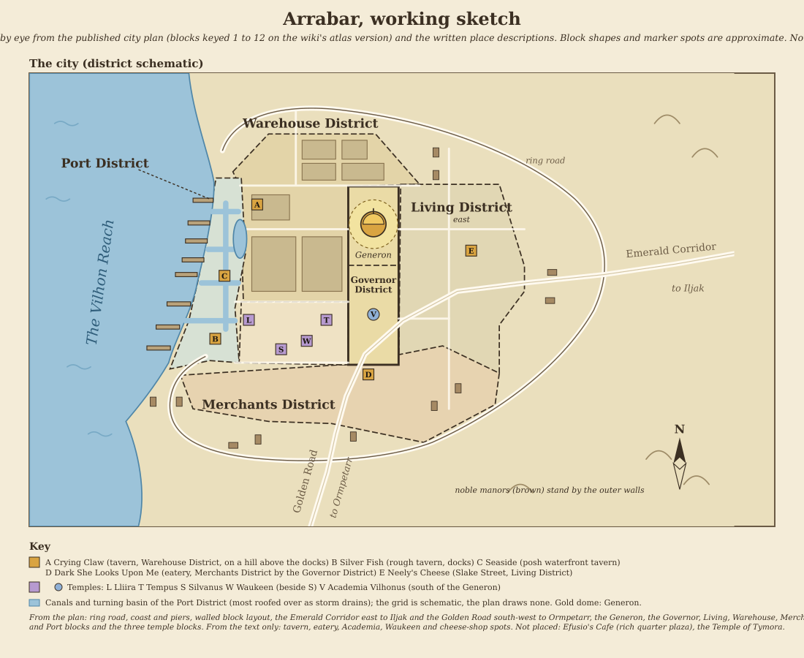

# Arrabar

[Location index](../../README.md)

**Region:** Chondath, Vilhon Reach (engine zone `vilhon`)  
**Settlement type:** Port metropolis; capital of Chondath  
**Reference period:** 1357 to 1373 DR lore, plus a late-15th-century status note  
**Evidence reviewed:** 2026-10-03 (Arrabar and Chondath articles); 2026-10-13 (Category: Inhabitants of Arrabar, its member pages, the linked location, organization and map pages, and a wider web search; see [Resource Pages](#resource-pages))  
**Engine ID:** `arrabar`  
**Structured metadata:** [arrabar.json](arrabar.json) (identity, periods, engine record, district layout, places, people, organizations, sketch, map and source links; regenerate it when this entry changes)

This entry paraphrases Forgotten Realms Wiki articles, which are secondary
sources; the underlying publications were not consulted directly. The wiki
refuses direct page fetches (HTTP 403), so the 2026-10-13 pass read the same
pages through its public MediaWiki API. See [Sources](#sources).

## Overview

Arrabar, "Shining Arrabar" or "Golden Arrabar", is the capital of Chondath and
one of the primary ports of the Vilhon Reach, known for crime and corruption.
Its heraldic symbol was three golden balls on a white background. Its people
are Arrabarrans, mostly human (Chondathans and Blade Kingdomers), speaking
Chondathan and paying in dinars and nobles. The wiki lists worship of Waukeen,
Lathander, Tymora, Sune, Loviatar, Lliira and Silvanus. It was destroyed in the
Spellplague and is described as back on the map by the late 15th century DR.
[Source][frwiki]

## Climate

*The Vilhon Reach* (1996), Introduction: Climate, p. 4 (read directly on
2026-10-14) describes the whole Reach as subtropical and humid: summers are very
hot, winters mild and rainy, and snow is rare. These are regional figures, not
readings specific to Arrabar.

| Season | Conditions |
| --- | --- |
| Spring (arrives early Mirtul) | Days can reach 80°F / 27°C; evenings and early mornings rarely drop below 60°F / 16°C |
| Summer (begins when the druids' Long Night ends, early Eleasis) | High humidity, with heat reaching 110°F / 43°C |
| Autumn (approaches late Marpenoth) | Cooler; daytime highs range from 80°F down to 50°F (27 to 10°C) |
| Winter | Heavy rain; usual highs of 50 to 65°F (10 to 18°C); cold spells can reach 35°F / 2°C; snow is rare |

Inference, not sourced for Arrabar: for city art this suggests shaded streets,
light clothing, lush planting, and buildings suited to heat and heavy rain; the
Netherwaters would likely feel damp and cooler than the streets above.

The engine shows this under **Climate** on the location page
(`faerun/data/climate.py`). The sourced text is descriptive only. Separately,
Arrabar carries the `tropical` trait (added 2026-10-14), so the engine's
climate class for it is `tropical` rather than the `temperate` default for the
`vilhon` zone. That class selects the tropical production calendars of 39 goods
when seasonal inventory is enabled; the engine has no separate "subtropical"
class.

## Geography and Layout

- On the south-eastern shore of the Reach, founded in 50 DR alongside Mussum
  and Samra. A sprawling, tidy city with lush gardens, vines and planters on
  its streets and buildings; gentle hills run from the perimeter walls down to
  the bay, and the climate is hot and humid.
- Districts: Port (west), Warehouse (north), Merchants (south) and Living
  (east) around the central Governor District. The published plan shows the
  Warehouse blocks in the north-west, the Generon in the north half of the
  central Governor block, and the Living blocks to its east.
- The Generon, the palace of the Lord of Arrabar, stands in the northern half of
  the Governor District with gilded domes of gold and silver. Barracks and
  fortifications ring it, held by Lord Wianar's personal army.
- Canals honeycomb the Port District and reach the neighbouring boroughs. The
  canals, docks and basin are collectively the Netherwaters, "Nethers" or
  "Below", which had a shady name for lowlifes and was rumoured to hide
  aquatic monsters. The canals converge on a turning basin south of the
  Warehouse District and run to the sea. Narrowboat barges carried the city's
  waste to the Shallows, a monster-infested bay down the coast.
- Ed Greenwood's own account (eight-tweet thread, 6 January 2022, answering a
  question about the Crying Claw; see [Resource Pages](#resource-pages)): the
  Port District is "honeycombed" with canals leading to a large turning basin
  just south of the Warehouse District, so many buildings are "waterfront" that
  they look several streets inland on the stylized published maps; the Crying
  Claw, for one, can be reached by boat, tied up at and left the same way.
  Almost all
  canals are roofed over; a light well smaller than the basin opens onto it;
  buildings have deep cellars and streets run on the roofs, with rain draining
  through gratings, "like modern Chicago's Loop". Goods boats still use the
  canals and the city polices them heavily, because rivals would otherwise block
  canals to delay competitors. Fishing from boats is banned in the canals and
  basin; fishing with a rod from a balcony or window is not (the Arrabar article
  says balconies and shores are also banned). "Narrowboat" barges haul garbage
  out to sea for dumping in the Shallows. The Netherwaters are where "bad
  people" (low, criminal and even misshapen) live and work, so many Arrabarrans
  never mention them. Greenwood says you could run a whole campaign "down
  there".
- Noble manors stand along the outer city walls, each family with a small
  private army.
- Only a few Reach harbors, Arrabar's and Hlath's among them, were deep enough
  for deep-draft ships (*Pirates of the Fallen Stars*, 1992, pp. 47 to 48). The
  marine ports are defended by ballistae.

### Plans and sketch

| Image | What it is |
| --- | --- |
| [Arrabar_map.webp](Arrabar_map.webp) | Published plan, north up. Oval ring road around a walled, block-by-block city on the Reach shore, piers along the west edge, the Emerald Corridor leaving east toward Iljak and the Golden Road leaving south-west toward Ormpetarr. Blocks are numbered 1 to 9. The wiki's "Arrabar map BW.jpg" (circa 1373 DR, credited to *The Ruby Guardian* map) may be the same plan; the pixel sizes differ, so the match is not confirmed |
| [ArrabarIA.webp](ArrabarIA.webp) | Interactive Atlas redrawing of the same plan with a key: 1 Port District, 2 Warehouse District, 3 Merchant District, 4 Governor's District, 5 Living District, 6 The Generon, 7 Temple to Tempus, 8 Temple of Silvanus, 9 Temple of Lliira, 10 Seaside Tavern, 11 Crying Claw, 12 Noble House. Its bar reads 0 to 500 ft |
| [OIP.webp](OIP.webp) | A second plan of the same oval with blocks numbered 1 to 10, a 0 to 500 ft bar, one block boxed in red (probably added later) and the same two road exits; key not seen |
| [Screenshot 2026-10-13 151147.png](<Screenshot 2026-10-13 151147.png>) | The engine world map around Arrabar and the Vilhon Reach. Not a published map |

The key settles which numbers are which on [Arrabar_map.webp](Arrabar_map.webp):
1 is the western strip, 2 the north-west blocks, 3 the southern blocks, 4 the
central block south of the Generon, 5 the eastern blocks and 6 the walled
compound at the top of the central block. The three temple blocks (7, 8, 9) lie
together just south-west of the centre. The plan's own bar makes the walled
blocks only about 1,300 to 1,500 ft across, too small for 61,012 residents, so do not
trust the scale. The Golden Road runs on through the city as its main diagonal
street and meets the Emerald Corridor east of the centre.

**Working sketch:** [arrabar-sketch.svg](arrabar-sketch.svg), redrawn 2026-10-13
by eye from the plan and the place descriptions; not a copy. From the plan: the
ring road, coast and piers, the block layout, the Generon and the two road
exits. From the text only: the tavern, eatery, Academia, Waukeen and cheese-shop
spots and the canal grid (the plan draws no canals). Efusio's Cafe and the
Temple of Tymora have no position and are not plotted.

**Generated images.** Four images in this folder look machine-generated from the
first, now superseded sketch: a painted top-down view, a "Fantasy Cadastral
Map", a "Topographical Plat" and a harbor scene. They are illustrations, not
lore. The painted view and the cadastral map put the Warehouse District across
the whole north and the Generon at the very centre, which the published plan
does not; regenerate them from the current sketch if they are to be used.

## Population

| Year | Figure | Source cited by the wiki |
| --- | --- | --- |
| 1357 DR | 5,000 | *Old Empires* (1990), p. 10 |
| 1372 DR | 61,012 | *Forgotten Realms Campaign Setting* 3rd edition (2001), pp. 217 to 218 |

The two figures are hard to reconcile; the 1357 count is not adopted. No count
after the city's restoration was found. The races are mostly human
(Chondathans and Blade Kingdomers).

**The engine now uses 61,012**, the 1372 DR count, as a planning scenario for
1492 DR (previously 42,000). It is recorded in
[populations.py](../../../faerun/data/populations.py) with 42,000 as the comparison.

## Economy and Trade

Arrabar's economy rests on trade in its open market. Merchants come to buy goods
for resale to the north and west, and local merchants stop in smaller Reach
towns such as Timindar to buy produce for Arrabar's markets. The city stands at
the end of two key roads, the southern Golden Road and the Emerald Way, the
latter also called the Emerald Corridor, the main Chondathan trade route along
the Reach to Hlath and Reth. Sea trade with Cormyr dates to 389 DR. In the late
14th century the oldest merchant families held nine tenths of the city's wealth
and younger houses fought over the rest.

The people work in trade, crafting, fishing and mercenary companies, including
private armies kept in the capital and companies that rest there between jobs.
The Sapphire Crescent is one.

| Direction | Goods |
| --- | --- |
| Exports | Lumber |
| Imports | Mulhorandi dark ale, Tashalaran coffee ("kaeth"), Tethyrian tea, peppers, balaumo, pipeweed |

These describe trade character, not volumes. Part of the import list comes from
the novel *The Sapphire Crescent* (2003). Arrabar took up Nimpeth's slave trade
by 258 DR and a Zhentarim plan of 1370 DR aimed at its slave trade with the Lake
of Steam; the engine has no slave commodity. In the 1360s Arrabar paid workers
toward Innarlith's proposed canal from the Lake of Steam to the Reach, and
Thayan agents staged the 1368 DR murder of its ambassador there to cast doubt on
the project.

## Government

The Lord of Arrabar rules from the Generon and the lordship extends over all the
cities of Chondath; most Chondathan warriors serve it. The Illistine family held
the rule of Chondath from Anthony Illistine's union of the free cities in 139 DR
to 300 DR (King Laviar Illistine is listed for 267 DR). Lord Simon Dessino is
named for 1370 DR and Lord Eles Wianar for 1372 DR. The 1492 ruler is unknown;
the engine's `ruler` field is left empty.

Eles Wianar's rule was kept by intrigue: General Clas Denwith of Sespech called
his family "decadent, evil, and corrupt". He kept the free cities busy with
petty feuds, taxed them and sold them mercenaries, ran spies in every noble
house and survived the assassins sent at him. His aim was to take all the free
cities, with the Emerald Enclave the main obstacle. Dessino, in 1370 DR, hired
fire giants to raid near Lachom and push it toward an alliance with Arrabar.

The Lord hosts a week-long annual assembly of representatives of the free cities.
Noble and wealthy visitors are expected to call at the Generon. The Municipal
Guard is organised in numbered squads, the 6th being the best, armed with
longswords and short bows, and it holds the undead as sworn enemies. In murder
cases it has Waukeen's clergy cast *speak with dead*. Young men and women are
conscripted for four years.

### Noble houses

Their manors stand along the outer walls.

| House | Notes |
| --- | --- |
| Wianar | The ruling house. Employed the League of Lightning mercenaries mid-14th century; its force topped 25,000 foot and horse |
| Cauldyl | Oldest and most powerful merchant family, and the most sneering and pretentious; a sprawling mansion with its own mercenaries |
| Darowdryn | The most private house, known for near-white hair; Matriarch Ariskrit Darowdryn |
| Elphaendim | Merchant house led by the wizard Thalammose Elphaendim |
| Matrell | Founded by Obiron Matrell I and Hetta Debrinne; held a position in the Waukeenar and was led by Dregaul Matrell in 1362 DR. A young house, shunned by older nobles |
| Mercatio | Noble merchant house; scion Adyan Mercatio |
| Mestel | Old merchant family that shunned the bastard-born Obiron, who left and founded Matrell |
| Rohden | Noble merchant house; scion Horial Rohden |
| Pharaboldi | Horse-loving house; Matriarch Anista Pharaboldi died in 1373 DR |
| Talricci | Noble merchant house with a house mage, Bartimus; Grozier Talricci headed it in 1373 DR |

### Regional relations

From the wiki pages on neighbouring places (late 14th century unless stated):

- **Hlath** is ruled by a single governor under Arrabar's control, and a highway
  links the two. **Iljak** pays Arrabar heavy taxes, serves Lord Wianar and
  exports crops and grain to Arrabar, Reth and even Hlath. **Samra** and
  **Mussum** paid taxes to the capital; lumber from **Shamph** was dispersed
  through Arrabar, Samra and Mussum.
- **Sespech** broke away after the Rotting War and Arrabar tested its
  sovereignty for centuries; Arrabar kept puppet barons there until 1364 DR,
  financed the bandit chief Haskar Corintis, and by 1372 DR Wianar was planning
  an invasion. **Elbulder** turned back an Arrabarran band; **Mimph**, which
  Arrabar razed in 135 DR, still saw Arrabarran vessels board its ships and
  claim cargo; **Lachom** disdained Arrabar and traded with Surkh instead.
- The free cities, with no formal pact, often worked together to stop Arrabar
  regaining its former strength. The Atlas of Ice and Fire blog (1371 to 1372 DR
  framing) adds that Chondath is one of Faerun's most densely populated nations,
  that Arrabar is its largest city by far, and that bids for independence "usually
  fail".
- The **Golden Road** runs from Arrabar through Ormpetarr to Innarlith and on to
  Shaarmid and Kormul in the Shaar; Fort Arran stands on it between Arrabar and
  Sespech.
- Church presence beyond the temples above: Silvanus and Tempus each have major
  temples at Arrabar and Ormpetarr; Lliira has a temple at Arrabar; Loviatar's
  High Holy Temptress Lauraera Dlarayna came from Arrabar (974 DR).

## Culture and Daily Life

- The folk are wary of wizards. Loyalist warriors often refuse magic items other
  than simple enchanted weapons and armor, and executions of mages were common.
  After the Rotting War many believed deadly plague magic still lingered.
- Learned people mark their foreheads with dots. The Academia Vilhonus began it
  before 300 DR: one dot for reading, two for writing, three for the Art. It
  became law-backed, and Vambran Matrell wore three blue circles in 1373 DR.
- A *naraebul* is a satchel with hidden compartments against pickpockets.
- Eateries are called *aszraun* and taverns *rathrur*. *Talthaek* is a gravy-filled
  meat pie. Street food includes thaek buns and honeyed buns; noble tables set
  scrambled eggs with cheese and lemon-wine sauce, stuffed fish and tea with
  gossip.

### Festivals

- **Night of Ghosts:** the Lord's annual gala ball, with actors dressed as ghosts
  and monsters frightening guests, rivals included. Held in Flamerule in 1362 DR.
- **Reign of Misrule:** from 10 Marpenoth, a tenday after Highharvestide.
- **Night of Dancing:** first half of Flamerule, at the new moon, for Chondath's
  hoped-for return to glory.
- **Spheres:** a Waukeenar festival on 10 Tarsakh, when clergy toss glass
  spheres holding coins and trinkets to the crowds.

## Defenses

Mercenaries and heavy fortification make Arrabar strong, but its navy was small
after the war with Yrkhetep. General Clas Denwith called its armies "under-trained
and woefully inadequate" against Sespech in the late 14th century. In 1357 DR
the Lord mustered the Windriders, the 6th Municipal Guard and the Lightblades,
Sisterhood of the Oaks and Sunshafts companies, with two gold dragons, against
Yrkhetep's cloud-castle assault, the Battle of Five Crowns.

## Named Places

Positions are from the wiki's text, read against the plan key where it lists the
place.

| Place | Where | Notes |
| --- | --- | --- |
| Generon | North half of the Governor's District, between the Warehouse District (west) and Living District (east); plan 6 | Palace and seat of the Lord. Gardens with peach and plantain trees and a pond; a fountain of dancing coins in the entry hall that appears to run with coins at Waukeenar events |
| Academia Vilhonus | Governor's District, south of the Generon | A famous bardic college with a large, politically coloured history library and vine-covered walls |
| Crying Claw | Warehouse District, near the waterfront, on a hill sloping to the Dock District; plan 11 | Moderately priced tavern for the middle class, adventurers and captains; sign shaped like a bird's claw that squeals in the east wind; terraced patio of greenery. Run by the Harper agent Jenis Glowarm circa 1370 DR. The Arrabar article calls it a waterfront tavern with small docks; the Crying Claw article puts it up the hill |
| Seaside | Waterfront; plan 10 | Expensive, posh tavern for the well off |
| Silver Fish | Docks | Rowdy, foul-smelling rathrur |
| Dark She Looks Upon Me | Mercantile (Merchants) District, bordering the Governor's District, a short walk from the Temple of Waukeen | Busy aszraun known for roast beef and lamb talthaek. The 1373 DR assassin attempt on Vambran Matrell took place here |
| Efusio's Cafe | A plaza in a rich part of the city | Open-air cafe selling imported tea, kaeth, Mulhorandi dark, balaumo and fruit-blended tobacco |
| Neely's Cheese | Slake Street, Living District, near a large square market | Cheesemaker's shop; Neely and his employee Mirolyn Skolotti circa 1373 DR |
| Temple of Waukeen | The Temple of Silvanus is adjacent, to its south-west; the Tempus and Lliira temples are in the same district | Domed, gilded and jewelled; being enlarged in 1373 DR; base of the Order of the Sapphire Crescent; the Grand Trabbar lived in its spires |
| Temple of Silvanus | Borders the northern part of the Merchants District; plan 8 | Large, centre of Silvanus worship |
| Temple of Tempus | Close to the centre, on the eastern edge of the Governor's District; plan 7 | Major temple led by General Vandemar Cordwin. The plan puts block 7 just west of the Governor block |
| Temple of Lliira | Centre-east border of the Port District; plan 9 | Worship place of the churches of Lliira and Waukeen |
| Temple of Lathander | Not placed | Kept the *Tome of the Morning* until 1221 DR |
| Temple of Ilmater | Not placed | Large and influential in the late 1350s DR; Shavryn Ilidar served as high priest |
| Temple of Tymora | Not placed | Main Tymora church in the city |
| Inn of the Five Crowns | Up the Emerald Corridor from Arrabar, where it nears the Chondalwood | Major inn; the 1357 DR rallying point against Yrkhetep |

## Organizations

- **Merchants' Guild:** independent of rulers and clergy; Guildmaster of Merchants.
  Circa 1370 DR it fought Lord Wianar's bid to install his son as Guildmaster.
  The engine also infers a Merchant Guild; the two are not linked.
- **Order of the Sapphire Crescent:** the Church of Waukeen's private mercenary
  army, based at the Temple of Waukeen.
- **Windriders:** an elite griffon-riding Chondathan company under Bren Wingblade,
  all but retired by the 1360s DR.
- **Company of the Singing Dawn:** mercenary company circa 1358 DR, led by Solara.
- **Bronzespur:** the city's local Heralds, serving the Heralds of Faerun.
- **Red Wizards:** a Thayan enclave allowed by Lord Wianar.
- **Six Swords of Arrabar** and **Band of the Flaming Sword:** adventuring companies.
- **Bards of Nun:** three bards who each chronicled the Rotting War for one of the
  armies of Arrabar, Reth and Hlath.
- **Minstrelwish:** a halfling clan whose low-profile landlords live in Arrabar
  among many cities.

## Notable People

Only people tied to Arrabar by the wiki category or the Arrabar article.

| Person | Role |
| --- | --- |
| Eles Wianar | Lord of Arrabar and ruler of Chondath in the late 14th century; cousin Rodolpho Wianar was killed by a stray crossbow bolt at the 1362 DR Night of Ghosts |
| Simon Dessino | Lord of Arrabar, short reign circa 1370 DR |
| Anthony Illistine | Lord who united Chondath in 139 DR |
| Vandemar Cordwin | General and powerful priest of Tempus; father of Ridimere Cordwin; zealot |
| Pontar Elimon | Sage and Zhentarim spy circa 1370 DR |
| Jenis Glowarm | Harper agent and Crying Claw proprietor |
| Shavryn Ilidar | High priest of Ilmater at an Arrabar temple; "Healer of the High Roads" |
| Lavant | Corrupt Grand Trabbar of the Temple of Waukeen circa 1373 DR |
| Vertucio | Captain in the Order of the Sapphire Crescent |
| Dressus | Corrupt Captain of the Municipal Guard circa 1373 DR |
| Enhanen | Mercenary recruiter who could raise 100 to 200 in two days (1358 DR) |
| Matrell family | Hetta Debrinne Matrell (founder); Dregaul (head in 1362 DR), Hesta, Obril, Xaphira; Vambran, Emriana, Evester; twins Obiron II and Quindy; guard Argen |
| Darowdryn family | Ariskrit (matriarch), Tharlgarl "Steelfists" |
| Elphaendim family | Thalammose (patriarch), Brastynbold "Oldhelm", Cauvra |
| Mercatio, Rohden | Adyan Mercatio and Horial Rohden, young scions in the 1362 and 1373 DR episodes |
| Pharaboldi household | Matriarch Anista; stablemaster Turcan; stablehand Hoytir (killed 1373 DR); maid Jithelle Skolotti; horses Goldy and Shert |
| Neely, Nimra and Mirolyn Skolotti | Commoners of the Living District |
| Bartimus | House mage of the Talricci family |
| Neveris Bikou | Ruler of Chondath circa 900 DR who started the Rotting War |
| Ricjolo Tomrase | Arrabar-controlled puppet Baron of Sespech until 1364 DR |
| Arnaglym | Cruel mage of Arrabar who died in a fire of his own fireball |
| Alacanther, Eressea Ambergyles, Lauraera Dlarayna, Melisanda, Olohmber Starnardyn, Onsiber the One-Eyed, Tethtor Kandrath | Other notables from the Arrabar article, with no detail read here |

## Chronology

| Date | Event |
| --- | --- |
| 50 DR | Founded, with Mussum and Samra |
| 132 to 135 DR | Mimph settled; Arrabar's armies level it in 135 DR. Crown Prince Azoun Obarskyr I of Cormyr visits |
| 139 DR | Shamph founded on the Emerald Corridor; Battle of the Elven Tears; Chondath formed under Anthony Illistine |
| By 258 DR | "Shining Arrabar", a centre of learning; takes up Nimpeth's slave trade |
| 389 DR | Sea trade with Cormyr (earliest dated) |
| 900 to 902 DR | The Rotting War breaks Chondath into city-states; only Iljak stays |
| Circa 1017 DR | Mercenary companies leave to found the Blade Kingdoms |
| 1346 DR | Jaulothan Marlyx and two beholders attack; summoned tanar'ri later banished. The Sash of Sune surfaces soon after |
| 1356 DR | Emerald Enclave's Shinthala Deepcrest forbids expansion into the Chondalwood |
| 1357 and 1358 DR | War with the arcanaloth Yrkhetep (Battle of Five Crowns) wrecks Arrabar's troops and navy |
| 1360s DR | Interest in Innarlith's canal; ambassador murdered 1368 DR |
| 1370 DR | Fzoul Chembryl's Zhentarim plots against Arrabar and Reth; Dessino's fire-giant scheme |
| 1372 DR | Lord Eles Wianar holds the Generon; the 61,012 count |
| 1373 DR | Rage of Dragons spares the city; the Matrell and Pharaboldi episodes |
| 1385 DR | Spellplague ruins Chondath; Arrabar seemingly destroyed |
| 1386 DR | Most of Chondath exchanged with Shyr of Abeir ([Chondath][chondath], citing *Forgotten Realms Campaign Guide*, 2008, p. 90) |
| 1486 DR | Chauntea drops earthmotes into the flooded Arrabar River to give her followers time to harvest (wiki timeline entry; source not read) |
| Late 15th century DR | Land healed after the Second Sundering; Arrabar a port stop on the Reach and the Golden Road (*Foreign Affairs*, DDAL-DRW04, 2020, p. 5) |

## Rumors

- After 1346 DR, rumours across Waterdeep, Skullport, Westgate and Arrabar offered
  the Mask of Mysteries for sale, mostly false.
- The Netherwaters were said to hide dangerous aquatic monsters.

## Engine Record

Updated 2026-10-03 with the MCP `update_settlement` tool, in two passes: population
and description first, then industries reviewed against the sources above.

| Field | Value | Basis |
| --- | --- | --- |
| Population | 61,012 (was 42,000) | 1372 DR count, user-selected planning scenario |
| `trade` | 3 | Hub of the Vilhon trade at the end of two trade roads; sea trade with Cormyr |
| `craft` | 2 | One of four named occupations |
| `merc` | 2 | Mercenary companies and private armies; could justify 3 for the 1370s |
| `tag_oak_timber` | 2 | Lumber is the only listed export; the Chondalwood is near, though the Emerald Enclave barred expansion into it in 1356 DR |
| `fish` | 2 (was 0) | One of four named occupations |
| `temple` | 1 (was 0) | Temples to Lliira and Waukeen, Tempus, Tymora, Silvanus, Lathander and Ilmater |
| `ship` | 1 (was 2) | Deep-water harbor documented; no shipbuilding mentioned; navy wrecked in 1358 DR |
| `textile` | 1 (was 2) | Not mentioned for Arrabar |
| `vint` | 1 (was 2) | Not mentioned for Arrabar; nearby wine comes from Nimpeth and Hlondeth |
| Specialties | `wine_common` 1 (was 2); `sword` removed (was 1) | Wine lowered to match `vint`; no smithing industry or sword trade in the sources |
| Region, port, traits | Chondath; Sea of Fallen Stars; `port`, `mercantile`, `mercenary`, `noble`, `tropical` | `tropical` added 2026-10-14 so the model's climate class matches the sourced warm, humid climate; the rest unchanged |

Industry levels are engine inputs chosen to reflect the description, not
sourced quantities.

### Model snapshot, 13 Marpenoth 1492 DR (month 17914)

Generated by the economy engine from the inputs above and read from
`location-arrabar-17914.json` (prices, accounts and requirements for all 281
goods are in that file and in `location-requirements-17914.json`). These are
modelled outputs for one month, not canon and not sourced figures; regenerate
them after any engine change. Gold pieces (gp) throughout.

| Measure | Value |
| --- | --- |
| Residents; wealth; living standard; tariff | 61,012; 1.15; common; 0.09 |
| Gross local product | about 60,640 gp/day (about 22.1 million gp/year, about 363 gp per resident) |
| Goods exports; imports | about 37,000 gp/day; about 2.81 million gp/day |
| Goods needing imports; in shortfall; in surplus | 158; 24; 38 |
| Freight by weight | about 2.89 million lb/day in, about 67,000 lb/day out |
| Workers | 30,506 (1,955 farm, 1,830 fishers, 244 temple); standing army 841; militia 1,830; mages 0 |
| Water (inferred, hydrology unverified) | 541,674 gal/day usable against 322,457 gal/day demanded; essential coverage 100% |

**Guilds** (all three inferred by the engine, not sourced):

| Guild | Size | Power | Tax rate | Domains |
| --- | --- | --- | --- | --- |
| Merchant Guild | 620 | 0.93 | 1.1% | Trade |
| Fishers' and Watermen's Guild | 326 | 0.79 | 0.39% | Fishing, whaling, shipping, salt |
| Artisans' Guild | 347 | 0.80 | 0.44% | Crafts, textiles, glass, pottery, paper, tanning, rope, logging, quarrying |

**Businesses** (invented for the engine, with no source basis):

| Business | Headquarters | Staff | What it does |
| --- | --- | --- | --- |
| Arrabar Watermen's Lighterage | Arrabar | 23 | Harbor lighterage and bulk cargo (timber, barrels) across the Reach to Hlondeth, chartered under the Fishers' and Watermen's Guild |
| Red Cask Hulls | Arrabar | 9 | Buys common wine at Arrabar and ships it to Hlondeth in its own cog; carries only its own cargo |
| Greenscale Reach Packets | Hlondeth | 16 | Scheduled packet caravels on the Hlondeth to Arrabar Sea Lane; passengers, post and mixed consignments |
| Cimbar Stone and Scroll | Cimbar | 13 | Chessentan books, paper and architectural stone; Arrabar is one of four outlets |

**Price levels by category.** Each good's price is the engine's base price times
a multiplier. Across the 173 goods in stock the median multiplier is about 1.04,
so a typical stocked good sells near its base price. The multiplier by category:

| Category | Goods | Out of stock | Median multiplier (stocked goods) | Range (stocked goods) |
| --- | --- | --- | --- | --- |
| Arcane | 28 | 23 | 0.79 | 0.51 to 1.08 |
| Arms | 15 | 2 | 1.09 | 0.68 to 1.24 |
| Drink | 9 | 2 | 1.19 | 0.69 to 8.26 |
| Exotic | 9 | 6 | 3.51 | 0.66 to 6.12 |
| Food | 64 | 7 | 1.35 | 0.61 to 20.31 |
| Gems | 22 | 21 | 0.56 | one stocked good |
| Livestock | 20 | 4 | 0.61 | 0.54 to 1.38 |
| Luxury | 23 | 2 | 0.60 | 0.54 to 1.11 |
| Materials | 29 | 18 | 0.88 | 0.52 to 4.55 |
| Metals | 15 | 12 | 1.85 | 0.61 to 4.37 |
| Manufactured products | 36 | 3 | 1.13 | 0.57 to 8.80 |
| Textiles | 11 | 8 | 1.00 | 0.53 to 1.04 |

Of the 281 goods, 108 (including 21 of 22 gems and 23 of 28 arcane goods) have
no stock in the market. The engine prices those at 2.1 to 22 times base, at its
scarcity cap, so those figures are placeholders and not asking prices; the very
dear items (longship, masterwork warhammer, pineapple, pears) are all of this
kind. Categories with only a few stocked goods (gems, exotic, metals, textiles,
arcane) have medians that mean little. Scrimshaw (about 34 times its quiet price
of 18.35 gp) and whale oil (about 14 times its 18.43 gp) are the goods that have
moved furthest from quiet-market levels, and both are out of stock.

## Discrepancies and Open Questions

- **1492 DR conditions.** The restoration note confirms a working port but gives
  no population, ruler or industry. Every engine value is a planning input
  based mostly on 1370s descriptions, and the named people and organizations
  are late-14th-century.
- **Population gap.** 5,000 in 1357 DR against 61,012 in 1372 DR.
- **Trade deficit.** The model snapshot has imports of about 2.81 million gp/day
  against gross local product of about 60,640 gp/day and exports of about
  37,000 gp/day. That is almost certainly a modelling artefact of the 61,012
  scenario rather than a finding about Arrabar, and it is not sourced.
- **Plan scale.** The plans' 0 to 500 ft bar makes the walled city about 1,300 to 1,500 ft
  across, far too small for 61,012 people.
- **Crying Claw.** A "waterfront" tavern with small docks in the Arrabar
  article, but up a hill in the Warehouse District in its own article and
  "two districts away from the Reach" on the novel map. Greenwood's 2022 thread
  reconciles them: the Port District canals run far inland, so the tavern has a
  water entrance as well as a street one. The sketch keeps it in the Warehouse
  District.
- **Fishing rule.** The wiki says fishing from boats, shores or balconies is
  banned; Greenwood bans it from boats only and contrasts rods from a balcony or
  window.
- **A "River Arrabar".** Two novels (*The Sentinel* and a Faroz caravan episode)
  cross a River Arrabar on the road to Ormpetarr, and a 1486 DR entry has
  Chauntea dropping earthmotes into a flooded Arrabar River. The plans show no
  river, and the engine has none for Arrabar. Its location and size are
  unknown.
- **Tempus temple.** The text puts it on the eastern edge of the Governor's
  District; the plan's block 7 sits just west of the Governor block.
- **Emerald Way.** The Arrabar article says it ran across Chondath and ended at
  Hlath; the Emerald Corridor article says Arrabar to Hlath and on to Reth, and
  the plan calls the road east of the city the Emerald Corridor, to Iljak.
- **Hlath's harbor.** The wiki names Hlath as one of the Reach's few deep-water
  harbors, but the engine has Hlath with no port. Not reviewed here.
- **Wine and Red Cask Hulls.** Wine is not supported by the reviewed articles.
  `wine_common` was kept at 1 rather than removed because the invented carrier
  Red Cask Hulls ships Arrabar's common wine to Hlondeth. If wine is dropped,
  the carrier should source from Hlondeth or Nimpeth instead.

## Candidate Engine Changes (not applied)

The 2026-10-13 pass found support for these; none has been made.

- `temple`: seven or more temples, several "large" or "major", and a rich Waukeen
  church with its own mercenary order, against the current 1.
- `merc`: House Wianar alone fielded over 25,000, plus many companies; the
  earlier note already says 3 could be justified.
- Guild: the wiki has a real independent Merchants' Guild; the engine's inferred
  Merchant Guild could be tied to it.
- Imports and exports match the engine's `trade` and `tag_oak_timber` values; no
  other goods are supported.

## Print References

Where the wiki's indexes put Arrabar in print, for anyone consulting the
originals (page numbers are the wiki's, not checked): *The Vilhon Reach* (1996)
pp. 4-5, 8, 11, 14, 16-17, 19, 28, 34, 49, 52, 55-58 and 60-63, plus Player's
Guide pp. 8-9, 22-23, 27-28 and 30-32; *Forgotten Realms Campaign Setting* 3rd
edition (2001) pp. 164 and 216-220; *Old Empires* (1990) p. 10; *Pirates of the
Fallen Stars* (1992) pp. 47-48; *Empires of the Shining Sea* pp. 145-146;
*Serpent Kingdoms* (2004) p. 94; *Draconomicon* (1990) p. 36; *Polyhedron* 98;
and the Scions of Arrabar novels by Thomas M. Reid (*The Sapphire Crescent*,
2003; *The Ruby Guardian*; *The Emerald Scepter*, 2005). *Foreign Affairs*
(DDAL-DRW04) lists Arrabar among its settlements. The books' own map is
described as "stylized" by Greenwood.

## Resource Pages

Pages found on 2026-10-13 that carry Arrabar information, with their status.
"Read" means the text was retrieved and used; "blocked" means the page exists but
returned HTTP 403.

| Page | What it offers | Status |
| --- | --- | --- |
| [Ed Greenwood, 6 Jan 2022 thread on Thread Reader](https://threadreaderapp.com/thread/1478915729684668424.html) | The setting's author on the Port District canals, the Netherwaters and the Crying Claw. Original tweets: @TheEdVerse, replying to @Artie_Pavlov (status 1478850943626194952) | Read |
| [D&D Sage Advice: "Are there waterways rivers or chanels in Arrabar?"](https://www.sageadvice.eu/are-there-waterways-rivers-or-chanels-in-arrabar/) | Fan archive of the same thread, with the question quoted | Read |
| [Atlas of Ice and Fire: Nations of the Forgotten Realms 05, Chondath](https://atlasoficeandfireblog.wordpress.com/2022/08/23/nations-of-the-forgotten-realms-05-chondath/) | Chondath as of 1371-72 DR from the Interactive Atlas and 1e/2e sources; Arrabar 61,012; regional politics | Read |
| [Forgotten Realms Wiki: Scions of Arrabar trilogy](https://forgottenrealms.fandom.com/wiki/Scions_of_Arrabar_trilogy) and the three novel pages ([The Sapphire Crescent](https://forgottenrealms.fandom.com/wiki/The_Sapphire_Crescent), [The Ruby Guardian](https://forgottenrealms.fandom.com/wiki/The_Ruby_Guardian), [The Emerald Scepter](https://forgottenrealms.fandom.com/wiki/The_Emerald_Scepter)) | Source of most named places and people; 1373 DR setting | Partly read |
| [Goodreads: The Sapphire Crescent](https://www.goodreads.com/book/show/89147.The_Sapphire_Crescent) | Blurb ("a nation of mercenaries"), published 1 November 2003, 288 pages | Read |
| [Forgotten Realms Wiki: The Vilhon Reach (sourcebook)](https://forgottenrealms.fandom.com/wiki/The_Vilhon_Reach_(sourcebook)) | Page index for the 1996 sourcebook; blurb "political tension that hovers over Shining Arrabar like a poised dagger" | Read |
| [Forgotten Realms Wiki: Free Cities of the Vilhon Reach](https://forgottenrealms.fandom.com/wiki/Free_Cities_of_the_Vilhon_Reach), [Hlath](https://forgottenrealms.fandom.com/wiki/Hlath), [Iljak](https://forgottenrealms.fandom.com/wiki/Iljak), [Sespech](https://forgottenrealms.fandom.com/wiki/Sespech), [Mimph](https://forgottenrealms.fandom.com/wiki/Mimph), [Lachom](https://forgottenrealms.fandom.com/wiki/Lachom), [Elbulder](https://forgottenrealms.fandom.com/wiki/Elbulder), [Fort Arran](https://forgottenrealms.fandom.com/wiki/Fort_Arran), [Golden Road](https://forgottenrealms.fandom.com/wiki/Golden_Road), [Emerald Corridor](https://forgottenrealms.fandom.com/wiki/Emerald_Corridor) | Relations with neighbouring cities and roads | Read (Arrabar sentences only) |
| [Forgotten Realms Wiki: Thaek bun](https://forgottenrealms.fandom.com/wiki/Thaek_bun), [Honeyed bun](https://forgottenrealms.fandom.com/wiki/Honeyed_bun), [Lamb talthaek](https://forgottenrealms.fandom.com/wiki/Lamb_talthaek), [Roasted eel](https://forgottenrealms.fandom.com/wiki/Roasted_eel), [Arrabarran stuffed fish](https://forgottenrealms.fandom.com/wiki/Arrabarran_stuffed_fish), [Mulhorandi dark](https://forgottenrealms.fandom.com/wiki/Mulhorandi_dark), [Kaeth](https://forgottenrealms.fandom.com/wiki/Kaeth) | Food and drink of the city | Read (Arrabar sentences only) |
| [Forgotten Realms Wiki: Category: Maps of Arrabar](https://forgottenrealms.fandom.com/wiki/Category:Maps_of_Arrabar) | Lists 23 maps including Generon, Crying Claw, Dark She Looks Upon Me, Temple of Waukeen, Vilhon Reach and Fort Arran maps; two Arrabar plans | Listing read; maps not opened |
| [Forgotten Realms Wiki: Foreign Affairs](https://forgottenrealms.fandom.com/wiki/Foreign_Affairs) | 2020 Adventurers League module placing Arrabar on the Reach; the only late-15th-century source cited | Read; the module itself not seen |
| [DriveThruRPG: DDAL-DRW-04 Foreign Affairs](https://www.drivethrurpg.com/en/product/326717/ddal-drw-04-foreign-affairs) | Store page for that module | Not fetched |
| [World Anvil: Arrabar (Forgotten Realms)](https://www.worldanvil.com/w/forgotten-realms-dmrobc/a/arrabar-settlement) and [Arrabar (Alternate Faerun)](https://www.worldanvil.com/w/alternate-faerun-rpg1811/a/arrabar-article) | Fan-written; may contain homebrew rather than canon | Blocked (403); treat as non-canon |
| [Realm of Adventure wiki: Chondath](https://realmofadventure.fandom.com/wiki/Chondath) | Fan wiki Chondath page | Blocked (403) |
| [Dungeons & Dragons Lore Wiki: Chondath](https://dungeonsdragons.fandom.com/wiki/Chondath) | Another wiki's Chondath page | Found in search; not read |
| [Noble Knight Games: The Vilhon Reach, map only](https://www.nobleknight.com/P/2148005485/Vilhon-Reach-The---Map-Only) | Shop listing for the 1996 boxed set's map | Not fetched |
| [Ed Greenwood's site](https://www.edgreenwood.net/) | Author's page; no Arrabar material found | Not searched in depth |

Searches of Candlekeep, EN World, Reddit and DMsGuild found no dedicated
Arrabar discussion. No full text of *The Vilhon Reach* is legally available
online, so the 1996 city description remains unread.

## Sources

**Directly consulted, secondary:** Forgotten Realms Wiki articles
[Arrabar][frwiki] and [Chondath][chondath] (accessed 2026-10-03, again 2026-10-13);
[Category: Inhabitants of Arrabar][cat-inhab] and its 37 member pages; the
Academia Vilhonus, Crying Claw, Dark She Looks Upon Me, Efusio's Cafe, Emerald
Corridor, Generon, Slake Street, Temple of Waukeen (Arrabar), Merchants Guild
(Arrabar), Order of the Sapphire Crescent, Windriders, Cauldyl, Church of
Waukeen, Bards of Nun and Minstrelwish pages; the wiki's category listings for
Locations in Arrabar, Organizations in Arrabar and Maps of Arrabar; and the file
page for "Arrabar map BW.jpg". All accessed 2026-10-13 through the wiki's
MediaWiki API because direct page fetches return 403. Publications cited above
are the wiki's references, not independently checked. Beyond the wiki, the
2026-10-13 web search added Ed Greenwood's January 2022 canal thread (the
setting's author, via Thread Reader and the Sage Advice archive), the Atlas of Ice
and Fire blog on Chondath and the Goodreads entry for *The Sapphire Crescent*;
see [Resource Pages](#resource-pages) for every page found and its status.

[frwiki]: https://forgottenrealms.fandom.com/wiki/Arrabar
[chondath]: https://forgottenrealms.fandom.com/wiki/Chondath
[cat-inhab]: https://forgottenrealms.fandom.com/wiki/Category:Inhabitants_of_Arrabar
