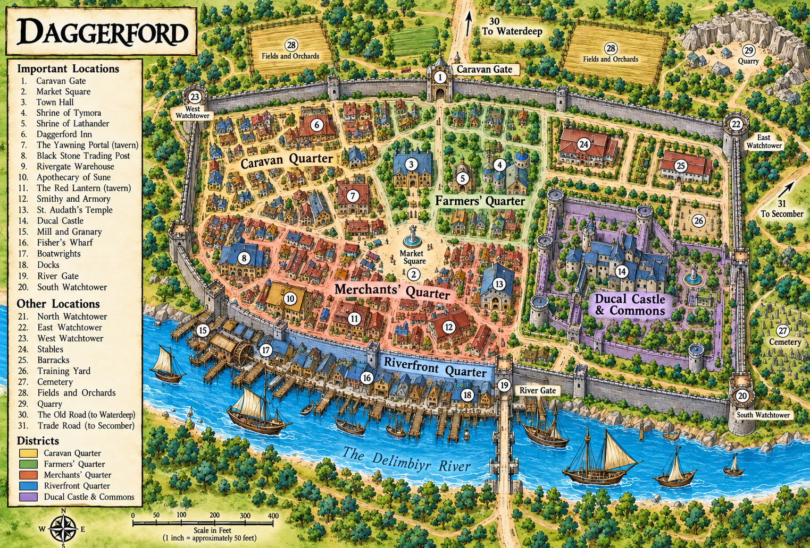
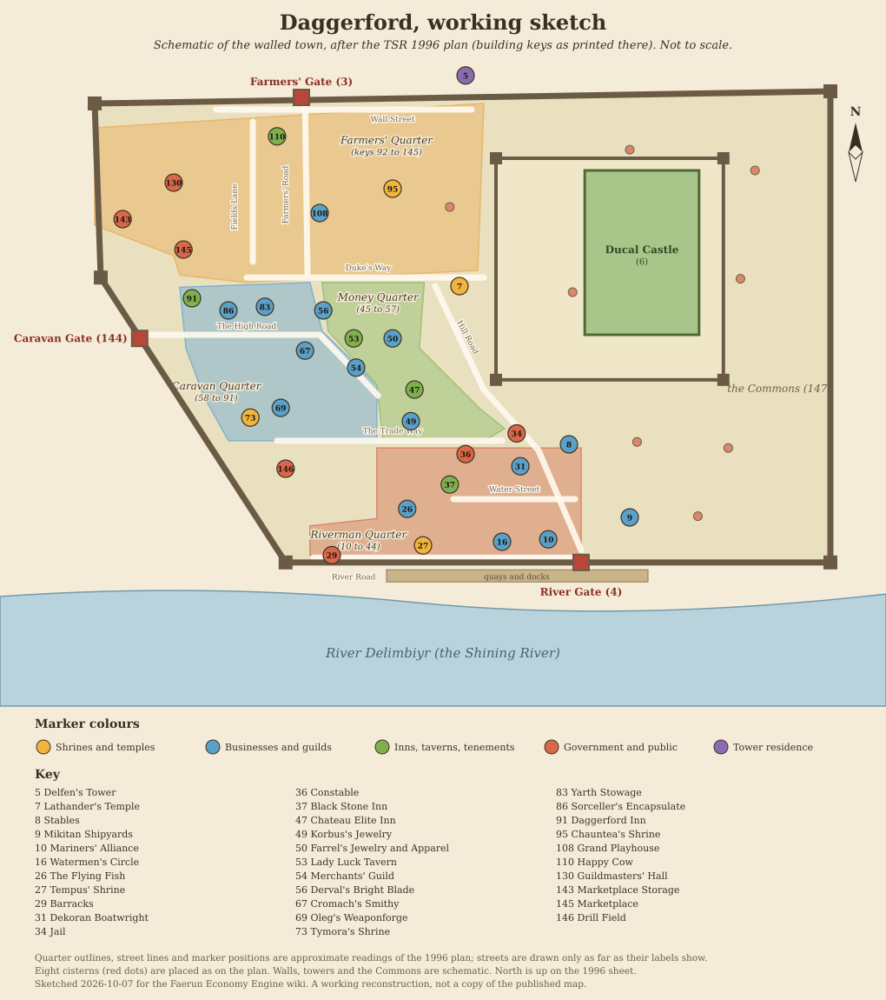

# Daggerford

[Location index](../../README.md)

**Region:** Delimbiyr Vale, Sword Coast; on the Trade Way at the north bank of the Delimbiyr River (engine region `Delimbiyr Vale` since 2026-10-07, zone `waterdeep`)  
**Settlement type:** Small walled town and duchy; farming community, river-to-caravan transfer point  
**Reference period:** 2nd-edition lore circa 1347 to 1372 DR; 5th-edition snapshot circa 1485 to 1489 DR; 1492 DR planning baseline  
**Evidence reviewed:** 2026-10-07  
**Engine ID:** `daggerford`  
**Structured metadata:** [daggerford.json](daggerford.json) (identity, engine record, town-plan building key, quarters, map and source links; regenerate it when this entry changes)  
**Reader-facing article:** [article.md](article.md) (chamber-of-commerce overview with live engine figures, 6 Marpenoth 1492 DR)

This entry paraphrases the [Forgotten Realms Wiki article][frwiki] (a secondary
source, rated a Good Article), its location, business and person articles, and
its interactive map. Its material spans 2nd-edition books (*Under Illefarn*,
1987; *Volo's Guide to the Sword Coast*, 1994; *The North: Guide to the Savage
Frontier*, 1996), the 3rd-edition *Forgotten Realms Campaign Setting* (2001),
5th-edition adventures (*Ghosts of Dragonspear Castle*, 2013; *Scourge of the
Sword Coast*, 2014; *Storm King's Thunder*, 2016), the *Sword Coast
Adventurer's Guide* (2015) and the video game *Neverwinter Nights: Darkness
over Daggerford* (2018). Publications are those the wiki cites; none was
independently consulted. Nothing here is verified for 1492 DR itself.

## Overview

Daggerford is a small walled town in the Delimbiyr Vale with ambitions out of
proportion to its size: a farming community that some travellers treat as a
mere stopover, but which has long tried to present itself as an alternative to
Waterdeep. Most of its people live on outlying hamlets, farms and estates
rather than inside the walls. The town is named for the legend of the boy
Tyndal, who in 931 DR killed six lizardfolk raiders with a dagger while
defending his family's trade wagon at the river crossing; every later duke
claimed descent from him. Its arms are a bloodied silver dagger on dark blue.
[Source][frwiki], citing *Volo's Guide to the Sword Coast*, p. 34; *The
North*, pp. 2 to 3; *Scourge of the Sword Coast*, p. 12.

## Geography

- On the Trade Way, on the north bank of the Delimbiyr (the Shining River). The
  wiki notes that 2nd- and 3rd-edition sources put the town south of the river
  and that 5th-edition maps (*Scourge of the Sword Coast*, p. 9; *Ghosts of
  Dragonspear Castle*, p. 141) place it north; the 5th-edition placement is
  treated as current.
- About 150 miles south of Waterdeep (*Forgotten Realms Campaign Setting*
  2nd edition, 1993); the largest settlement between Waterdeep and Baldur's
  Gate. Engine straight-line distance to Waterdeep is about 123 miles.
- The dukes claimed land from the Floshin Estates in the north to Dragonspear
  Castle in the south; in practice the duchy is the town and about a score of
  farmsteads (*Volo's Guide to the Sword Coast*, p. 34; *Sword Coast
  Adventurer's Guide*, p. 7).
- Within a day's travel: Gillian's Hill, Liam's Hold and Black Helm Tower. The
  Floshin family estate is about two days away (*The North*, p. 32).
- Walled, with a moat crossed at three gates: Farmer's Gate (north), Caravan
  Gate (west) and River Gate (south). The moat was a refuse dump until the late
  15th century DR. Streets are unpaved. The Ducal Castle stands on a hill and
  is older than the town (*Scourge of the Sword Coast*, pp. 9, 16).
- Four quarters: River (docks, jail and constabulary, barracks, stables,
  Sullerton Shipbuilders), Caravan (shops, guildhalls, boarding houses; nearly
  empty in winter when caravans stop), Farmers' (animal pens and paddocks,
  Harvest House temple of Chauntea) and Money (the wealthiest, nearest the
  castle) (*The North*, p. 10; *Ghosts of Dragonspear Castle*, pp. 138 to 139).
- Engine: one neighbour, a 4.8-mile road to "Daggerford South Junction" via a
  route named "Daggerford Rtoad" (spelling as stored). Routes are reviewed in a
  later phase (D19).

## Population

| Figure | Scope | Year | Source cited by the wiki |
| --- | --- | --- | --- |
| 300 (1,000 overall) | Town (town plus duchy) | 1347 DR | Infobox; probably *Under Illefarn* (1987), p. 7 |
| 500 | Town | 1370 DR | Infobox; probably *The North* (1996), p. 3 |
| About 500 citizens | Implied: militia of 50 was one tenth of the citizens | 1368 DR | *The North*, p. 7; Siege of Dragonspear field report (2016) |
| 891 | Town | 1372 DR | Infobox; probably *Forgotten Realms Campaign Setting* 3e (2001), p. 227 |
| 1,200 | Town (scope not stated) | 1485 DR | Infobox; the history group cites *Ghosts of Dragonspear Castle*, p. 134, and *Sword Coast Adventurer's Guide*, p. 47, among others |

The infobox cites its population references as a group, so the book behind
each figure is inferred, not confirmed. Races: dwarves, halflings, humans.
Religions: Amaunator, Chauntea, Lathander, Tempus, Tymora.

**Engine:** 900 residents, a gazetteer estimate with no reference year. The
engine's own Daggerford analysis (`get_settlement_analysis`, accessed
2026-09-16) recorded 1,200 only as an unverified search lead attributed to the
*Sword Coast Adventurer's Guide*, because the wiki was then blocked; the wiki
infobox now gives 1,200 for 1485 DR. The 900 baseline remains unchanged; a dated historical comparison and the absence of a verified 1492 DR census are now recorded in `populations.py` (D10 remains a proposed recalibration).

## Economy and Trade

| Direction | Goods (wiki infobox) |
| --- | --- |
| Imports | Green wood (lumber from Andalor's Mill in Bowshot; *Volo's Guide to the Sword Coast*, p. 31) |
| Exports | Furs, garments (*Volo's Guide to the Sword Coast*, p. 31; *The North*, p. 3) |

- Mainly agricultural and largely self-sufficient (*The North*, p. 3).
- A regional trade hub where goods pass between Delimbiyr river boats and Trade
  Way caravans; the river is too shallow for ships to go further upstream.
  Skippers and rivermen carry people downriver to Secomber and nearby
  settlements (*Scourge of the Sword Coast*, p. 12; *The North*, p. 10).
- Trade services are limited and local prices are often marked up (*The
  North*, p. 3). The town recruits craftsmen and artisans to rival Waterdeep.
- Open market twice a tenday for grocers, farmers and other merchants
  (*Ghosts of Dragonspear Castle*, p. 140).
- Guilds: each trade has a guildmaster, even a single town representative;
  they formed the Council of Guilds in the early 14th century DR and many
  merged into fewer guilds by the 15th century (*Scourge of the Sword Coast*,
  p. 18). The wiki lists guildhalls including the Leatherworkers'
  Conglomerate, Tanners' Council, Carpenters' Lodge, Animal Handlers'
  Affiliation, Farmers' Society (over 200 members in and around the town),
  Mariners' Alliance, Watermen's Circle, Jewelers' Congress, Tailors'
  Federation, Taverners' Confederation, Scribes' Friendship, Physicians'
  Order and Moneylenders' Coalition (mostly *The North*, mid to late 14th
  century DR).
- Tannery: after a mid-15th-century sickness the townsfolk blamed the tanners
  and moved the tannery outside the walls, across the Trade Way (*Scourge of
  the Sword Coast*, pp. 9, 16).
- Silver: a mid-15th-century silver discovery in the nearby Sword Hills
  swelled the town and gave the Silver Flood Inn its name (*Scourge of the
  Sword Coast*, p. 18).
- Fish: the Flying Fish market (mid 14th century DR) inspected and packed fish
  before it went along the Trade Way (*The North*, p. 16).
- Named local foods and drink: Daggerford clarry, a blended wine from grapes
  grown around Daggerford, Liam's Hold and Gillian's Hill, popular in
  1372 DR (video game source only); Churlgo Cheese, a cow-milk cheese from the
  Eastern Farmlands made by the Churlgo halfling family, circa 1372 DR (video
  game source only).

## Government and Defense

- A duchy ruled by a Duke or Duchess of Tyndal's line, with the Council of
  Guilds (chartered by Duke Conan, 1280 or 1320 DR; sources differ) handling
  daily affairs. The council was meant to be anonymous like Waterdeep's
  Lords, but everyone knew the guildmasters sat on it (*The North*, p. 3;
  *Under Illefarn*, p. 7; *Forgotten Realms Campaign Setting* 3e, p. 227).
- Rulers in the infobox: Conan (1320 DR), Pryden (1356 DR), Pwyll
  "Greatshout" (1370 DR), Maldwyn (1485 DR), Morwen (1489 DR).
- Around 1485 DR Duke Maldwyn was targeted by the succubus Pencheska and the
  spirit of the pit fiend Baazka. Primogeniture was suspended the next year
  and Lady Morwen became duchess, but Pencheska may have imprisoned her in
  Cromm's Hold and ruled in her likeness, and struck a deal with the
  Zhentarim during the giant crisis (*Scourge of the Sword Coast*, pp. 13,
  18, 23; *Storm King's Thunder*, p. 96). In 1489 DR "Lady Morwen" still ruled;
  whether she was the real duchess is unknown (*Sword Coast Adventurer's
  Guide*, p. 47).
- Daggerford joined the Lords' Alliance before the Second Sundering
  (*Sword Coast Adventurer's Guide*, p. 7).
- Defense: the duke's guard and a standing citizen militia (50 strong in
  1368 DR), serving three days a month with basic arms (*The North*, p. 7).

## History (to 1492 DR)

- 133 DR: Morlin Castle built on the site; later abandoned. 523 DR: the area
  part of Phalorm. 931 DR: Tyndal's fight with the lizardfolk; he later
  married into the ducal house of Calandor and, after a dragon destroyed
  Delimbiyran around 947 DR, built the Ducal Castle over Morlin Castle's ruins.
- Mid 13th century DR: Clan Ironeater dwarves rebuild many of the town's
  40-odd wooden buildings in stone.
- 1363 DR: Battle of Daggerford against fiends from Dragonspear Castle.
- 1368 DR: 50 militia sent to the Coalition army (Second Dragonspear War).
- 1372 DR: Duke Pwyll's apparent death and a Zhentarim plot with the devil
  Gorgomorz; the merchant Matagar Bugo briefly rules; Pwyll restored (video
  game source).
- Circa 1485 to 1486 DR: Maldwyn's peril, end of primogeniture, Morwen
  duchess (see above).
- Circa 1489 DR: a vampire attack, a rakshasa's portal and the release of the
  red dragon Karrnsyrrl damage the town (*Shadows Over Dragonspear Castle*
  board game booklet, 2017).

## Notable Inhabitants

From the wiki's Daggerford article (Notable Inhabitants and rulers), the
business articles and the "Inhabitants of Daggerford" category (248 entries,
read 2026-10-07; only people tied to roles in the article or to businesses
were followed). Paraphrased; publications are those the wiki cites, not
independently checked. Nearest to 1492 DR first.

### Late 15th century DR (closest to the 1492 baseline)

| Person | Role | Dated | Source cited by the wiki |
| --- | --- | --- | --- |
| Morwen Daggerford | Duchess from 1486 DR; possibly impersonated by the succubus Pencheska | 1486 to 1489 DR | *Scourge of the Sword Coast*; *Sword Coast Adventurer's Guide*, p. 47; *Storm King's Thunder*, p. 96 |
| Maldwyn Daggerford | Duke before and in 1485 DR | 1485 DR | *Scourge of the Sword Coast*, p. 13 |
| Curran Corvalin | Very wealthy halfling; custodian of the Fairfortune Hall shrine | Late 15th century DR | *Scourge of the Sword Coast*, pp. 12 to 13 |
| Kelson Darktreader | Master of the Hunt, serving the town for over a century | Late 15th century DR | *Scourge of the Sword Coast*, p. 14; *The North*, p. 24 |
| Filarion Filvendorson | Of the Floshin family; possibly once head of the town's thieves' guild | Late 15th century DR | *Scourge of the Sword Coast*, p. 13 |
| Darfin "Longwalker" Floshin | Aged elf, protector of secret magic in the Ardeep Forest | Late 15th century DR | *Scourge of the Sword Coast*, p. 14 |
| Jekk Ironfist | Retired gladiator from Hillsfar | Late 15th century DR | *Scourge of the Sword Coast*, p. 13 |
| Sir Isteval | Retired Cormyrean knight | Late 15th century DR | *Scourge of the Sword Coast*, p. 12 |
| Wilma Sullerton | Owner of Sullerton Shipbuilders | Late 15th century DR | *Scourge of the Sword Coast*, p. 19 |
| Halla and Sturgin Brewer | Run Daggerthrust Ales; Halla is from Calimshan | Late 15th century DR | *Scourge of the Sword Coast*, p. 18 |
| Bess Miller | Owns Miller's Dry Goods and three grain mills | Late 15th century DR | *Scourge of the Sword Coast*, p. 19 |
| Gilly Gublin | Runs Gublin's Cloth & Cordage | Late 15th century DR | *Scourge of the Sword Coast*, p. 19 |
| Ignal Ironeater | Runs Derval's Smithy; grandson of Derval | Late 15th century DR | *Scourge of the Sword Coast*, p. 18 |
| Tholvar Cragjaw | Dwarf smith running Cromach's Smithy | Late 15th century DR | *Scourge of the Sword Coast*, p. 19 |
| Jerdan Went | Smith, Jerdan's Smithy | Late 15th century DR | *Scourge of the Sword Coast*, p. 19 |
| Lady Belinda Anteos | Owns the Sword Coast Traders' Bank; of the Waterdhavian Anteos family | Late 15th century DR | *Scourge of the Sword Coast*, p. 19 |
| Old Ander | Owns Trade of the Tools | Late 15th century DR | *Scourge of the Sword Coast*, p. 19 |
| Hunnett Honestone | Runs the Clean Chin (barber and mortuary) | 1480s DR | *Scourge of the Sword Coast*, p. 19 |
| Glenys | Runs the Lady Luck Tavern | Circa 1486 DR | *Scourge of the Sword Coast*, pp. 17 to 18 |
| Sasha | Half-orc owner of the Lizard's Gizzard | Late 15th century DR | *Scourge of the Sword Coast*, p. 17 |
| Connar Filvarson, Ganfar Redgrin | Owners of the Silver Flood Inn | Late 15th century DR | *Scourge of the Sword Coast*, p. 18 |
| Koggin and Lily Hardcheese | Owners of the Happy Cow tavern | Late 15th century DR | *Storm King's Thunder*, p. 80 |

### Mid to late 14th century DR (historical)

| Person | Role | Dated | Source cited by the wiki |
| --- | --- | --- | --- |
| Pwyll "Greatshout" Daggerford | Duke, named for his magically loud voice | 1370 to 1372 DR | *Under Illefarn*, p. 7; *Darkness over Daggerford* |
| Pryden Daggerford | Duke, killed in the First Dragonspear War | 1356 DR | *Under Illefarn*, p. 7 |
| Lady Bronwyn Daggerford | Wizard, rumoured Harper | Circa 1370 DR | *The North*, p. 5 |
| Sir Llewellyn Longhand | Duke's master-at-arms | Circa 1370 DR | *The North*, p. 8 |
| Gwydion pen Dafwyd | Court wizard to Duke Pwyll | Circa 1370 DR | *The North*, p. 5 |
| Delfen Ondabarl | Resident mage taking apprentices | Circa 1370 DR | *The North*, p. 8 |
| Galass Tholt | Elderly druid | Circa 1370 DR | *Forgotten Realms Campaign Setting* 2e, p. 24 |
| Nanteuil | Dwarf cleric of Marthammor Duin near the River Gate | Circa 1370 DR | *The North*, p. 14 |
| Derval Ironeater | Master dwarf smith, Derval's Bright Blade | Late 1360s DR | *Volo's Guide to the Sword Coast*; *The North* |
| Matagar Bugo | Merchant councillor who seized the ducal seat as a Zhentarim puppet | 1372 DR | *Darkness over Daggerford* (video game) |
| Fulbar Hardcheese | Halfling owner of the Happy Cow; served his family farm's cheese and his own almond beer | 1366 to 1372 DR | *The North*, p. 27; *Under Illefarn* |
| Demetira Landscraper | Dwarf owner of the Daggerford Inn; manager at the Happy Cow | Mid to late 14th century DR | *The North* |
| Other 14th-century shopkeepers | Cromach (smith), Wayfel (smith), Oleg (weaponsmith), Korbus Brightjewel (court jeweller), Farrel (fine goods), Oryv (cloth), Nartan (fine foods), Yarth (warehouse), Carrl (fish market), Wiston (apothecary), Mikitan and Dekoran (shipyards), Gildamesh (Black Stone Inn) | Mid to late 14th century DR | *The North*; *Forgotten Realms Interactive Atlas* (1999) |

### Legendary and loosely tied

| Person | Note |
| --- | --- |
| Tyndal "Daggerford" | Founder of the line; the dagger fight of 931 DR |
| Rugyar the Just | Named as the first Duke of Daggerford |
| Edwin and Conan Daggerford | Duke Edwin died defeating the devil Gorgomorz circa 1270 DR; his son Conan granted the town charter |
| Gorgomorz; Baazka; Pencheska | Fiends tied to the 1270, 1372 and 1485 DR crises |
| Peredus | Caravan guard of a popular local ballad |

### Families and organizations

The ducal Daggerford family; Clan Ironeater (dwarf builders and smiths);
the Hardcheese and Churlgo halfling families; the Floshin elves. Organizations
listed under Daggerford include the Council of Guilds, Daggerford militia,
Mariners' Alliance (involved in Zhentarim arms smuggling in 1372 DR),
Shoreside Shipping Consortium, Moneylenders' Coalition and Church of Tempus;
not all were read.

## Businesses

### In the live market (engine `businesses.json`)

| Business | Type | Offers | Note |
| --- | --- | --- | --- |
| Daggerthrust Ales (`daggerthrust_ales`) | Brewery | Ale (fine) | Added 2026-10-07 (D9). River Quarter; Halla and Sturgin Brewer; Calishite-style beers; late 15th century DR (*Scourge of the Sword Coast*, p. 18) |
| Miller's Dry Goods (`millers_dry_goods`) | Dry goods | Grain, flour | Added 2026-10-07 (D9). Caravan Quarter; Bess Miller, who owns three grain mills (p. 19) |
| Gublin's Cloth & Cordage (`gublins_cloth_and_cordage`) | Cloth and rope | Rope (fine), linen | Added 2026-10-07 (D9). Farmers' Quarter; rope machinery from Baldur's Gate; much stock imported (p. 19). Linen stands in for unspecified cloth |
| Derval's Smithy (`dervals_smithy`) | Weaponsmith | Swords (fine), spears, arrows | Added 2026-10-07 (D9). River Quarter; Ignal Ironeater; mainly spear and arrow heads for the militia (p. 18) |
| Cromach's Smithy (`cromachs_smithy`) | Smithy | Artisan's tools (fine), horseshoes | Added 2026-10-07 (D9). Farmers' Quarter; Tholvar Cragjaw; tools, horseshoes and wooden wheels (p. 19). No wheel commodity |
| Sullerton Shipbuilders (`sullerton_shipbuilders`) | River shipyard | River boats | Added 2026-10-07 (D9). By the River Gate; Wilma Sullerton; river vessels only; short of lumber (pp. 9, 19). Generated stock of 21 boats is implausible (D21) |
| Golden Sheaf Provisions | Provisions (HQ Goldenfields) | Grain, flour, bread, salted meat, ale | Engine-authored |
| Trade Way Cartwrights | Cart yards (HQ Scornubel) | Carts, wagons, barrels, nails, planks | Engine-authored |
| Waterdeep-Daggerford Caravan Company; Sword Coast Overland Exchange | Carriers (HQ Waterdeep) | None | Both list `baldurs_gate`, which is not a settlement id (D20). Routes and carriers phase |

All existing offers name valid commodities; no offer needed fixing. The
generated addresses ("High Road, Trade Quarter") are placeholders.

### Named in the source, not in the market

| Name | Kind | Dated | Modeled goods it suggests |
| --- | --- | --- | --- |
| Jerdan's Smithy | Smithy (odd jobs) | Late 15th century DR | `nails`, `tools_carpenter` |
| Trade of the Tools | Used tools and furniture, sale or rent | Late 15th century DR | `tools_carpenter` |
| Sword Coast Traders' Bank | Bank: deposits redeemable in Waterdeep or Baldur's Gate | Late 15th century DR | Service only |
| Lady Luck Tavern; River Shining Tavern; Happy Cow; Otter's Run | Taverns | Late 15th century DR | `ale`; lodging |
| Silver Flood Inn; Lizard's Gizzard | Boarding houses | Late 15th century DR | Lodging |
| Clean Chin | Barber and mortuary | 1480s DR | Service only |
| Helmick's Herbs and Oddments; The Decorated Man | Shops (on the late-15th-century map; not read) | Late 15th century DR | `herbs_healing` (to check) |
| Tannery (Tanners' guild) | Tannery outside the walls | Mid 15th century DR | `leather` |
| Flying Fish | Fish market, inspection and packing | Mid 14th century DR | `fish_fresh`, `fish_salt` |
| Mikitan Shipyards; Dekoran Boatwright | Shipyards (large ships; fishing boats, rafts, canoes) | Mid to late 14th century DR | `ship_boat` |
| Derval's Bright Blade; Wayfel's Smithy; Oleg's Weaponforge | Smithies | 14th century DR | Weapons, tools |
| Nartan's Fine Foods; Farrel's Fine Jewelry and Apparel; Korbus's Jewelry and Fine Ornaments; Oryv's Cloth Emporium | Luxury and import shops | 14th century DR | `spices_exotic`, `silk`, `furs`, jewelry (no commodity) |
| Wiston Apothecary | Apothecary | 14th century DR | `herbs_healing`, `potion_healing` |
| Yarth Stowage | Five-storey warded warehouse | 14th century DR | Storage |
| Daggerford Inn; Dragonback Inn; Black Stone Inn; Chateau Elite | Inns | 14th century DR | Lodging |
| Kryptgarden Scrolls; Grand Playhouse; Potter's Wheel | Library, theatre, housewares shop | 14th century DR | `book`; `pottery` |

Daggerthrust Ales occupies "the building that used to house the River
Shining Tavern", yet the late-15th-century interactive map places both,
in different quarters. The conflict is unresolved.

## Maps and Village Layout

### Maps

Preferred edition: 2nd. Published images are linked, not stored in the repo.

**Display map:** [Daggerford.png](Daggerford.png) (1,523 by 1,032 pixels), the
map supplied by the project owner for use with this entry.

Provenance caution: the image carries no publisher, artist, edition or date,
and it is not any of the published maps listed below. It is a painted
illustration with a 31-item legend, and several of its details disagree with
the published plans and the lore, so treat it as an illustrative map, not a
source. Its legend is transcribed in [daggerford.json](daggerford.json)
(`display_map`). Differences from the 1996 TSR plan:

| Point | Display map | 1996 TSR plan and lore |
| --- | --- | --- |
| Gates | Caravan Gate (1) in the north wall, with the road to Waterdeep north; River Gate (19) south; no Farmers' Gate | Farmers' Gate north, Caravan Gate west, River Gate south-east |
| Quarters | Caravan, Farmers', Merchants', Riverfront, and "Ducal Castle and Commons" | Caravan, Farmers', Money and Riverman |
| Ducal Castle | East side of the walls, with the Commons | North-east enclosure; Commons east of it |
| Town Hall, Market Square | Central Market Square (2) and Town Hall (3) | Marketplace in the north-west (key 145); Guildmasters' Hall (130) |
| Named buildings | "The Yawning Portal (tavern)" (7), Rivergate Warehouse, Apothecary of Sune, The Red Lantern, St. Audath's Temple | The Yawning Portal is Waterdeep's tavern; the others are not in the sources read here |
| Temples | Shrines of Tymora (4) and Lathander (5), Daggerford Inn (6), Black Stone Trading Post (8) | Shrines of Tymora, Lathander, Tempus and Chauntea; Black Stone Inn (37), Daggerford Inn (91) |
| Waterfront | Long timber quay with a waterwheel mill (15), a bridge or pier at the River Gate | Docks and shipyards south of the south wall; no bridge shown |
| Scale | Bar to 400 feet, "1 inch is approximately 50 feet" | Bar to 100 feet |

| Map | Edition and date | Shows | Where |
| --- | --- | --- | --- |
| Town map of Daggerford | 2nd edition, *Hordes of Dragonspear* (1992), pp. 8 to 9 (artist Steve Beck); circa 1360s DR | Gates, castle, temples, quarters, marketplace | [File:Daggerford map.jpg][map2e] (1,185 by 932 pixels) |
| Town map (*The North*) | 2nd edition, *The North: Guide to the Savage Frontier* (1996), Daggerford map; circa 1370 DR | Named shops and guildhalls (cited by many business articles); 148 keyed buildings, quarters and streets | [d20.pub scan, "Town of Daggerford", ©1996 TSR][mapnorth] (2,226 by 1,509 pixels); read 2026-10-07, see the layout section below. Its book of origin is inferred from the date and the keys, not printed on the sheet |
| Interactive Atlas town views | *Forgotten Realms Interactive Atlas* (1999), 2nd-edition era | Whole town, south and north-west sections | [File:DaggerfordCity.JPG][mapia], [File:SouthDaggerford.JPG][mapias], [File:NWDaggerford.JPG][mapianw] |
| Environs of Waterdeep | Circa 1374 DR, *City of Splendors* web enhancement (2006), p. 3 | Daggerford in Waterdeep's hinterland | [File:WaterdeepEnvirons1.png][mapenv] |
| Sword Coast overview | 4th edition, Spellplague years | Daggerford, Secomber, Zelbross | [File:Daggerford.jpg][map4e] |
| Delimbiyr Vale | 5th edition, *Scourge of the Sword Coast* (2014), p. 10 (Mike Schley); late 15th century DR | Surroundings: Gillian's Hill, Liam's Hold, Floshin Estates, Cromm's Hold, Julkoun | [File:DelimbiyrVale.png][mapvale] |
| Town map of Daggerford | 5th edition, Adventurers League DDAL-DRW-INT-01 *Big Problems*, p. 17 (Mike Schley; the same town drawn for *Scourge of the Sword Coast*); late 15th century DR | 40 keyed places | [File:Daggerford map.png][map5e] (2,113 by 1,731 pixels); interactive version [Map:Daggerford (14th Century DR)][mapint] |
| Daggerford and environs | *Darkness over Daggerford* (2018) promotional map, 1372 DR | Town and farmlands | [File:Daggerford promo map.jpg][mappromo]; [File:Daggerford Farmlands.png][mapfarm] |

The engine already holds a separate survey of the Schley town map
(`get_settlement_analysis`, from the cartographer's public portfolio, north
pointing left in that image) with 40 transcribed keys, 140 roof groups and
11 street traces. It does not set population.

### Layout data from the interactive map

Marker positions from the wiki's interactive map "Map:Daggerford (14th Century
DR)", which, despite its title, is drawn on the 5th-edition Schley map
(File:Daggerford map.png). The map's coordinate origin is bottom left, x then y,
in the map's own units (not image pixels). Orientation is inferred: Farmer's
Gate (north) has the largest y, River Gate (south) a small y and Caravan Gate
(west) the smallest x, so larger x is east and larger y is north. No scale is
given. Read 2026-10-07. Nine cistern markers are omitted.

| Place | Kind | x | y | Note |
| --- | --- | --- | --- | --- |
| Caravan Gate | Gate | 167 | 524 | West |
| Farmer's Gate | Gate | 375 | 842 | North |
| River Gate | Gate | 743 | 192 | South, near the docks |
| Ducal Castle | Public building | 820 | 615 | |
| Marketplace | Landmark | 230 | 638 | |
| Guildmasters' Hall | Public building | 217 | 727 | |
| Barracks | Public building | 437 | 256 | |
| Jail and Constable's office | Public building | 595 | 364 | |
| Stables | Business | 730 | 370 | |
| Caravan Quarter (label) | Quarter | 333 | 491 | |
| Money Quarter (label) | Quarter | 471 | 494 | |
| Rivermen's Quarter (label) | Quarter | 609 | 304 | |
| Harvest House (Chauntea) | Temple | 506 | 704 | |
| Morninglow Tower (Lathander, later Amaunator) | Temple | 577 | 578 | |
| Shrine of Tempus | Shrine | 540 | 240 | |
| Shrine of Tymora | Shrine | 303 | 404 | |
| Cromach's Smithy | Business | 142 | 671 | |
| Jerdan's Smithy | Business | 130 | 785 | |
| Derval's Smithy | Business | 529 | 313 | |
| Sullerton Shipbuilders | Business | 800 | 295 | |
| Daggerthrust Ales | Business | 486 | 322 | |
| Sword Coast Traders' Bank | Business | 582 | 431 | |
| The Clean Chin | Business | 488 | 293 | |
| Miller's Dry Goods | Shop | 285 | 571 | |
| Gublin's Cloth & Cordage | Shop | 334 | 648 | |
| Trade of the Tools | Shop | 447 | 523 | |
| The Decorated Man | Shop | 325 | 579 | |
| Helmick's Herbs and Oddments | Shop | 418 | 776 | |
| Lady Luck Tavern | Tavern | 235 | 564 | |
| Happy Cow Tavern | Tavern | 339 | 786 | |
| River Shining Tavern | Tavern | 429 | 699 | |
| Silver Flood Inn | Inn | 637 | 337 | |
| The Otter's Run | Tavern | 644 | 244 | |
| The Lizard's Gizzard | Inn | 493 | 573 | |
| Delfen's Tower | Residence | 604 | 832 | |
| Sir Isteval's Residence | Residence | 197 | 789 | |
| Curran Corvalin's Residence | Residence | 486 | 440 | |
| Darrondar Gweth's Residence | Residence | 486 | 357 | |
| Ironeater Residence | Residence | 249 | 791 | |
| Kelson Darktreader's House | Residence | 506 | 791 | |
| Filarion Filvendorson's House | Residence | 254 | 761 | |
| Darfin Floshin's Townhouse | Residence | 520 | 513 | |

The Ducal Castle marker sits well east of centre although the text puts the
castle on a hill at the town's centre; check against the image before relying
on it. The 1996 plan below puts the castle in the north-east, east of centre
too, so the marker is plausible for that plan.

**Working sketch:** [daggerford-sketch.svg](daggerford-sketch.svg), drawn
2026-10-07 from the 1996 plan below. Quarter outlines, street lines and marker
positions are approximate readings of that plan, north is up as printed, and
streets are drawn only as far as their labels show. A reconstruction to work
from, not a copy of the published map.

### Layout data from the TSR 1996 town map

Read 2026-10-07 from the d20.pub scan of the "Town of Daggerford" sheet
(©1996 TSR, Inc.; product code 1142XXX0703), enlarged and transcribed by eye.
It is a four-panel poster: a perspective painting of the walled town and
harbour, an index "Locations by Type", a plan "Type of Building" and a plan
"The Town Quarters". Numbers below are the sheet's own building keys. Read
with care: the index print is small, and three residents share key 88. The
period is 2nd edition, so names may not match the late-15th-century businesses
above (see "Cross-checks").

**Orientation and shape.** North is up: Farmers' Gate (key 3) is in the north
wall and the Caravan Gate (144) in the west wall; the River Gate (4) is at the
south-east corner, toward the docks. The wall is an irregular quadrilateral
with towers (key 1 on the plan) at the corners and gates. The Ducal Castle (6)
is a separate walled enclosure with corner towers and a garden courtyard in the
north-east. The open ground east of it is "the Commons" (147). About eight
cisterns (2) are scattered through the castle enclosure and the Commons. The painting shows quays, moored cogs and a longship south of the
south wall, with the Delimbiyr beyond. The scale bar reads 0, 50 and 100 feet;
no other scale is given.

**Quarters and streets**

| Quarter | Building keys | Where | Named streets |
| --- | --- | --- | --- |
| Riverman Quarter | 10 to 44 | South, along River Road and the docks | River Road, Water Street, Kauth Alley |
| Money Quarter | 45 to 57 | Centre, east of the Caravan Quarter | Hill Road, the Trade Way |
| Caravan Quarter | 58 to 91 | West, inside the Caravan Gate | The High Road, Rogar Alley, Guild Alley |
| Farmers' Quarter | 92 to 145 | North and north-west | Farmers' Road, Fields Lane, Wall Street, Cymora Alley, Horse Way, Duke's Way |

Street names are read from the quarters plan; "Kauth Alley" and "Cymora Alley"
are the least certain. The Marketplace (145) and its storage (143) lie in the
north-west corner, with the Drill Field (146) in the south-west.

**Numbered building key.** Each key lists everything the index prints for that
number (a shop and its owner can share a key). Residents are named as printed;
no occupation is given for them.

| Key | Entry |
| --- | --- |
| 1 | Towers (wall towers) |
| 2 | Cisterns |
| 3 | Farmers' Gate |
| 4 | River Gate |
| 5 | Delfen's Tower; resident Delfen "Yellowknife" Ondabarl (also listed at 78) |
| 6 | Ducal Castle; residents Bronwyn Daggerford, Gwydion pen Dafwyd, Pwyll "Greatshout" Daggerford |
| 7 | Lathander's Temple (Moonglow Tower) |
| 8 | Stables |
| 9 | Mikitan Shipyards (Mikitan) |
| 10 | Mariners' Alliance |
| 11 | Kaulbach |
| 12 | Olin |
| 13 | Soumet |
| 14 | Pauldine |
| 15 | Nanteuil |
| 16 | Watermen's Circle |
| 17 | Maranta |
| 18 | Weichert |
| 19 | Delisle |
| 20 | Trommen |
| 21 | Ramusio |
| 22 | Archiloque |
| 23 | Janssen |
| 24 | Zaluski |
| 25 | Valmiki |
| 26 | The Flying Fish; Carrl |
| 27 | Tempus' Shrine (Table of the Sword) |
| 28 | Heralds' and Runners' Union |
| 29 | Barracks |
| 30 | Tenison |
| 31 | Dekoran Boatwright (Dekoran) |
| 32 | Youmans's Residence |
| 33 | Cromach |
| 34 | Jail |
| 35 | Empty |
| 36 | Constable |
| 37 | Black Stone Inn; Gildamesh |
| 38 | Pleaders' Consortium |
| 39 | Blacksmiths' Guildhouse |
| 40 | Derval Ironeater |
| 41 | Duneden |
| 42 | Moneylenders' Coalition |
| 43 | River Shining Tavern |
| 44 | The Clean Chin (barber, mortuary, adventuring needs, healing); Garick Honestone |
| 45 | Darfin Longwalker |
| 46 | Empty |
| 47 | Chateau Elite Inn; Papa Blekandssen |
| 48 | Bjorn's Tenements (Bjorn) |
| 49 | Korbus's Jewelry and Fine Ornaments |
| 50 | Farrel's Fine Jewelry and Apparel |
| 51 | Empty |
| 52 | Nartan's Fine Foods (Nartan) |
| 53 | Lady Luck Tavern |
| 54 | Merchants' Guild |
| 55 | Jewelers' Congress |
| 56 | Derval's Bright Blade |
| 57 | Kryptgarden Scrolls |
| 58 | Tailors' Federation |
| 59 | Tanners' Council |
| 60 | Thinkers' Fraternity |
| 61 | Youatt |
| 62 | Wayfel |
| 63 | Physicians' Order |
| 64 | Taverners' Confederation |
| 65 | Owenden |
| 66 | Garrick |
| 67 | Cromach's Smithy |
| 68 | Empty |
| 69 | Oleg's Weaponforge |
| 70 | Quarenghi |
| 71 | Garth |
| 72 | Kira |
| 73 | Tymora's Shrine (Fairfortune Hall) |
| 74 | Oleg |
| 75 | Leatherworkers' Conglomerate |
| 76 | Farrel |
| 77 | Baergon Bluesword |
| 78 | Delfen "Yellowknife" Ondabarl |
| 79 | Emser |
| 80 | Ines |
| 81 | Bohle |
| 82 | Scribes' Friendship |
| 83 | Yarth Stowage (five-storey warded warehouse); Yarth of Berun |
| 84 | Empty |
| 85 | Oryv's Cloth Emporium (Oryv) |
| 86 | Sorceller's Encapsulate |
| 87 | Empty |
| 88 | Derf's Skin Art; residents Derf, Sniden Elkslodge, Zarebor the Piercer |
| 89 | Fences' Syndicate |
| 90 | Schlegel |
| 91 | Daggerford Inn |
| 92 | Kelson Darktreader |
| 93 | Llewellyn Longhand |
| 94 | Liam Sunmist |
| 95 | Chauntea's Shrine (Harvest House) |
| 96 | Ransaran's Sergeant-at-Arms (Ransaran) |
| 97 | Ruckert |
| 98 | Wiston Apothecary (Wiston of Yartar) |
| 99 | Filvendor Lightfoot |
| 100 | Korbus Brightjewel (Korbus's Jewelry and Fine Ornaments) |
| 101 | Uilkens |
| 102 | Pascal's Tenements (Pascal) |
| 103 | Xylander |
| 104 | Shalendra Dare-all |
| 105 | Maerovyna |
| 106 | Farmers' Society |
| 107 | Empty |
| 108 | Grand Playhouse |
| 109 | Empty |
| 110 | Happy Cow (tavern and tenement) |
| 111 | Vix the Chandler |
| 112 | Fulbar Hardcheese |
| 113 | Sherlen Spearslayer |
| 114 | Maelwyn |
| 115 | Animal Handlers' Affiliation |
| 116 | MacClure |
| 117 | Cadogan |
| 118 | Dragonback Inn; Alian |
| 119 | Empty |
| 120 | Kyrie |
| 121 | Aswansea |
| 122 | Cork |
| 123 | Jesse |
| 124 | Filarion Filvendorson |
| 125 | Thieves' Brotherhood |
| 126 | Czszudleaux |
| 127 | Hadrion |
| 128 | Paine |
| 129 | Falconer |
| 130 | Guildmasters' Hall |
| 131 | Empty |
| 132 | Nicomantis |
| 133 | Bando the Lame |
| 134 | Demetira Landscraper |
| 135 | Potter's Wheel; Marcus |
| 136 | Wayfel's Smithy |
| 137 | Empty |
| 138 | Lamet |
| 139 | Empty |
| 140 | Carpenters' League |
| 141 | Zeno |
| 142 | Behring |
| 143 | Marketplace Storage |
| 144 | Caravan Gate |
| 145 | Marketplace |
| 146 | Drill Field |
| 147 | Commons |
| 148 | Empty |

Keys 8 and 9 (Stables, Mikitan Shipyards) are the two large blue blocks at the
south-east, near the River Gate. The thirteen empty keys are 35, 46, 51, 68, 84, 87, 107, 109, 119, 131, 137,
139 and 148. Two people are placed outside the walls: Elorfindar Floshin
(2 days west) and Elorshin Highthought (2 days east); Tyr's Mosque is also
"2 days east".

**Services by type (as printed).** The index groups the keys as follows;
guild and union entries are the same buildings listed in the key.

| Group | Entries (key) |
| --- | --- |
| Adventuring needs | Clean Chin (44), Fences' Syndicate (89), Merchants' Guild (54), Sorceller's Encapsulate (86), Thieves' Brotherhood (125) |
| Animal care and farming | Animal Handlers' Affiliation (115), Farmers' Society (106), Stables (8), Merchants' Guild (54) |
| Blacksmithing and carpentry | Blacksmiths' Guildhouse (39), Carpenters' League (140), Cromach's Smithy (67), Dekoran Boatwright (31), Derval's Bright Blade (56), Mikitan Shipyards (9), Oleg's Weaponforge (69), Wayfel's Smithy (136) |
| Clothing | Farrel's Fine Jewelry and Apparel (50), Leatherworkers' Conglomerate (75), Oryv's Cloth Emporium (85), Tailors' Federation (58), Tanners' Council (59) |
| Food | Flying Fish (26), Nartan's Fine Foods (52), Watermen's Circle (16), Merchants' Guild (54) |
| Government | Barracks (29), Cisterns (2), Commons (147), Constable (36), Delfen's Tower (5), Drill Field (146), Ducal Castle (6), Guildmasters' Hall (130), Jail (34), Marketplace (145), Marketplace Storage (143), Towers (1) |
| Healing | Chauntea's Shrine (95), Clean Chin (44), Lathander's Temple (7), Physicians' Order (63), Tempus' Shrine (27), Tymora's Shrine (73), Wiston Apothecary (98) |
| Home supplies | Potter's Wheel (135), Vix the Chandler (111), Yarth Stowage (83), Moneylenders' Coalition (42), Carpenters' League (140), Merchants' Guild (54) |
| Inns | Black Stone Inn (37), Chateau Elite Inn (47), Daggerford Inn (91), Dragonback Inn (118) |
| Taverns | Happy Cow (110), Lady Luck Tavern (53), River Shining Tavern (43), Taverners' Confederation (64) |
| Jewelry | Farrel's (50), Jewelers' Congress (55), Korbus's Jewelry and Fine Ornaments (49), Merchants' Guild (54) |
| Legal | Constable (36), Heralds' and Runners' Union (28), Jail (34), Pleaders' Consortium (38), Scribes' Friendship (82), Thinkers' Fraternity (60) |
| Library | Heralds' and Runners' Union (28), Kryptgarden Scrolls (57), Pleaders' Consortium (38), Scribes' Friendship (82), Sorceller's Encapsulate (86), Thinkers' Fraternity (60) |
| Miscellaneous | Clean Chin (44), Derf's Skin Art (88), Fences' Syndicate (89), Heralds' and Runners' Union (28), Merchants' Guild (54), Thieves' Brotherhood (125), Vix the Chandler (111), Yarth Stowage (83) |
| Nautical | Carpenters' League (140), Dekoran Boatwright (31), Mariners' Alliance (10), Merchants' Guild (54), Mikitan Shipyards (9) |
| Spellcasting | Sorceller's Encapsulate (86), plus resident spellcasters and temples |
| Temples | Chauntea's Shrine, Harvest House (95); Lathander's Temple, Moonglow Tower (7); Tempus' Shrine, Table of the Sword (27); Tymora's Shrine, Fairfortune Hall (73); Tyr's Mosque (2 days east) |
| Tenements | Barracks (29), Bjorn's Tenements (48), Black Stone Inn (37), Chateau Elite Inn (47), Daggerford Inn (91), Dragonback Inn (118), Grand Playhouse (108), Pascal's Tenements (102) |
| Weapons and armor | Blacksmiths' Guildhouse (39), Cromach's Smithy (67), Derval's Bright Blade (56), Leatherworkers' Conglomerate (75), Merchants' Guild (54), Oleg's Weaponforge (69), Ransaran's Sergeant-at-Arms (96), Wayfel's Smithy (136) |

The "Guilds" list gives these keys: Animal Handlers'
Affiliation (115), Blacksmiths' Guildhouse (39), Carpenters' League (140),
Farmers' Society (106), Fences' Syndicate (89), Guildmasters' Hall (130),
Heralds' and Runners' Union (28), Jewelers' Congress (55), Leatherworkers'
Conglomerate (75), Mariners' Alliance (10), Merchants' Guild (54),
Moneylenders' Coalition (42), Physicians' Order (63), Pleaders' Consortium
(38), Scribes' Friendship (82), Sorceller's Encapsulate (86), Tailors'
Federation (58), Tanners' Council (59), Taverners' Confederation (64),
Thieves' Brotherhood (125), Thinkers' Fraternity (60), Watermen's Circle (16).

**Cross-checks.** Present on both this sheet and the late-15th-century
interactive map: Cromach's Smithy, Derval's smithy, Clean Chin, River Shining
Tavern, Lady Luck Tavern, Happy Cow, Black Stone Inn, Daggerford Inn, the
Marketplace, Guildmasters' Hall, Barracks, Jail, the shrines of Tempus and
Tymora, Chauntea's Harvest House, Morninglow Tower (Lathander) and Delfen's
Tower. Present only on the 1996 sheet: Mikitan Shipyards, Dekoran Boatwright,
Wayfel's Smithy, Oleg's Weaponforge, Nartan's Fine Foods, Farrel's, Korbus's,
Oryv's Cloth Emporium, Kryptgarden Scrolls, Yarth Stowage, Wiston Apothecary,
Derf's Skin Art, Grand Playhouse, Dragonback Inn, Chateau Elite Inn, the
Potter's Wheel and the guild hall list. Sullerton Shipbuilders, Daggerthrust
Ales, Miller's, Gublin's, Jerdan's, the Traders' Bank, Otter's Run, Silver
Flood Inn and the Lizard's Gizzard are not on it (later establishments). The
Happy Cow (110, Farmers' Quarter) and Clean Chin (44, Riverman Quarter) sit in
the same districts as on the Schley map.

## Engine Record

| Field | Value |
| --- | --- |
| Population | 900 (gazetteer estimate, no reference year) |
| Wealth / tax / security | 0.9 / 0.05 / 0.65 |
| Region / zone | `Delimbiyr Vale` (was `Sword Coast` before 2026-10-07) / `waterdeep` |
| Port / river | None / yes |
| Terrain | Plains |
| Traits | `agrarian`, `frontier` |
| Industries | `farm` 3, `cattle` 2, `craft` 1, `smith` 1; added 2026-10-07: `hunt` 1, `ship` 1, `tan` 1, `brew` 1, `fish` 1 |
| Specialties | `grain` 1; added 2026-10-07: `furs` 1, `clothing_common` 1 |
| Shortages | None |
| Ruler | Blank (D11 proposed) |
| Size category | Small town |
| Guilds (inferred) | Farmers' and Millers' Guild |

Observed 2026-10-07 (6 Marpenoth 1492 DR), before this run's changes
(`get_trade_summary`): gross local product 535,107 gp a year (595 gp per
resident); goods exports 717 gp a day against imports of 41,430 gp a day;
5,490 gp a day of inbound freight assigned to no carrier. Leading exports by
volume: vegetables (73 a day), fruit (63), tea and herbal infusions (30),
medicinal herbs (10) and beeswax (9). Small surpluses of tin, copper and
cotton appear in a town with no mines or cotton fields (D17, D18). The usual
unavailable exotic goods each show a flat 1.8-a-day import need (W5).

After the changes and `reload_catalog`: gross local product 662,663 gp a year
(736 gp per resident); exports 878 gp a day, imports 41,425 gp a day. Furs are
now made locally (about 1.16 bundles a day, with no local demand, so all
exportable). River boats show an input-backed capacity of about 0.00003 a day
(roughly one a century) and zero demand, so `ship` 1 adds almost nothing
while planks are scarce (D13). `hunt` did not produce dinosaur hide (still
imported from Port Nyanzaru in tiny amounts).

**Live server note:** this run's `reload_catalog` again moved Amphail to
x 621.7, y 1126 with no neighbours (A12, fourth time); its stored position
(x 648.5289, y 1161.7169) was restored with `update_settlement`.

## Discrepancies and Proposed Engine Changes

| # | Issue | Proposal | Status |
| --- | --- | --- | --- |
| D1 | Furs are a named export (*Volo's Guide to the Sword Coast*, p. 31; *The North*, p. 3); no industry made furs. A Master of the Hunt serves the town | Add `hunt` 1 and specialty `furs` 1 | Applied 2026-10-07 |
| D2 | Garments are a named export; `craft` 1 already makes common clothing | Add specialty `clothing_common` 1 (no `textile`, which would also grow cotton; see A10) | Applied 2026-10-07 |
| D3 | River shipyards are named products: Sullerton Shipbuilders (late 15th century DR), Mikitan Shipyards and Dekoran Boatwright (14th century DR) | Add `ship` 1 (`ship_boat` is the engine's river boat) | Applied 2026-10-07 |
| D4 | Tanners' guild, a tannery outside the walls (mid 15th century DR) and the Leatherworkers' Conglomerate (leather armour and barding) | Add `tan` 1 | Applied 2026-10-07 |
| D5 | Daggerthrust Ales brews ales and beers (late 15th century DR) | Add `brew` 1 | Applied 2026-10-07 |
| D6 | The Flying Fish packed fish for shipment along the Trade Way (mid 14th century DR) | Add `fish` 1 | Applied 2026-10-07 |
| D7 | Description was blank | Set from the sources (Trade Way and Delimbiyr transfer point, exports, crafts, government) | Applied 2026-10-07 |
| D8 | Engine region `Sword Coast`; the wiki infobox gives Delimbiyr Vale, Sword Coast, and the engine already uses `Delimbiyr Vale` for Loudwater and Llorkh | Set region `Delimbiyr Vale`; zone unchanged | Applied 2026-10-07 |
| D9 | No source-named business in the market | Added six businesses shown operating in the late 15th century DR (*Scourge of the Sword Coast*, set around 1485 DR): Daggerthrust Ales, Miller's Dry Goods, Gublin's Cloth & Cordage, Derval's Smithy, Cromach's Smithy, Sullerton Shipbuilders | Applied 2026-10-07 |
| D10 | Engine 900 has no source count; infobox gives 891 (1372 DR) and 1,200 (1485 DR) | `populations.py` now records dated secondary evidence while keeping 900 as an undated estimate used for 1492 planning. A separate decision is needed before adopting 1,200 or changing the Daggerford analysis; no 1492 census is known | Evidence applied 2026-10-15; recalibration proposed |
| D11 | Ruler was blank | Recorded "Duchess Morwen Daggerford (identity disputed in 1489 DR)" from the 1489 DR snapshot (*Sword Coast Adventurer's Guide*, p. 47); neither identity nor succession is verified for 1492 DR | Applied 2026-10-15; 1492 DR unresolved |
| D12 | Docks and river-to-caravan transfer, boats downriver to Secomber; `port` is null and the field names sea basins | Model Daggerford as a river port in the routes phase (river lane to Secomber and Loudwater; Delimbiyr mouth) rather than setting a sea basin | Proposed (routes phase) |
| D13 | Lumber is the named import (Andalor's Mill, Bowshot) and Sullerton lacked lumber in the late 15th century DR; river boat output is near zero | Add shortage `timber`; check plank supply for `ship` | Proposed |
| D14 | Daggerford clarry, a blended local wine (1372 DR, video game source only) | Consider `vint` 1 once a book source is found; see the grapes candidate (C8) | Proposed (low confidence) |
| D15 | Churlgo Cheese from the Eastern Farmlands (1372 DR, video game source only); `cattle` 2 already makes cheese | Consider specialty `cheese` 1 | Proposed (low confidence) |
| D16 | Further late-15th-century businesses: Jerdan's Smithy, Trade of the Tools, Sword Coast Traders' Bank, Lady Luck, River Shining, Happy Cow, Otter's Run, Silver Flood Inn, Lizard's Gizzard, Clean Chin | Add the goods sellers now; add taverns and inns when lodging or service goods exist | Proposed |
| D17 | Tin and copper ingots appeared as local surplus with no mine; `smith` lists both among its products | Remove the unbacked ingot capacity here (and Neverwinter) unless a corresponding mine is recorded; smiths may still use imported ingots. Historical volumes above predate this correction | Applied 2026-10-15 (raw-floor correction) |
| D18 | Tea and herbal infusions (30 a day), medicinal herbs and cotton appeared as exports without documented `herb` or `textile` industry | Tea and medicinal herbs remain an **inferred accessible hinterland** yield, not confirmed fields inside Daggerford. A town-specific zero would conceal the lack of local-versus-hinterland accounting; review source evidence before suppressing yields. Cotton remains a separate commodity/producer question | Proposed: source attribution and cotton |
| D19 | Only neighbour is a 4.8-mile road "Daggerford Rtoad" (typo) to Daggerford South Junction; Trade Way links north to Waterdeep and south to Baldur's Gate not shown | Fix the route name and check Trade Way links | Proposed (routes phase) |
| D20 | Carriers Waterdeep-Daggerford Caravan Company and Sword Coast Overland Exchange list `baldurs_gate`; the settlement id is `baldur_s_gate` | Correct the location ids | Proposed (carriers phase) |
| D21 | New businesses get generated stock; Sullerton holds 21 river boats (about 16,800 gp at book price), far beyond a small yard | Review generated inventory sizing for high-value goods engine-wide | Proposed (engine-wide) |
| D22 | Golden Sheaf Provisions and Trade Way Cartwrights are engine-authored | Leave | No change |

## Proposed New Commodities

| Candidate | Evidence | Producers |
| --- | --- | --- |
| Daggerford clarry (blended wine) | Popular local wine, 1372 DR; staple of the Black Stone Inn (*Darkness over Daggerford*; *Baldur's Gate III* reference) | `vint` (with grapes, C8) |
| Churlgo Cheese | Halfling cow-milk cheese of the Eastern Farmlands, circa 1372 DR (video game) | `cattle` (regional variant of `cheese`) |
| Almond beer | Brewed by Fulbar Hardcheese at the Happy Cow, late 14th century DR | `brew` (needs nuts) |
| Wheels (cart wheels) | Cromach's Smithy makes wooden wheels, late 15th century DR | `craft`, `smith` |
| Jewelry | Korbus Brightjewel (court jeweller) and Farrel's, 14th century DR; already proposed for Waterdeep | `craft` |

## Lore Follow-ups

1. **The North (1996) town map and keys.** Image found (d20.pub scan, ©1996
   TSR) and transcribed above. Still to do: confirm the book it ships in
   (the sheet does not say), and compare building positions with the 1992 and
   2014 maps.
2. **1492 DR state.** Whether the real Morwen rules, and the damage from
   Karrnsyrrl's release (circa 1489 DR), are unknown; check *Storm King's
   Thunder* p. 96 and later sources.
3. **Silver in the Sword Hills.** A mid-15th-century silver rush is named;
   check whether mining continued and whether a `mine_silver` site belongs
   near Daggerford.
4. **Bowshot and Andalor's Mill.** The lumber source is not in the engine and
   the wiki has no Andalor's Mill article (HTTP 404); read *Volo's Guide to
   the Sword Coast*, p. 31.
5. **Daggerthrust Ales and the River Shining Tavern.** Resolve whether the
   brewery took over the tavern's building.
6. **Population scope.** Confirm which book gives each infobox figure and
   whether 1,200 is the town or the duchy.
7. **Hinterland.** Liam's Hold, Gillian's Hill, the Floshin Estates, Cromm's
   Hold, Tellum's Hold and Julkoun are near Daggerford and not in the engine.
8. **Map orientation.** The interactive map's castle marker disagrees with the
   text, but the 1996 plan also puts the castle in the north-east; the
   2026-10-07 sketch follows the 1996 plan. Settle the castle's position
   against the 1992 and 2014 maps.

## Sources

**Directly consulted, secondary:** [Forgotten Realms Wiki: Daggerford][frwiki],
accessed 2026-10-07 through the browser (direct fetch returned only a partial
page; the raw source returned HTTP 402). Also, all accessed 2026-10-07: the
categories [Inhabitants of Daggerford][inh] and [Locations in
Daggerford][loc]; the business articles named in the tables (for example
[Sullerton Shipbuilders][sull], [Daggerthrust Ales][dta], [Miller's Dry
Goods][mdg], [Gublin's Cloth & Cordage][gcc], [Derval's Smithy][dsm],
[Cromach's Smithy][csm], [Happy Cow][hc], [Flying Fish][ff]); [Daggerford
clarry][clarry]; [Churlgo Cheese][churlgo]; [Morwen Daggerford][morwen]; the
map files listed above and the interactive map [Map:Daggerford (14th Century
DR)][mapint]. Also read 2026-10-07: the [d20.pub Daggerford page][d20] (a fan
page by "d20 Game Master", last updated 2018-09-10, which hosts the TSR sheet,
the *Under Illefarn* and Delimbiyr Vale maps and a Mapplic interactive map of
a 5th-edition-style town plan) and the TSR town map [image][mapnorth].

Publications named above are the wiki's references, not independently
checked: *Under Illefarn* (1987), p. 7; *Hordes of Dragonspear* (1992),
pp. 8 to 9; *Forgotten Realms Campaign Setting* 2nd edition revised (1993);
*Volo's Guide to the Sword Coast* (1994), pp. 31, 34 to 38; *The North: Guide
to the Savage Frontier* (1996), Daggerford booklet pp. 2 to 32; *Forgotten
Realms Campaign Setting* 3rd edition (2001), p. 227; *The Grand History of the
Realms* (2007); *Ghosts of Dragonspear Castle* (2013), pp. 134 to 141;
*Scourge of the Sword Coast* (2014), pp. 9 to 24; *Sword Coast Adventurer's
Guide* (2015), pp. 7, 47; *Storm King's Thunder* (2016), pp. 80, 96;
*Shadows Over Dragonspear Castle* booklet (2017); Adventurers League *Big
Problems*, p. 17; *Neverwinter Nights: Darkness over Daggerford* (2018 video
game).

**Engine:** `get_settlement`, `get_trade_summary`, `get_price`,
`get_settlement_analysis` and
[businesses.json](../../../faerun/data/store/businesses.json), observed
2026-10-07. No city directory exists for Daggerford.

[frwiki]: https://forgottenrealms.fandom.com/wiki/Daggerford
[inh]: https://forgottenrealms.fandom.com/wiki/Category:Inhabitants_of_Daggerford
[loc]: https://forgottenrealms.fandom.com/wiki/Category:Locations_in_Daggerford
[sull]: https://forgottenrealms.fandom.com/wiki/Sullerton_Shipbuilders
[dta]: https://forgottenrealms.fandom.com/wiki/Daggerthrust_Ales
[mdg]: https://forgottenrealms.fandom.com/wiki/Miller%27s_Dry_Goods
[gcc]: https://forgottenrealms.fandom.com/wiki/Gublin%27s_Cloth_%26_Cordage
[dsm]: https://forgottenrealms.fandom.com/wiki/Derval%27s_Smithy
[csm]: https://forgottenrealms.fandom.com/wiki/Cromach%27s_Smithy
[hc]: https://forgottenrealms.fandom.com/wiki/Happy_Cow
[ff]: https://forgottenrealms.fandom.com/wiki/Flying_Fish
[clarry]: https://forgottenrealms.fandom.com/wiki/Daggerford_clarry
[churlgo]: https://forgottenrealms.fandom.com/wiki/Churlgo_Cheese
[morwen]: https://forgottenrealms.fandom.com/wiki/Morwen_Daggerford
[map2e]: https://forgottenrealms.fandom.com/wiki/File:Daggerford_map.jpg
[mapia]: https://forgottenrealms.fandom.com/wiki/File:DaggerfordCity.JPG
[mapias]: https://forgottenrealms.fandom.com/wiki/File:SouthDaggerford.JPG
[mapianw]: https://forgottenrealms.fandom.com/wiki/File:NWDaggerford.JPG
[mapenv]: https://forgottenrealms.fandom.com/wiki/File:WaterdeepEnvirons1.png
[map4e]: https://forgottenrealms.fandom.com/wiki/File:Daggerford.jpg
[mapvale]: https://forgottenrealms.fandom.com/wiki/File:DelimbiyrVale.png
[map5e]: https://forgottenrealms.fandom.com/wiki/File:Daggerford_map.png
[mapint]: https://forgottenrealms.fandom.com/wiki/Map:Daggerford_(14th_Century_DR)
[mappromo]: https://forgottenrealms.fandom.com/wiki/File:Daggerford_promo_map.jpg
[mapfarm]: https://forgottenrealms.fandom.com/wiki/File:Daggerford_Farmlands.png
[mapnorth]: https://d20.pub/assets/uploads/2018/02/Daggerford-Side-View-Expanded-Map-Forgotten-Realms.gif
[d20]: https://d20.pub/resources/daggerford/
