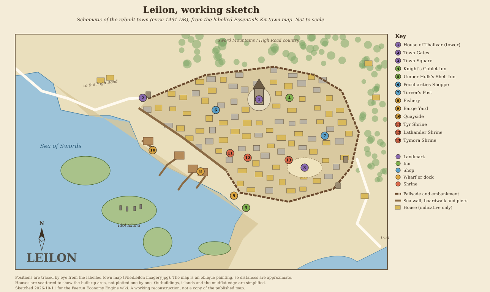

# Leilon

[Location index](../../README.md)

**Region:** Sword Coast North; on the High Road between Neverwinter and Waterdeep, at the edge of the Sea of Swords below the Sword Mountains, with the Mere of Dead Men to the south (engine region `Sword Coast North`, zone `swordcoast_north`)  
**Settlement type:** Small town; a mining town and High Road rest stop in the 14th century DR, abandoned after 1385 DR and resettled from 1485 DR  
**Reference period:** 1357 to 1370 DR lore (1st- and 2nd-edition sources); circa 1491 DR resettlement snapshot (*Storm King's Thunder*, D&D Essentials Kit adventures); 1492 DR unverified  
**Evidence reviewed:** 2026-10-11  
**Engine ID:** `leilon`  
**Structured metadata:** [leilon.json](leilon.json) (identity, periods, engine record, plan label positions, sketch, map and source links; regenerate it when this entry changes)  
**In-world fiction:** [A traveller's journal](travellers-journal.md), a fictional visit to the town in 1491 DR (not lore)

This entry paraphrases the [Forgotten Realms Wiki article][frwiki] (a secondary
source), read 2026-10-11 with a direct fetch for the text and through the
browser for the infobox, the gallery and the linked person and location
articles. The trade, mines and defences come from *Waterdeep and the North*
(1987) and *The North: Guide to the Savage Frontier* (1996). The resettled town
comes from *Storm King's Thunder* (2016) and the three D&D Essentials Kit
adventures (2019), set around 1491 DR. The infobox exports come from a video
game. Nothing here is verified for 1492 DR.

## Overview

Leilon is a small mining town on the High Road between Neverwinter and
Waterdeep, long used as a resting place by travellers on that road. In the
14th century DR it was allied with Waterdeep and a member of the Lords'
Alliance. Its eastern mines yielded copper, nickel and silver. The Spellplague
of 1385 DR broke the wards on the wizard Thalivar's tower in the town centre,
its guardians overran the town and Leilon was abandoned. In 1485 DR Lord
Protector Dagult Neverember of Neverwinter ordered the tower pulled down to
make the High Road safe, and the town was resettled under Neverwinter.
[Source][frwiki], citing *Waterdeep and the North*, pp. 6 to 7; *The North*,
p. 8; *Storm King's Thunder*, p. 96; *Neverwinter Campaign Setting*, p. 10.

## Geography

- On a shallow mudflat running out to the Sea of Swords, with the Sword
  Mountains rising behind it ([source][frwiki], citing *The North*, p. 8, and
  the Essentials Kit adventures).
- The Mere of Dead Men lies just south; the High Road runs along it
  (Map of the Sword Coast in *The North*; [Vester Jessup][jessup]).
- Southkrypt, a former dwarven silver mine and hall of a seafaring dwarf
  realm, lies east in the Sword Mountains; stones bearing that realm's sign
  were reused in Leilon's buildings (*Dwarves Deep*, p. 58).
- The gnome village of Ieirithymbul is in the western Sword Mountains
  (*Dragon* #252).
- The old town was stone cottages with slate or mud-hardened thatch roofs;
  the resettled town of the late 15th century DR is mostly simple wooden
  buildings.
- No river is recorded. The harbour, Quayside, takes fishing boats and
  barges that can cross the mudflats.

## Population

| Year | Population | Scope and source |
| --- | --- | --- |
| 1357 DR | 3,000 | Infobox; *Waterdeep and the North* (1987) is among the cited references |
| 1370 DR | 3,000 | Infobox; *The North* (1996) |
| 1385 to 1485 DR | None | Abandoned after the Spellplague |
| 1491 DR | 200 | Infobox; resettled town under Neverwinter (*Storm King's Thunder*, Essentials Kit) |

The infobox does not tie each figure to a single reference; the years follow
its cited sources. In 1358 DR a longship raid killed almost 200 townspeople
([source][frwiki], citing *The Savage Frontier*, pp. 61 to 62).

Demographics standard update (2026-10-15): no settlement-level racial or ethnic
breakdown was found in the reviewed Leilon sources. Runtime demographics remains
`unresearched` with a checked-source note in `faerun/data/demographics.py`.

**Engine:** 900 residents, an undated estimate retained for 1492 DR planning
rather than a census. [populations.py](../../../faerun/data/populations.py)
now separates the 1491 DR resettled-town 200 from the pre-Spellplague 3,000;
the engine population was not changed (L6).

## Economy and Trade

| Direction | Goods | Period and source |
| --- | --- | --- |
| Export | Copper, nickel and silver from the eastern mines, sold to Waterdeep merchants | 1357 to 1370 DR; *Waterdeep and the North*, pp. 6 to 7; *The North*, p. 8 |
| Export | Ore, timber, animal skins (infobox) | *Neverwinter Nights 2: Storm of Zehir* (2008, video game only) |
| Import | Most imports by caravan from Waterdeep | 1357 to 1370 DR; same sources |
| Trade | Gnomes of Ieirithymbul come to trade once a month except in winter | *Dragon* #252 (1998) |
| Livestock | Giant goats (milk, meat, goat hair) bred for the town; part of the flock sold to a Waterdeep trader through Barthen's Provisions of Phandalin | Circa 1491 DR; *Storm Lord's Wrath* ([Pinchwit Wigglehoof][pinchwit]) |
| Fish | Fishing revived after the resettlement; catches sold at the Fishery on Quayside | Late 15th century DR; Essentials Kit ([Valdi Estapaar][valdi], [Fishery][fishery]) |

- **Sea trade:** dangerous. Twelve barges, magically warded against fire and
  rot, were poled out to ships offshore and cargo moved with cranes that could
  not work in high winds; most trade went by caravan instead (14th century DR).
  In the 15th century DR the barge yard rented barges at 10 gp each for ten
  days ([Barge yard][bargeyard]; [Rorsta Anvilhand][rorsta]).
- **Mines:** rich in copper, nickel and silver, heavily guarded by the Lances
  of Leilon; tunnels run through the mountains and some open into the town
  (*The North*, p. 8; *Storm Lord's Wrath*). Whether the mines were worked
  again by 1491 DR is not stated.
- **Farms:** the 1358 DR raid burned farms and carried off livestock and cost
  three months of ore output (*The Savage Frontier*, pp. 61 to 62).

## Government

- **1357 to 1370 DR:** Lord Pelindar Filmarya (also spelled Filmarva in one
  wiki article), an ally of Waterdeep, with Leilon in the Lords' Alliance.
- **Late 15th century DR:** a town council loyal to Dagult Neverember,
  Lord Protector of Neverwinter, who is given as lord in 1491 DR. Members:
  Grizzelda Copperwraught (rebuilding), Sergeant Hazz Yorrum (Neverwinter
  garrison), Valdi Estapaar (fishing), Merrygold Brightshine (priest of
  Lathander), Jack Torver (merchant) and Vangol Kuskolt (priest of Tyr and
  judge).
- **Defence (14th century DR):** no walls; an earthen rampart with a wooden
  palisade and ditch, open only at the landward entrance. The Lances of
  Leilon, about 200 mounted soldiers, patrolled against orcs, trolls,
  bugbears, bandits and pirates and guarded the mines.

## Notable Inhabitants

From the wiki's [Category: Inhabitants of Leilon][inhab] (28 articles) and the
linked person articles, read 2026-10-11. Publications are those the wiki
cites, not independently checked. SLW is *Storm Lord's Wrath*, SDW *Sleeping
Dragon's Wake* and DC *Divine Contention* (all D&D Essentials Kit, 2019).

### Late 15th century DR (closest to the 1492 baseline)

| Person | Role | Dated | Source cited by the wiki |
| --- | --- | --- | --- |
| Dagult Neverember | Lord Protector of Neverwinter; lord of Leilon | 1485 to 1491 DR | *Storm King's Thunder*, p. 96 |
| Grizzelda Copperwraught | Dwarf architect; councillor in charge of rebuilding | Late 15th century DR | SLW, SDW, DC; *Storm King's Thunder* |
| Hazz Yorrum | Sergeant of the Neverwinter garrison; councillor | Circa 1491 DR | SLW, SDW, DC |
| Valdi Estapaar | Half-elf fisher; councillor who revived the fishing industry | Late 15th century DR | SLW, SDW, DC |
| Merrygold Brightshine | Halfling priest of Lathander; keeps the Lathander Shrine | Late 15th century DR | SLW, SDW, DC |
| Jack Torver | Merchant; owner of Torver's Post, the first general store | Late 15th century DR | SDW, DC |
| Vangol Kuskolt | Dwarf priest of Tyr; judges disputes | Late 15th century DR | DC |
| Puck Caribdas | Elf; keeps the Tymora Shrine and sells potions | Late 15th century DR | SDW, DC |
| Alion Malwyn | Innkeeper of the Umber Hulk's Shell Inn | Late 15th century DR | SDW, DC |
| Amrisiol Touchfire | Half-elf innkeeper of the rebuilt Knight's Goblet | Late 15th century DR | DC |
| Rorsta Anvilhand | Dwarf barge master at the barge yard | Late 15th century DR | SLW |
| Zana Taylish | Blacksmith selling arms and armour from a stall in the town square | Late 15th century DR | SLW, SDW, DC |
| Pinchwit Wigglehoof | Gnome goatherd for the town (giant goats) | Circa 1491 DR | SLW |
| Breltora Red-Eye | Half-orc stonemason | Circa 1491 DR | SLW |
| Silla Scalesweep | Halfling fisherwoman | Circa 1491 DR | SLW |
| Gallio Elibro | Rashemi mage and researcher | Late 15th century DR | SLW, SDW, DC |
| Erlum, Gori, Koz, Emmalou, Vester Jessup | Neverwinter soldiers posted to the town and the High Road patrol | Circa 1491 DR | SLW |
| Burnice, Smithwell | Children of fishers, displaced in the Cult of Talos attack | Circa 1491 DR | SLW |
| Demelza Tackwind | Harbourmaster of Quayside (named in the town article only) | 15th century DR | DC |

### Historical

| Person | Role | Dated | Source cited by the wiki |
| --- | --- | --- | --- |
| Pelindar Filmarya | Lord of Leilon, ally of Waterdeep; built the shrine of Tyr | 1357 to 1370 DR | *Waterdeep and the North*, pp. 6 to 7; *The North*, p. 8 |
| Augusta Krul, Ogri Ninebeards, Aubrey Silverspun | Members of the Swords of Leilon adventuring company; died in the Spellplague and stayed as ghosts guarding the ruins | Died 1385 DR | SLW, SDW, DC |

### Legendary and loosely tied

| Person | Note |
| --- | --- |
| Thalivar | Wizard who built the High Tower in the late 13th century DR for research on the planes, then vanished (SLW, DC; *Volo's Guide to the North*, p. 110) |
| Palarandusk | Gold dragon protecting the Ieirithymbul gnomes who trade in Leilon (*Dragon* #252) |
| Voaraghamanthar | Black dragon of the Mere of Dead Men, said to deal with a Cult of the Dragon cell in town (*Dragon* #258) |

### Families and organizations

- **Lances of Leilon:** about 200 mounted soldiers (14th century DR).
- **Swords of Leilon:** adventuring company based in the town (1987 to 2019
  sources).
- **Neverwinter garrison:** posted for the resettlement (late 15th century DR).
- **Cults of Talos and Myrkul:** fought over the rebuilt tower in the Battle
  of Leilon (early 1490s DR). Rumoured Cult of the Dragon and Zhentarim
  presence in the 14th century DR.

## Businesses

### In the live market (engine `businesses.json`)

None. No business in `businesses.json` lists `leilon`, so there were no offers
to check against `commodities.json`.

### Named in the source, not in the market

| Business | Kind | Operating | Source cited by the wiki |
| --- | --- | --- | --- |
| Torver's Post (Jack Torver) | General store and adventuring gear; no arms, armour or healing potions | Late 15th century DR | SDW |
| The Fishery, Quayside | Fish market and fishing-gear sales and repair; evening town hall | Late 15th century DR | SDW |
| Barge yard (Rorsta Anvilhand) | Barge storage and hire, 10 gp per barge per ten days | Late 15th century DR | SLW |
| Zana Taylish's stall | Arms and armour, town square | Late 15th century DR | SLW, SDW, DC |
| Umber Hulk's Shell Inn (Alion Malwyn) | First inn of the resettlement; rooms 5 sp a night, meals 1 sp | Late 15th century DR | SDW, DC |
| Old Knight's Goblet (Amrisiol Touchfire) | Inn for wealthy travellers and officials; weapons banned | Late 15th century DR | DC |
| Aubrey's Peculiarities Shoppe | Trinkets and magic items, kept by a ghost | Late 15th century DR | DC |
| Shrines of Lathander, Tymora and Tyr | Healing, potions, judgement | Late 15th century DR | SLW, SDW, DC |
| Settler Camp (Mazira Shae) | Temporary camp where most business was done during the rebuilding | Late 15th century DR | Essentials Kit |
| The Knight's Goblet | Travellers' tavern (whole roast boar) | 14th century DR | *Volo's Guide to the North*, p. 110 |
| The Orc's Tusks; The Rutting Buck; The Dusty Gnome | Taverns (locals; town centre; miners) | 14th century DR | *The North*, p. 8; video games |
| The Sword of Leilon | Inn | 14th century DR | *The North*, p. 8 |
| Temple of Waukeen | Small gilded temple | 14th century DR | *The North*, p. 8 |

## Maps and Village Layout

Preferred edition: 2nd. Published images are linked, not stored in the repo.
No interactive `Map:Leilon` page exists (404 on 2026-10-11).

**Working sketch:** [leilon-sketch.svg](leilon-sketch.svg), drawn 2026-10-11 by
eye from the labelled 5th-edition town map ([Leilon_imagery.webp](Leilon_imagery.webp)).
It shows the palisaded town with Thalivar's tower, the town square, the inns,
shops and three shrines, and the quayside with its piers on the Sea of Swords.
The source is an oblique painting, so positions are approximate, the houses are
scattered to show the built-up area rather than plotted, and the islands and
mudflat edge are simplified. A reconstruction to work from, not a copy of the
published map.

| Map or image | Edition and date | Shows | Where |
| --- | --- | --- | --- |
| Map of Leilon and surrounding area | Circa 1358 DR; likely 1st edition (*The Savage Frontier*, 1988); edition inferred from the date | Regional | [File:Leilon.jpg][map1358] |
| Mere of Dead Men map | 2nd edition, *The North* (1996); circa 1370 DR | Leilon with the Mere and the High Road | [File:MereOfDeadMen-TheNorth.png][map1370] |
| Map of Leilon and surrounding area | 5th edition; circa 1491 DR | Regional | [File:Leilon Region.png][map1491] |
| Labelled map of the rebuilt town | 5th edition, Essentials Kit; circa 1491 DR | Town plan (Quayside, barge yard, shrines, Torver's Post) | [File:Leilon imagery.jpg][mapimagery] |
| Illustrations | 5th edition | Leilon rebuilt and ruined; Thalivar's tower rebuilt and ruined | [Leilon rebuilt][imgrebuilt]; [Category: Images of Leilon][imgcat] |
| Other regional maps | Mixed (*Dungeon* #73, Kryptgarden Forest 2nd edition, *Lost Mine of Phandelver*, Triboar Trail region, Thornhold, Sword Coast Legends) | Regional; not opened | [Category: Maps of Leilon][mapcat] |

Only the four gallery maps were identified by caption; none was opened at full
size, and no file description pages could be read. The 1358 DR map's edition is
an inference from its date.

## Engine Record

| Field | Value |
| --- | --- |
| Population | 900 (no source) |
| Wealth / tax / security | 0.75 / 0.05 / 0.6 |
| Port / river | None / no |
| Terrain | Hills |
| Position | Stored x 488.4, y 1050.8 (also the `coords.json` control point); live position before this run x 458.9, y 1069.2 |
| Traits | `frontier`, `mining` |
| Industries | `mine_iron` 2, `smith` 1, `farm` 1; added 2026-10-11: `mine_copper` 1, `mine_silver` 1, `fish` 1 |
| Specialties / shortages | `iron_ore` 1 / none |
| Guild | Smiths' and Armorers' Guild (size 3) |
| Ruler | None |
| Size category | Small town |
| Neighbours | None. The "Neverwinter to Waterdeep Road" named route runs from Neverwinter straight to Waterdeep without a Leilon stop, and no track reaches the town |
| Description | Empty until 2026-10-11; set from the sources (L3) |

Observed 2026-10-11 (`get_trade_summary`, top 15), before the changes: goods
output about 576 gp a day (gross local product about 207,400 gp a year,
230 gp per resident). Exports and imports are both zero because the town has
no route neighbours. The "export" list is local surplus with nowhere to go:
fruit, vegetables, corn, timber, tea, spices, iron ore (9.4 loads a day),
small amounts of tin, copper and cotton. Fifteen unavailable goods (pears,
plantains, citrus, breadfruit, llamas, Genasi glass censers, scrimshaw and
others) show unmet needs of 0.09 to 1.8 a day.

After the changes: goods output about 593 gp a day. New surpluses include
fresh fish (about 7.8 barrels a day), copper (1.3 ingots a day, up from 0.6)
and lead (0.8 ingots a day). Iron ore surplus fell to 4.8 loads a day. Silver
did not appear in the top 15. Trade is still zero (L5).

## Discrepancies and Proposed Engine Changes

| # | Issue | Proposal | Status |
| --- | --- | --- | --- |
| L1 | Sources name copper, nickel and silver from the eastern mines, sold to Waterdeep merchants; the engine had only `mine_iron` | Add `mine_copper` 1 and `mine_silver` 1 (14th century DR evidence; whether the mines reopened by 1491 DR is not stated) | Applied 2026-10-11 |
| L2 | Fishing revived as an industry by a councillor; the Fishery and Quayside serve fishing boats (late 15th century DR) | Add `fish` 1 to identify previously unrepresented fishing capacity, not another business or commodity; does not establish a measured catch rate | Applied in catalogue 2026-10-15; 2026-10-11 note had not persisted |
| L3 | Description was empty | Set description from the sources | Applied 2026-10-11 |
| L4 | `mine_iron` 2 and specialty `iron_ore` 1: iron is never named; the only "ore" export is from a video game | Lower `mine_iron` to 1 or remove it, and remove the `iron_ore` specialty | Proposed |
| L5 | No neighbours, so no trade at all; the High Road named route bypasses Leilon. Sources put it on the High Road with most imports by caravan from Waterdeep | Add Leilon as a stop on the Neverwinter to Waterdeep Road (High Road); check the Phandalin and Triboar Trail links with P13 | Proposed (routes phase) |
| L6 | Population 900 has no sourced count; the wiki gives 3,000 (1357 and 1370 DR) and 200 (1491 DR) | `populations.py` records both historical scopes; retain 900 pending a separate population and economic decision | Evidence applied 2026-10-15; recalibration proposed |
| L7 | Ruler was empty | Record the 1491 DR town council loyal to Lord Protector Dagult Neverember rather than present him as its direct governor; 1492 DR composition unknown | Applied 2026-10-15; 1492 DR unverified |
| L8 | Harbour (Quayside) and offshore ship trade by barge, though sea trade is described as perilous and secondary to caravans | Set `port` to `Sea of Swords` with a low-quality lane, or keep the town landward; decide with L5 | Proposed (routes phase) |
| L9 | Infobox exports timber and animal skins, from a video game set before 1385 DR | Add `log` 1 and `hunt` 1 | Proposed (low confidence) |
| L10 | Giant goats bred for the town (milk, meat, goat hair), circa 1491 DR | Add `herd` 1 | Proposed |
| L11 | Late 15th century DR businesses (Torver's Post, the Fishery, barge yard, Zana Taylish's stall, two inns) | Add as market businesses once the 1492 DR state is checked; the barge yard fits a carrier record | Proposed |
| L12 | Engine-wide: `reload_catalog` applied map calibration points in `faerun/data/coords.json`, overriding saved map positions such as Amphail's (A12). | The 2026-10-15 local reload fix replays `maps/location-edits.json` over calibrated coordinates. The catalog reload test and a fresh local-world reload confirm Amphail's saved position; verify the deployed live server separately. | Fixed in local code; live server verification pending |
| L13 | Live position before this run (x 458.9, y 1069.2) differed from the stored and control-point position (x 488.4, y 1050.8). The description update saved 458.9 to disk; restored to 488.4 the same run. The queue's 192 miles used the old live position; the stored position is 186.3 miles from Waterdeep | Check Leilon's position against the 2nd- and 5th-edition maps | Proposed (map) |
| L14 | Engine-wide: an isolated market still logs unmet needs of up to 1.8 a day for exotic goods (llamas, Genasi glass censers) | Review with W5 | Proposed |

## Proposed New Commodities

| Commodity | Evidence | Status |
| --- | --- | --- |
| Nickel | Eastern mines of Leilon (14th century DR; *Waterdeep and the North*, pp. 6 to 7) | Proposed |
| Giant goats; goat hair | Pinchwit Wigglehoof's herd, circa 1491 DR (SLW); hair prized for warmth and strength | Needs reading (adds to Phandalin's giant goats entry) |

## Lore Follow-ups

1. **Mines after 1485 DR.** Read *Storm Lord's Wrath* and *Storm King's
   Thunder*, p. 96, for whether copper and silver were mined again in the
   1490s DR (affects L1, L4).
2. **Battle of Leilon.** The cult conflict of the early 1490s DR may leave the
   town damaged or emptied in 1492 DR.
3. **Population scope.** Whether the 1491 DR 200 counts the settler camp.
4. **Maps.** Open the four gallery maps; confirm the 1358 DR map's source and
   the engine position (L13).
5. **Southkrypt and Ieirithymbul.** Map-only sites; the gnomes' monthly trade
   may justify a small seasonal flow.

## Sources

**Directly consulted, secondary:** [Forgotten Realms Wiki: Leilon][frwiki]
(article text by direct fetch; infobox and gallery captions through the
browser), [Category: Inhabitants of Leilon][inhab] and its 28 person articles,
[Category: Locations in Leilon][loccat] with [Torver's Post][torver], the
[Fishery][fishery], the [Barge yard][bargeyard], the [Umber Hulk's Shell
Inn][umber], the [Knight's Goblet][goblet] and the [Settler Camp][camp],
[Category: Maps of Leilon][mapcat] and [Category: Images of Leilon][imgcat],
all accessed 2026-10-11. The source text (`action=raw`) could not be fetched.
Publications named above are the wiki's references, not independently
checked: *Waterdeep and the North* (1987), pp. 6 to 7; *Forgotten Realms
Campaign Set* (1987), "Cyclopedia of the Realms", p. 21; *The Savage Frontier*
(1988), pp. 29, 61 to 62; *Dwarves Deep* (1990), p. 58; *Volo's Guide to the
North* (1993), pp. 108, 110, 111; *The North: Guide to the Savage Frontier*
(1996), "Cities & Civilization", p. 8, and the Map of the Sword Coast; *Dragon*
#252 (1998), pp. 70 to 74; *Dragon* #258 (1999); *Neverwinter Campaign
Setting* (2011), p. 10; *Storm King's Thunder* (2016), p. 96; *Storm Lord's
Wrath*, *Sleeping Dragon's Wake* and *Divine Contention*, D&D Essentials Kit
(2019); video games *Treasures of the Savage Frontier* (1992) and *Neverwinter
Nights 2: Storm of Zehir* (2008).

**Engine:** `get_settlement`, `get_trade_summary`, `get_city_directory` (no
directory for Leilon), `list_named_routes`,
[settlements.json](../../../faerun/data/store/settlements.json),
[businesses.json](../../../faerun/data/store/businesses.json),
[commodities.json](../../../faerun/data/store/commodities.json) and
[coords.json](../../../faerun/data/coords.json), observed 2026-10-11.

[frwiki]: https://forgottenrealms.fandom.com/wiki/Leilon
[inhab]: https://forgottenrealms.fandom.com/wiki/Category:Inhabitants_of_Leilon
[loccat]: https://forgottenrealms.fandom.com/wiki/Category:Locations_in_Leilon
[mapcat]: https://forgottenrealms.fandom.com/wiki/Category:Maps_of_Leilon
[imgcat]: https://forgottenrealms.fandom.com/wiki/Category:Images_of_Leilon
[jessup]: https://forgottenrealms.fandom.com/wiki/Vester_Jessup
[pinchwit]: https://forgottenrealms.fandom.com/wiki/Pinchwit_Wigglehoof
[valdi]: https://forgottenrealms.fandom.com/wiki/Valdi_Estapaar
[rorsta]: https://forgottenrealms.fandom.com/wiki/Rorsta_Anvilhand
[fishery]: https://forgottenrealms.fandom.com/wiki/Fishery_(Leilon)
[bargeyard]: https://forgottenrealms.fandom.com/wiki/Barge_yard
[torver]: https://forgottenrealms.fandom.com/wiki/Torver%27s_Post
[umber]: https://forgottenrealms.fandom.com/wiki/Umber_Hulk%27s_Shell_Inn
[goblet]: https://forgottenrealms.fandom.com/wiki/Knight%27s_Goblet
[camp]: https://forgottenrealms.fandom.com/wiki/Settler_Camp
[map1358]: https://forgottenrealms.fandom.com/wiki/File:Leilon.jpg
[map1370]: https://forgottenrealms.fandom.com/wiki/File:MereOfDeadMen-TheNorth.png
[map1491]: https://forgottenrealms.fandom.com/wiki/File:Leilon_Region.png
[mapimagery]: https://forgottenrealms.fandom.com/wiki/File:Leilon_imagery.jpg
[imgrebuilt]: https://forgottenrealms.fandom.com/wiki/File:Leilon_rebuilt.JPG
