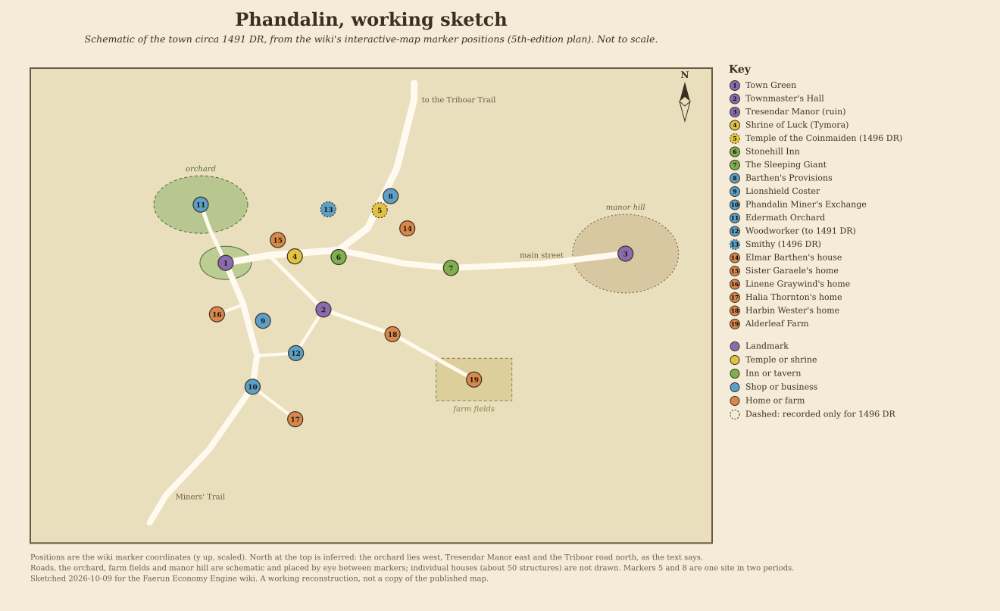

# Phandalin

[Location index](../../README.md)

**Region:** Sword Coast North, in the Lost Hills of the Sword Mountains south of Neverwinter Wood (engine region `Sword Coast North`, zone `swordcoast_north`)  
**Settlement type:** Village (wiki infobox); rebuilt frontier settlement of farmers and prospectors  
**Reference period:** Resettlement from about 1486 DR; 1491 DR snapshot (*Lost Mine of Phandelver*); early 1490s DR (*Dragon of Icespire Peak*, *In Volo's Wake*); 1496 DR (*Acquisitions Incorporated*, after the baseline); 1492 DR planning baseline  
**Evidence reviewed:** 2026-10-09 (first review 2026-10-01)  
**Engine ID:** `phandalin`

This entry paraphrases the [Forgotten Realms Wiki article][frwiki] (a secondary
source), its interactive map, the wiki's [Category: Inhabitants of
Phandalin][inh] and the linked business and person articles, read 2026-10-09
through the browser (WebFetch could not fetch the article). The late 15th
century detail comes from *Lost Mine of Phandelver* (2014, dated 1491 DR by the
wiki), *Dragon of Icespire Peak* (2019), *Storm King's Thunder* (2016), the
adventure *In Volo's Wake* (2016) and *Acquisitions Incorporated* (2019, dated
1496 DR by the wiki from a creator statement). Earlier history comes from
*Volo's Guide to the North* (1993), *The North* (1996), *The Grand History of
the Realms* (2007) and the video games *Neverwinter Nights 2: Storm of Zehir*
(2008) and *Baldur's Gate III* (2020). These are the wiki's references; none was
independently consulted. The 2026-10-01 review is folded in; its engine
demographics snapshot is kept below.

## Overview

Phandalin is a small, plain frontier town of hard-working settlers built on
the ruins of an older Phandalin. The first town prospered in the 10th century
DR as a farming community and a member of Phandelver's Pact, with access to the
Forge of Spells and the mines of Wave Echo Cave, and was overrun by orcs in 951
DR. Settlers from Neverwinter and Waterdeep began rebuilding around 1486 DR, and
by 1491 DR the town was well established. Its people are farmers, woodcutters,
trappers and miners; most of its wealth comes from mining in the Sword
Mountains. [Source][frwiki]

## Geography

- In the Lost Hills of the Sword Mountains, south of Neverwinter Wood and
  north-east of Leilon, where the road from the High Road toward Triboar fades
  into a trail (the Triboar Trail). Icespire Peak is visible on clear days.
- Temperate climate with about 18 inches (46 cm) of rain a year
  (*Acquisitions Incorporated*, p. 104).
- About fifty well-kept structures of logs and flagstones, with three deep wells
  (*Lost Mine of Phandelver*, p. 14; *Volo's Guide to the North*, p. 196). An
  apple orchard lies on the west side, the ruined Tresendar Manor on a hill to
  the east, and a small town square and green in the middle. In the mid to
  late 14th century DR, when the town was a ruin, one of the three wells was
  said to hold a poison harmless only to orcs (*The North*, p. 36); nothing
  carries that into the rebuilt town. Well yields are unknown, and the engine's
  water assessment (2026-10-01 dashboard) is inferred, not sourced.
- The Miners' Trail leaves the south-west corner of town toward the mines; the
  road to the Triboar Trail leaves the north side (interactive map).
- Nearby places named in the related articles: Butterskull Ranch east of
  Conyberry on the Triboar Trail (cattle, horses, pigs, poultry, vegetables,
  corn, apples and skull-shaped butter sold to Barthen's Provisions), Tibor
  Wester's logging camp in Neverwinter Wood, Umbrage Hill windmill (Adabra
  Gwynn, midwife and apothecary), Wave Echo Cave and Icespire Hold.
- Engine: the only neighbour is Triboar by the Phandalin to Triboar Trail (86.5
  miles, 6.5 days), added 2026-10-08 (T13). The sources give about 225 miles by
  the Triboar Trail (T16). Straight-line engine distances: Neverwinter 120.5
  miles, Leilon 98.5, Waterdeep 158.8. No road to Neverwinter or Leilon is
  modelled, though settlers, goods and the Neverwinter wagon of 1491 DR came
  from Neverwinter (P13).

## Population

| Figure | Scope | Year | Source cited by the wiki |
| --- | --- | --- | --- |
| Not given | No resident count in the article, infobox or the business and person articles read | None | None |
| About 50 structures | Log and flagstone buildings in the rebuilt town | 1491 DR | *Lost Mine of Phandelver*, p. 14; *Acquisitions Incorporated*, pp. 101 to 102 |
| Mainly humans, with dwarves, elves, gnomes, half-elves and halflings | Races (infobox) | Late 15th century DR | Infobox |

Demographics standard update (2026-10-15): recorded as **qualitative** in
`faerun/data/demographics.py` ("mainly humans" plus named groups, with no
percentages). The [wiki infobox][frwiki] does not establish exact shares or a
1492 DR census; avoid treating the later 1496 DR climate description attributed
to *Acquisitions Incorporated* as verified baseline weather without reading it.

**Engine:** 500 residents, an undated estimate retained for 1492 DR planning,
not a census. [populations.py](../../../faerun/data/populations.py) now records
that the 1491 DR structure count is not a resident count. Fifty structures cannot be turned into a census without knowing
how many are homes, how many people share each and how many live on outlying
farms and claims. As an order-of-magnitude check only: if about 40 of the 50
are homes at 4 to 6 people each, the town core holds about 160 to 240 people,
before outlying farms (Alderleaf Farm, Edermath Orchard) and miners camped at
their claims. The engine's 500 is therefore plausible only if it covers the
surrounding farms and claims. No change made; see P10.

## Economy and Trade

| Item | Evidence | Period |
| --- | --- | --- |
| Exports (infobox) | Cold iron, gold, platinum, skins, timber | Gold and platinum: *Dragon of Icespire Peak*, p. 7 (early 1490s DR). Cold iron, skins, timber: *Neverwinter Nights 2: Storm of Zehir* (video game; first resettlement, before 1374 DR) |
| Imports | None listed | None |
| Mining | Most of the wealth came from mining in the nearby Sword Mountains for gold and platinum, plus ore; the mineral wealth expected in the early 1490s often failed to arrive, and the Miner's Exchange could go months without income; efforts to reopen Wave Echo Cave were abandoned | *Dragon of Icespire Peak*, p. 7; *Acquisitions Incorporated*, pp. 105 to 106 |
| Cold iron | Cold-iron mines worked during the first resettlement, taken over by Danley's people after the "Cold Mining Company" was exposed | Before 1374 DR, video game only |
| Farming and ranching | Land good for farming and ranching; Alderleaf Farm; Barthen brokered livestock sales between sellers as far south as Leilon and buyers as far as Waterdeep, including herds of giant goats sold for Dagult Neverember | Article text; *Dragon of Icespire Peak*, pp. 8 to 9, 34 |
| Logging | Near enough to Neverwinter Wood for woodcutting and logging; Tibor Wester's camp floated logs down to Neverwinter and bought its supplies at Barthen's | Article text; *Dragon of Icespire Peak*, pp. 34 to 35 |
| Apples and cider | Edermath Orchard sold fresh fruit and juice in summer and cider in winter to visiting merchants and local inns | *Lost Mine of Phandelver*, pp. 15 to 16; *Acquisitions Incorporated*, pp. 101, 107 |
| Trading posts | Barthen's Provisions (general goods, wagon loading, livestock brokering); Lionshield Coster (weapons and armour shipped from Yartar); Miner's Exchange (buys ore and gems, keeps claims, sells carts and wagons) | 1491 DR to the mid 1490s DR |
| Tourism | Visitors and adventurers came after Volo wrote about the area, setting the inns and taverns competing | *In Volo's Wake*, p. 5 (early 1490s DR) |
| Prices | Stonehill Inn: a bed 5 sp a night, a meal about 1 sp | 1491 DR |

These describe trade character, not output volumes or prices.

## Government

- At first there was no real government. The Miner's Exchange kept the records
  of mining claims, and an annually elected Townmaster acted as judge, mediator
  and record keeper. Harbin Wester was the perennial Townmaster in 1491 DR
  (*Lost Mine of Phandelver*, p. 18).
- After losing faith in a single Townmaster during the early 1490s DR (the
  Redbrand bandits and the white dragon Cryovain), the townsfolk elected a
  three-member Town Council: Harbin Wester, Sildar Hallwinter and Trilena
  Stonehill (*In Volo's Wake*, p. 6). Trilena was later replaced by Halia
  Thornton, who then vanished. The exact year of the change is not given.
- In 1496 DR the town held its first mayoral election (Wester against
  Hallwinter) and moved to enlarge the council to five (*Acquisitions
  Incorporated*, pp. 101 to 102, 107). After the baseline.
- Townmaster's Hall (later the Town Council Hall) is a stone building with a
  bell tower, a notice board and a two-cell jail.
- Organizations: Zhentarim (ran the Miner's Exchange), Harpers (Sister
  Garaele), Lords' Alliance (Sildar Hallwinter), Lionshield Coster, Emerald
  Enclave (Reidoth), the Redbrands (bandits, 1491 DR), and from 1496 DR a
  franchise of Acquisitions Incorporated in Tresendar Manor.

## Notable Inhabitants

From the wiki's [Category: Inhabitants of Phandalin][inh] (56 people, including
its six sub-categories) and the linked articles, read 2026-10-09. Roles are
paraphrased; publications are those the wiki cites, not independently checked.
Nearest to 1492 DR first.

### Late 15th century DR (closest to the 1492 baseline)

*Lost Mine of Phandelver* (LMoP, 2014, 1491 DR) unless stated.

| Person | Role | Dated | Source cited by the wiki |
| --- | --- | --- | --- |
| Harbin Wester | Townmaster, later town councillor; described as a banker; half-brother of Tibor Wester | 1491 DR to 1496 DR | LMoP, pp. 14 to 15, 18 to 19; *Acquisitions Incorporated*, pp. 101 to 102; *Dragon of Icespire Peak*, p. 10 |
| Sildar Hallwinter | Retired Neverwinter knight and Lords' Alliance agent; town councillor | Early 1490s to 1496 DR | LMoP, pp. 11, 61; *In Volo's Wake*, p. 6; *Acquisitions Incorporated*, p. 106 |
| Alana Hallwinter | Sildar's adopted daughter | Late 15th century DR | *In Volo's Wake*, pp. 15 to 17 |
| Toblen and Trilena Stonehill; Pip and Tamara Stonehill | Owners of the Stonehill Inn, from Triboar; Trilena also a councillor; their children | 1491 DR | LMoP, pp. 15 to 16; *In Volo's Wake*, p. 6; *Acquisitions Incorporated*, p. 108; *Phandelver and Below*, pp. 84 to 85 |
| Elsa | Dwarf barmaid at the Stonehill Inn | 1491 DR | LMoP, pp. 15 to 16 |
| Elmar Barthen (Elmina in *Phandelver and Below*) | Owner of Barthen's Provisions | 1491 DR to about 1495 DR | LMoP, pp. 15 to 16; *Phandelver and Below*, pp. 28, 30 |
| Ander; Thistle | Clerks at Barthen's Provisions | 1491 DR | LMoP, p. 16 |
| Vincent | Barthen's ox, which pulled carts for large orders | Early 1490s DR | *Dragon of Icespire Peak*, pp. 34, 55 |
| Linene Graywind; Minghee Graywind | Master of the Lionshield Coster post; her daughter | 1491 DR; 1496 DR | LMoP, p. 17; *Acquisitions Incorporated*, pp. 105, 107 |
| Velleen Firecrow | Assistant and courier to Linene Graywind; a spy | Late 15th century DR | *Storm Lord's Wrath* (Essentials Kit adventure) |
| Halia Thornton | Zhentarim agent, guildmaster of the Miner's Exchange, briefly councillor | 1491 DR | LMoP, pp. 15 to 18, 50; *Storm King's Thunder*, p. 231 |
| Sharna Quirstiron | Dwarf Zhentarim agent who replaced Halia at the Exchange | 1496 DR | *Acquisitions Incorporated*, pp. 105 to 107 |
| Daran Edermath; Bertice Edermath | Retired half-elf marshal keeping the orchard; a young half-elf woman of the household | 1491 DR; 1496 DR | LMoP, pp. 15 to 16; *Acquisitions Incorporated*, pp. 99, 107 |
| Qelline Alderleaf; Carp Alderleaf | Halfling farmer at Alderleaf Farm; her son | 1491 DR | LMoP, pp. 15 to 16 |
| Grista Kettlecopp | Dwarf keeper of the Sleeping Giant | 1491 to 1496 DR | LMoP, p. 18; *Acquisitions Incorporated*, p. 108 |
| Garaele | Elf priestess of Tymora at the Shrine of Luck; former Harper | 1491 DR | LMoP, pp. 15, 18; *Dragon of Icespire Peak*, p. 9 |
| Thel Dendrar; Mirna, Nilsa and Nars Dendrar | Woodcarver killed by the Redbrands; his widow and children | 1491 DR | LMoP, pp. 15 to 16, 22 to 23 |
| Freda | Gnome weaver | 1491 DR | LMoP, pp. 15 to 16 |
| Lanar | Miner | 1491 DR | LMoP, pp. 15 to 16 |
| Narth | Elderly farmer | 1491 DR | LMoP, pp. 15 to 16 |
| Aida Camber | Carpenter, with her sister Cathlette | Late 15th century DR | *Phandelver and Below: The Shattered Obelisk* (2023; page not captured) |
| Nedd Angelite; Sasha Flint; Grace Hardstone | Dwarf residents | Late 15th century DR | *In Volo's Wake*, pp. 15 to 17 |
| Ilsa Wisemantle | Neverwinter noble concerned with the town's safety | Late 15th century DR | *In Volo's Wake*, pp. 33, 38, 49 |
| Adabra Gwynn | Acolyte of Chauntea, midwife and apothecary at the Umbrage Hill windmill | Early 1490s DR | *Dragon of Icespire Peak*, pp. 8 to 9, 44, 55 |
| Reidoth | Druid of the Emerald Enclave, friend of Qelline | 1491 DR | LMoP, pp. 18, 27, 30 to 32 |
| Iarno Albrek ("Glasstaff") | Wizard leading the Redbrands; Lords' Alliance agent turned traitor | 1491 DR | LMoP, pp. 19, 25 to 26 |
| Alger Frakk; Maza Fieldsalder | Master blacksmith at the Smithy; his apprentice | 1496 DR | *Acquisitions Incorporated*, p. 108 |
| Hesten Jenz; Mischka Solmen | Acolytes at the Temple of the Coinmaiden (Waukeen), run by Ditch Fundi | 1496 DR | *Acquisitions Incorporated*, p. 104 |
| Grovet; Macklin Talctuft; Brawn McGable | Young miner; dwarf settler; bandit turned settler | 1496 DR | *Acquisitions Incorporated*, pp. 99, 103 to 105, 107 |
| Stuuzant | Unusually clever ogre attacking local livestock | 1496 DR | *Acquisitions Incorporated*, pp. 97, 107 |
| Argus Skeel | Vampire spawn spying for the Cult of Myrkul | Late 15th century DR | *Storm Lord's Wrath* |
| Droop; Mosk | Goblin slave of the Redbrand bugbears; bugbear leader for Nezznar | 1491 DR | LMoP, pp. 20 to 24 |

### Historical

| Person | Role | Dated | Source cited by the wiki |
| --- | --- | --- | --- |
| Mayor Alderleaf | Mayor who wrote *The Wonders of Phandalin* | 950 DR | *Baldur's Gate III* (video game) |
| Aldith Tresendar ("the Black Hawk") | Knight of the Tresendar family | 10th century DR | LMoP, p. 24; *Volo's Guide to the North*, p. 196; *Grand History*, p. 112 |
| Ona | Orc of the Sword Coast North | Early 10th century DR | *The Lost Library of Lethchauntos*, pp. 227, 237 |
| Danley | Miner who reopened the cold-iron mines and ran Danley and Sons Inn | Before 1374 DR | *Neverwinter Nights 2: Storm of Zehir* (video game) |

### Legendary and loosely tied

| Person | Note |
| --- | --- |
| Lethchauntos the Black | Orc wizard, author and maker of magic weapons (*The Lost Library of Lethchauntos*) |
| Oni-guma; Shikimi | Pre-generated characters from Kara-Tur in the licensed adventure *The Oni's Right Hand* |

### Families and organizations

The Stonehill family (inn), the Barthen family (trading post), the Dendrar
family, the Alderleaf family (farm; a Mayor Alderleaf in 950 DR), the Edermath
household, the Hallwinters, the Tresendar family (old manor). Organizations:
Zhentarim, Harpers, Lords' Alliance, Lionshield Coster, Emerald Enclave, the
Redbrands, Acquisitions Incorporated (from 1496 DR).

## Businesses

### In the live market (engine `businesses.json`)

None existed before this run. Added 2026-10-09 (P12), each shown operating in
1491 DR by *Lost Mine of Phandelver* and still recorded in the mid 1490s DR:

| Business | Type | Offers | Note |
| --- | --- | --- | --- |
| Barthen's Provisions (`barthens_provisions`) | Trading post, general goods | Caravan supplies, rope, lanterns, candles, butter | No weapons, armour or potions in the source; offers inferred; closed late 1495 or early 1496 DR |
| Lionshield Coster, Phandalin post (`lionshield_coster_phandalin`) | Weapons and armour | Swords, spears, short bows, arrows, leather armour, shields | Weapon types inferred. All six are rare with no stock in Phandalin's market (swords and leather armour come from Sundabar), matching the missing shipments of 1491 DR |
| Phandalin Miner's Exchange (`phandalin_miners_exchange`) | Ore and gem buyer, claims office | Carts, wagons | Ore and gem buying not modelled |
| Edermath Orchard (`edermath_orchard`) | Orchard and cider mill | Fruit (fine) | No cider commodity; `apples` is made only by `tag_apples`, so fruit stands in |
| Stonehill Inn (`stonehill_inn`) | Inn | Ale, bread, fresh meat | Lodging not modelled; menu inferred |
| The Sleeping Giant (`sleeping_giant_phandalin`) | Tap house | Ale (basic) | |

Generated addresses ("High Road", "Trade Quarter") are placeholders. Each
business starts with generated stock (12 to 21 of each good), which ignores
value (D21).

### Named in the source, not in the market

| Name | Kind | Operating | Modelled goods it suggests |
| --- | --- | --- | --- |
| The Smithy (Alger Frakk) | Blacksmith | 1496 DR only | Nails, horseshoes, tools (P14) |
| Alderleaf Farm | Farm | 1491 DR | Vegetables, grain |
| The Woodworker | Woodcarving | Until Thel Dendrar's death in 1491 DR | None (closed) |
| Shrine of Luck | Shrine to Tymora | 1491 DR | None |
| Temple of the Coinmaiden | Temple of Waukeen in the former Barthen's building | 1496 DR | None |
| Townmaster's Hall | Town hall and jail | 1491 to 1496 DR | None |
| Tresendar Manor | Ruined manor; Redbrand hideout; Acquisitions Incorporated guildhall from 1496 DR | Various | None |
| Danley and Sons Inn; Shrine of Waukeen | Inn and shrine of the first resettlement | Before 1374 DR | None (gone) |

## Maps and Village Layout

### Maps

Structured metadata for every map below (stored files, sizes, orientation,
scale, labels, interactive-map markers and links) is in
[phandalin.json](phandalin.json).

Preferred edition: 2nd. No 2nd-edition town plan exists: the town was a ruin
in the 2nd-edition era. The only street plan is 5th edition. Published images
are linked, not stored, except the two files the project owner already placed
in this folder.

| Map | Edition and date | Shows | Where |
| --- | --- | --- | --- |
| Excerpt from *The Forgotten Realms Atlas* | 2nd edition (Karen Wynn Fonstad, 1999) | The vicinity of Leilon, Phandalin and the Sword Mountains (the wiki's gallery map, captioned "2e map of the vicinity") | [File:Leilon.jpg][map2e] |
| Poster map from *The North: Guide to the Savage Frontier* | 2nd edition, 1996 | Mere of Dead Men area; whether Phandalin is marked was not checked | [File:MereOfDeadMen-TheNorth.png][mapnorth] |
| Map of Phandalin | 5th edition, 1491 DR; *Lost Mine of Phandelver*, p. 17; Mike Schley | Town plan with labelled buildings, north up, scale bar to 500 feet | [File:Phandalin.jpg][map5e]; a copy is stored here as [phandalin.jpg](phandalin.jpg); full-size DM and player versions (4000 by 2788) at the [Mike Schley print shop][schleylmop] |
| Environs south of Neverwinter | 5th edition; *Lost Mine of Phandelver*, p. 5; Mike Schley (wiki dates it circa 1481 DR) | Regional | [File:Location of castle2.jpg][mapenv] |
| Lost Mine of Phandelver area map | 5th edition; Mike Schley | Regional | [File:MapLostMine.png][maplmop] |
| Triboar Trail region | 5th edition; *Lost Mine of Phandelver* and *Dragon of Icespire Peak* fused; Mike Schley | Regional, Neverwinter to the Triboar Trail | [File:Triboar Trail Region Map.jpg][maptrail] |
| Leilon region | 5th edition; Map of Faerun (*Sword Coast Adventurer's Guide*); Mike Schley | Regional | [File:Leilon Region.png][mapscag] |
| Phandalin (remastered) | 5th edition, 2023; *Phandelver and Below: The Shattered Obelisk*; Mike Schley | Town plan for the remake of *Lost Mine of Phandelver*, sold as DM and player versions | [Mike Schley print shop][schleypb]; not viewed, so changes from the 2014 plan are unconfirmed |
| Phandalin Alleys | 5th edition, 2023; *Phandelver and Below*; Mike Schley | Encounter map of streets in town, 3000 by 4071 pixels | [Mike Schley print shop][schleyalleys]; not viewed |
| The Phandalin Region | 5th edition; drawn for *Lost Mine of Phandelver* (2014), remastered as a poster in *Phandelver and Below* (2023); Mike Schley | Regional | [Mike Schley print shop][schleyregion] |
| Phandalin, *Dragon of Icespire Peak* | 5th edition, 2019; *Essentials Kit* | A town map reported to show fewer spoilers than the *Lost Mine* plan; the regional poster map in the kit is called the best version by The Alexandrian | Reported by [EN World][enworld] and [The Alexandrian][alexandrian]; not viewed, cartographer not confirmed |
| Regional map, *D&D Adventurer* | UK partwork magazine | Large regional map that also marks the magazine's own adventure sites | Reported by [The Alexandrian][alexandrian]; not viewed |
| *Acquisitions Incorporated* (1496 DR) | 5th edition, 2019 | No town map confirmed. The interactive map's second source, which adds the Smithy and the Temple of the Coinmaiden, is probably this book | Unconfirmed |
| Interactive map | Wiki [Map:Phandalin (1491 DR)][imap], drawn on an unlabelled copy of the 5th-edition plan (4000 by 2788) | 21 markers | Marker positions below |
| Phandalin: A Frontier Village Map | No publisher, artist, edition or date; supplied by the project owner | A repainted version of the 5th-edition plan with the same labels, plus a stream along the south and east and field strips at Alderleaf Farm; scale bar to 500 feet | [Phandalin_ A Frontier Village Map.png](<Phandalin_ A Frontier Village Map.png>) |


Provenance caution: the repainted map is illustrative, not a source. It follows
the 5th-edition plan closely but drops Sister Garaele's home and adds details
(the stream, the farm fields) that the published plan does not show.

**Working sketch:** [phandalin-sketch.svg](phandalin-sketch.svg), drawn 2026-10-09
from the interactive-map marker positions below (scaled, y up, north at the
top as inferred). Roads, the orchard, the farm fields and the manor hill are
schematic and placed by eye between markers, and the roughly 50 houses are not
drawn. Markers recorded only for 1496 DR (the Smithy and the Temple of the
Coinmaiden) are dashed. A reconstruction to work from, not a copy of the
published map.



### Interactive map markers

Map bounds x 0 to 4000, y 0 to 2788 (map units; coordinate order x then y,
origin bottom-left, so y rises toward the top). **Orientation inferred: north
at the top.** The published plan has a compass rose with north up, Edermath
Orchard falls at low x (west) and Tresendar Manor at high x (east), and the
road to the Triboar Trail leaves at high y (north), all as the text says. The
references marker says the positions come from two sources (the 1491 DR plan,
*Lost Mine of Phandelver*, p. 17, and a second source not captured, most likely
*Acquisitions Incorporated* for the Smithy and the 1496 DR temple).

| Place | x | y | Category |
| --- | --- | --- | --- |
| Stonehill Inn | 1809 | 1679 | Inn or tavern |
| Sleeping Giant | 2468 | 1615 | Inn or tavern |
| Barthen's Provisions | 2114 | 2037 | Shop or business |
| Smithy | 1748 | 1959 | Shop or business |
| Edermath Orchard | 1000 | 1987 | Shop or business |
| Lionshield Coster | 1365 | 1305 | Shop or business |
| Woodworker | 1558 | 1115 | Shop or business |
| Phandalin Miner's Exchange | 1304 | 918 | Shop or business |
| Town Green | 1146 | 1645 | Landmark |
| Townmaster's Hall | 1720 | 1371 | Landmark |
| Tresendar Manor | 3492 | 1699 | Landmark |
| Shrine of Luck | 1552 | 1683 | Temple or shrine |
| Temple of the Coinmaiden (1496 DR) | 2050 | 1954 | Temple or shrine |
| Elmar Barthen's house | 2212 | 1847 | Private residence |
| Sister Garaele's home | 1452 | 1779 | Private residence |
| Linene Graywind's home | 1095 | 1343 | Private residence |
| Halia Thornton's home | 1554 | 727 | Private residence |
| Harbin Wester's home | 2125 | 1226 | Private residence |
| Alderleaf Farm | 2603 | 960 | Private residence |
| Road to Triboar Trail | 2252 | 2605 | Road |
| Miners' Trail | 798 | 284 | Road |

The Temple of the Coinmaiden marker (2050, 1954) sits beside Barthen's
Provisions (2114, 2037), although the text says the temple took over Barthen's
building in 1496 DR; the two markers are probably the same site in two periods.

## Engine Record

| Field | Value |
| --- | --- |
| Population | 500 (gazetteer estimate, no reference year or evidence entry; P10) |
| Wealth / tax / security | 0.7 / 0.03 / 0.5 |
| Terrain / port / river | Hills / none / no |
| Traits | `frontier`, `mining` |
| Industries | `mine_iron` 1, `mine_silver` 1, `farm` 1, `craft` 1, `mine_gold` 1, `log` 1, `hunt` 1 (last three added 2026-10-09, P1 to P3) |
| Specialties | `silver_ingot` 1 (no source; P7) |
| Shortages | `wine_common`, `silk` (model inputs, no source) |
| Ruler | Blank (P9) |
| Description | Set 2026-10-09 from the sources (P4) |
| Size category | Village |
| Stored engine coordinates | x 555.0, y 1047.7 |
| Neighbours | Triboar by trail, 86.5 miles |
| Historical city directory | None (`get_city_directory`) |

Observed 2026-10-09 before this run's changes (`get_trade_summary`): gross
local product 131,822 gp a year (264 gp per resident); goods output 366 gp a
day; goods exports 112 gp a day against imports of 22,973 gp a day; 3,603 gp a
day of inbound freight assigned to no carrier. Leading exports: vegetables (21
a day), fruit (18.7), tea and herbal infusions (9.0), cheese (7.5), common
spices (7.5), eggs (6.7), fresh meat (5.6) and iron ore (2.0). Silver, the only
specialty, made about 0.55 ingots a day and exported 0.06. Corn, cotton, oxen
and mules sat as uncommitted surplus. Imports were the usual unavailable goods
(citrus, camel, pears, pineapple, yak, llama, longship, clockwork, woolly
mammoth) at a flat 1 a day each.

After the changes and `reload_catalog` (P1 to P4): gross local product 149,013
gp a year (298 gp per resident, up 13%); goods output 413 gp a day; exports 123
gp a day. New output: timber 7.7 loads a day (6.6 exported; hinterland
multiplier about 10.9), gold 0.067 ingots a day (about 32 gp a day at catalogue
price; none exported, no local demand), furs 0.17 bundles a day (no local
demand, none exported). Iron ore exports fell from 2.0 to 1.6 loads a day.
Imports unchanged.

**Orchard trial (P5).** `orchard` 1 was applied and then reverted the same day.
With it Phandalin grew olives (6 barrels a day; olives have no climate gate),
pressed olive oil, and imported 23.9 barrels a day of olives from Athkatla,
1,260 miles away, to feed the press. Gross local product rose to 192,250 gp a
year, almost all from that olive chain. Fruit is already made by `farm`.

**Live server note (2026-10-09):** each `reload_catalog` this run again moved
Amphail to x 621.7, y 1126 with no neighbours (A12, sixth and seventh times).
Its stored position (x 648.5289, y 1161.7169, confirmed on disk) was passed
back through `update_settlement` both times. Phandalin kept its position.

### Engine demographics (2026-10-01 snapshot)

Recomputed on **2026-10-01** from the stored Phandalin settlement using
[settlement_profile](../../../faerun/requirements.py), with service classification
enabled. This is the current on-disk engine baseline, not a read of a potentially
older running server. It is a fixed annual-average profile, independent of the
selected month; the 1492 planning date does not make it a historical census.

| Measure | Value | Engine field / interpretation |
| --- | --- | --- |
| Residents | 500 | `population`; visitors excluded |
| Worker pool | 250 | `worker_population`; assumed 50% of residents |
| Modeled mages | 0 | `mage_population`; not proof that no spellcasters live here |
| Standing army | 4 | `standing_army`; included in the worker pool |
| Militia | 35 | `militia`; resident reserve, not an extra workforce bucket |
| Builders | 1 | `builders` |
| Carpenters | 1 | `carpenters` |
| Existing home-equivalents | 100 | `existing_homes`; assumes five residents per home |
| Annual growth | 0.44% | `annual_growth_rate`; the earlier dashboard rounded this to 0.4% |
| New home-equivalents per year | 0.44 | `new_homes_per_year` |
| Repair home-equivalents per year | 0.75 | `repair_home_equivalents_per_year` |
| Baseline unallocated workers | 88 | `unallocated_workers`; before service classification |

All people counts are subsets of the 500 residents, not additional population.
The other 250 residents are outside the assumed worker pool; their ages,
occupations, and reasons for being outside it are not established. The model
does not supply age, gender, ancestry percentages, or household composition.
External and peak-season visitor counts remain unknown, not zero. No dated
census evidence or confidence interval is attached to this settlement input.

The **100 modeled home-equivalents are not 100 surveyed buildings**. They are
derived from the population assumption and should not replace or be added to
the source's approximately 50 structures. This discrepancy remains unresolved.
Annual growth is a planning rate, not automatically compounded population.

#### Baseline Occupations

These labor buckets total **162 allocated workers**, with **88 unallocated**,
reconciling to the 250-worker pool. Establishments are labor-capacity estimates,
not observed buildings, named businesses, or guaranteed material-supported output.

| Occupation | Workers | Estimated establishments |
| --- | --- | --- |
| Mages and magical workshops | 0 | 0 |
| Standing garrison companies | 4 | 1 |
| Building crews | 1 | 1 |
| Carpenters | 1 | 1 |
| Farms and market gardens | 123 | 25 |
| Fishing crews | 0 | 0 |
| Bakeries and mills | 5 | 1 |
| Butchers and dairies | 2 | 1 |
| Breweries and inns | 3 | 1 |
| Smithies and tool workshops | 2 | 1 |
| Textile and clothing workshops | 4 | 1 |
| Healers and apothecaries | 1 | 1 |
| Carriers and warehouses | 7 | 1 |
| Sanitation and water crews | 2 | 1 |
| Extraction: mine iron | 1 | 1 |
| Extraction: mine silver | 2 | 1 |
| Extraction: quarry | 1 | 1 |
| Woodland management and logging | 3 | 1 |
| Temple staff | 0 | 0 |

#### Service Classification

With services enabled, the engine reclassifies **12.1** baseline workers and
allocates **13.2** from the baseline unallocated pool. The result is **25.3
service FTE**, **149.9 other-occupation FTE**, and **74.8 remaining unallocated
FTE**, still totaling **250**. FTE means full-time-equivalent labor, not
fractional people. Do not add this table to the baseline occupation table.

| Service sector | Worker FTE (rounded) |
| --- | --- |
| Health | 1.25 |
| Religion | 0.75 |
| Animal services | 0.30 |
| Administration | 1.25 |
| Knowledge | 1.50 |
| Commerce | 1.50 |
| Logistics | 7.50 |
| Communications | 1.40 |
| Hospitality | 2.50 |
| Utilities | 2.50 |
| Civil security | 1.50 |
| Maintenance | 1.50 |
| Culture | 1.07 |
| Professional services | 0.78 |

Zero baseline temple staff and 0.75 religion-service FTE reflect different
classifications, not evidence against the sourced Shrine of Luck. Similarly,
modeled mage counts cannot establish the abilities of named lore residents.

#### Refreshing the Snapshot

Run from the project root using the project Python environment:

```python
from pprint import pprint
from faerun.data_store import load_settlements
from faerun.requirements import settlement_profile

settlement = next(
  item for item in load_settlements() if item.id == "phandalin"
)
pprint(settlement_profile(settlement, include_services=True))
```

This reads stored inputs and computes the profile without changing the catalogue
or fetching wiki content. The tables are a dated snapshot, not automatically
synchronized documentation. Current location-detail responses already include
the engine profile under `requirements.profile`, separately from `lore`.

### Previously Observed Scenario Event

The dashboard also showed a generated regional silver-strike event dated
1 Eleint 1492 to 1 Uktar 1493. It is simulation scenario content, not evidence
from the wiki for historical silver production. No generated events or market
prices should be promoted to sourced lore merely because they appear in the UI.

## Discrepancies and Proposed Engine Changes

| # | Issue | Proposal | Status |
| --- | --- | --- | --- |
| P1 | Gold is a named export and gold mining brings most of the wealth (*Dragon of Icespire Peak*, p. 7); no `mine_gold` | Add `mine_gold` 1 | Applied 2026-10-09 |
| P2 | Woodcutters are a main occupation, logging an industry and timber an export; no `log` | Add `log` 1 | Applied 2026-10-09 |
| P3 | Trappers are a main occupation and skins an export (skins from the video game only); no `hunt` | Add `hunt` 1 (makes furs and game) | Applied 2026-10-09 |
| P4 | Description blank | Set description from the sources | Applied 2026-10-09 |
| P5 | Edermath Orchard grows apples and makes cider | Add `orchard` 1 once olives and olive oil are limited to warm climates (or `orchard` stops producing them in the North); see results above | Proposed (applied and reverted 2026-10-09) |
| P6 | Platinum is a named export, but only `tag_platinum_ore` makes `platinum_ingot` | Add a platinum source for Phandalin after W4, or a `mine_platinum` tag | Proposed |
| P7 | `mine_silver` 1 and specialty `silver_ingot` 1 have no source; the sources name gold, platinum, ore and cold iron | Remove the silver specialty, and review `mine_silver` against the Sword Mountains sources | Proposed |
| P8 | Cold iron (first resettlement, before 1374 DR, video game only) has no commodity; no 1490s source mentions it | No engine change; commodity candidate only | No change |
| P9 | Ruler blank. Townmaster Harbin Wester in 1491 DR; Town Council (Wester, Hallwinter, Trilena Stonehill) in the early 1490s, year not given | Set "Town Council (Harbin Wester, Sildar Hallwinter, Trilena Stonehill)", or "Townmaster Harbin Wester" if 1492 DR is taken to precede the council | Proposed |
| P10 | Engine 500 has no sourced resident count; about 50 structures in 1491 DR cannot establish household numbers or outlying population | `populations.py` records the unknown and keeps the 500 planning estimate; changes to model population require separate evidence and validation | Evidence applied 2026-10-15; recalibration deferred |
| P11 | Land good for ranching; Barthen brokered livestock and giant goats; nearby Butterskull Ranch raised cattle, horses and pigs | Add `herd` 1 or `cattle` 1 | Proposed |
| P12 | No business in the market | Add Barthen's Provisions, Lionshield Coster post, Miner's Exchange, Edermath Orchard, Stonehill Inn and the Sleeping Giant (all operating 1491 DR, *Lost Mine of Phandelver*) | Applied 2026-10-09 |
| P13 | Only link is the Triboar trail (86.5 engine miles against about 225 in the sources). No link to Neverwinter or Leilon, though settlers, the 1491 DR wagon of goods and livestock buyers and sellers moved on those roads. Engine Phandalin sits 120.5 miles from Neverwinter | Check Phandalin's position against the 5th-edition regional maps (with T16) and add Neverwinter and Leilon links in the routes phase | Proposed (routes phase) |
| P14 | The Smithy (Alger Frakk) is recorded only for 1496 DR | Add `smith` 1 and the business only if an earlier source shows it | Proposed |
| P15 | Gold is made (0.067 ingots a day) but not exported and has no local demand; furs likewise | Check why gold and furs find no buyers (with W4, W6) | Proposed |
| P16 | Lionshield Coster offers are all rare with no stock in Phandalin (arms come from Sundabar) | Consider giving the post an inbound supply from Yartar in the carriers phase | Proposed (carriers phase) |
| P17 | Tourism after *In Volo's Wake* and the competing inns are not modelled (visitor receipts 0.33 gp a day) | Review the visitor model for Phandalin after the baseline is settled | Proposed |

## Proposed New Commodities

| Candidate | Evidence | Producers |
| --- | --- | --- |
| Cider | Edermath Orchard makes cider in winter; the Stonehill Inn serves it (1491 DR) | `orchard`, `brew`; see Cider fruit (C11) |
| Cold iron | Cold-iron mines of the first resettlement (before 1374 DR, video game only) | A mining tag; low confidence |
| Skull-shaped butter | Butterskull Ranch butter sold through Barthen's Provisions (early 1490s DR) | `butter` nearest; no new commodity needed |
| Giant goats | Herds sold through Barthen's for Dagult Neverember (early 1490s DR) | `herd`; low priority |

## Lore Follow-ups

1. **Population.** No count found in any article read. Check *Lost Mine of
   Phandelver*, *Dragon of Icespire Peak* and *Phandelver and Below* directly
   for a figure (P10).
2. **Council date.** Find the year the Town Council replaced the Townmaster,
   to choose the 1492 DR ruler (P9).
3. **Mines.** Which gold and platinum mines (the Dwarven Excavation, Mountain's
   Toe, others in *Dragon of Icespire Peak*) were working in 1492 DR, and
   whether any silver is mentioned (P6, P7).
4. **Regional position.** Read the distance from Neverwinter and Leilon on the
   5th-edition regional maps (P13, T16).
5. **Interactive map's second source.** The references marker's link was not
   followed; confirm it is *Acquisitions Incorporated*.
6. **Nearby places missing from the engine.** Conyberry, Thundertree,
   Butterskull Ranch, Tibor Wester's logging camp, Wave Echo Cave (see the
   inventory).
7. **Runtime lore.** The `phandalin` entry in `lore.py` was rewritten on
   2026-10-09 from this review.

## Sources

**Directly consulted, secondary:** [Forgotten Realms Wiki: Phandalin][frwiki],
read 2026-10-09 through the browser (WebFetch returned an error for the article
and its raw text); [Map:Phandalin (1491 DR)][imap] (marker data);
[Category: Inhabitants of Phandalin][inh] and its six sub-categories, with the
56 linked person articles (lead sentence, occupation and cited pages); the
articles Barthen's Provisions, Edermath Orchard, Phandalin Miner's Exchange,
Stonehill Inn, Sleeping Giant, Alderleaf Farm, Townmaster's Hall, Temple of the
Coinmaiden, Lionshield Coster, Butterskull Ranch and Tibor Wester; the file
pages of the maps listed above. All accessed 2026-10-09.

Publications named above are the wiki's references, not independently checked:
*Volo's Guide to the North* (1993), p. 196; *The North: Guide to the Savage
Frontier* (1996), p. 36; *The Grand History of the Realms* (2007), p. 112;
*Lost Mine of Phandelver* (Starter Set, 2014), pp. 3, 5, 11, 14 to 26, 42, 47,
50, 57, 61; *Storm King's Thunder* (2016), pp. 104, 231; *In Volo's Wake*
(Adventurers League, 2016), pp. 5, 6, 15 to 17, 33, 38, 49; *Acquisitions
Incorporated* (2019), pp. 97 to 109; *Dragon of Icespire Peak* (Essentials Kit,
2019), pp. 7 to 11, 16 to 17, 31, 34 to 35, 44, 55; *Storm Lord's Wrath*
(Essentials Kit adventure); *Phandelver and Below: The Shattered Obelisk*
(2023), pp. 28 to 30, 84 to 85, 106 to 107; *Forgotten Realms: Adventures in
Faerun*, *The Lost Library of Lethchauntos*, pp. 227 to 237; *Neverwinter
Nights 2: Storm of Zehir* (2008 video game); *Baldur's Gate III* (2020 video
game).

**Earlier review (2026-10-01):** the same wiki article, then consulted
directly; the stored settlement record; the [location index](../../../maps/locations.json)
entry `fps-phandalin` (engine-inferred position, east -45.0 and north 152.3
miles from Waterdeep); [route edits](../../../maps/route-leg-edits.json) and
the [transport export](../../../reference/transport/direct-legs.csv) (six
legacy Phandalin caravan tracks marked deleted); the local location dashboard
(transient observation); and the demographics calculation above.

**Engine:** `get_settlement`, `get_trade_summary`, `get_price` (furs, timber,
olives, gold), `get_market_report` (arms), `get_city_directory` (no directory
for Phandalin) and [businesses.json](../../../faerun/data/store/businesses.json),
observed 2026-10-09.

[frwiki]: https://forgottenrealms.fandom.com/wiki/Phandalin
[imap]: https://forgottenrealms.fandom.com/wiki/Map:Phandalin_(1491_DR)
[inh]: https://forgottenrealms.fandom.com/wiki/Category:Inhabitants_of_Phandalin
[map2e]: https://forgottenrealms.fandom.com/wiki/File:Leilon.jpg
[mapnorth]: https://forgottenrealms.fandom.com/wiki/File:MereOfDeadMen-TheNorth.png
[map5e]: https://forgottenrealms.fandom.com/wiki/File:Phandalin.jpg
[mapenv]: https://forgottenrealms.fandom.com/wiki/File:Location_of_castle2.jpg
[maplmop]: https://forgottenrealms.fandom.com/wiki/File:MapLostMine.png
[maptrail]: https://forgottenrealms.fandom.com/wiki/File:Triboar_Trail_Region_Map.jpg
[mapscag]: https://forgottenrealms.fandom.com/wiki/File:Leilon_Region.png
[schleypb]: https://prints.mikeschley.com/p52230723/hC13D60EB
[schleyalleys]: https://prints.mikeschley.com/p57186496/hC13D77AC
[schleyregion]: https://prints.mikeschley.com/p530730153/h3061DC4D
[schleylmop]: https://prints.mikeschley.com/p856083253/h18591121
[enworld]: https://www.enworld.org/threads/advents-amazing-advice-phandelver-and-below-the-shattered-obelisk-a-campaign-fully-prepped-and-ready-to-go-part-2a-phandalin.700657/
[alexandrian]: https://thealexandrian.net/wordpress/50006/roleplaying-games/phandalin-region-map-label-layers
