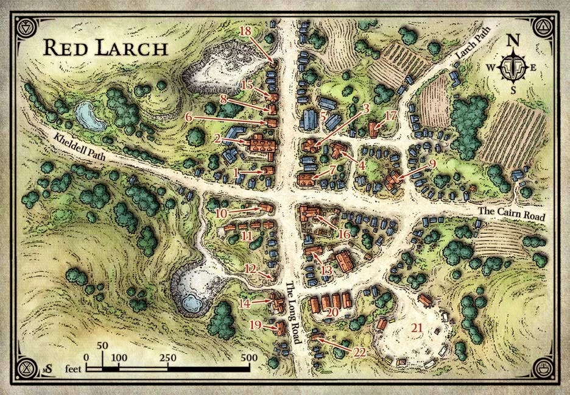
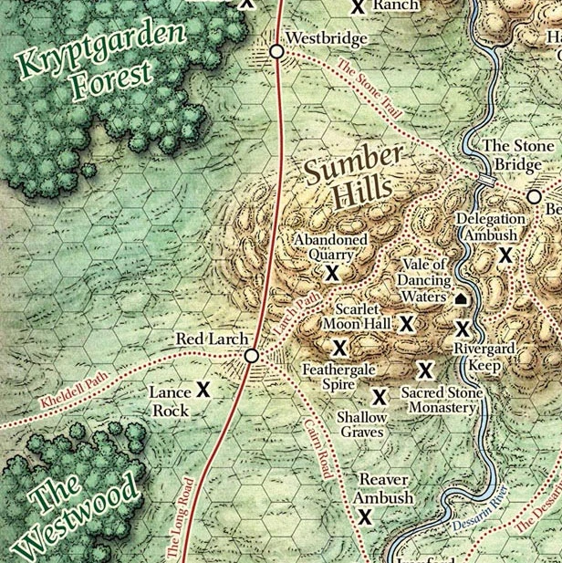
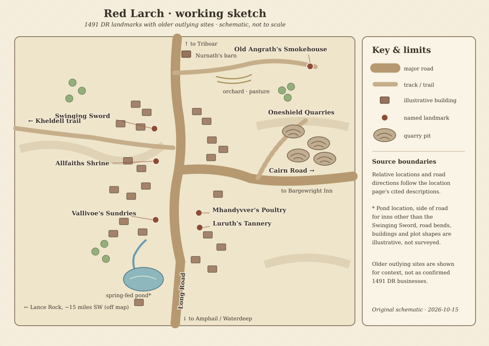

# Red Larch, Faerûn — Collected Research

**Focus:** The fictional settlement of Red Larch in the Dessarin Valley, Forgotten Realms, primarily 1491–1492 DR.  
**Compiled:** 15 October 2026.  
**Source status:** This document collects the user-supplied research and a short summary of their simulation data. It is **not** the completed Deep Research report, which was not available as a file for inclusion.

## How to use this document

- The section **User-supplied town research** below preserves the full text of `README(4).md`. Its book citations often come through the Forgotten Realms Wiki and were not independently checked.
- The **economic simulation** section is explicitly a scenario for 14 Marpenoth 1492 DR, not a canonical census or economic record.
- Map image files are referenced by filename so the links work when the Markdown file is kept alongside the uploaded maps. A Markdown file alone does not embed those image bytes.
- The SVG working sketch is illustrative, not a surveyed map. The published town plan should govern street, water, and building placement in future cartography.

## Supplied maps and drawings

### Town reference image

### Regional reference image

### Working sketch

Official source-map links also appear in the research notes below.

## Selected notes for a 1492 DR town map

The provided research locates Red Larch on a low ridge along the western Dessarin Valley, with the Long Road, the Cairn Road toward Bargewright Inn, and a trail toward Kheldell. The spring-fed pond, eastern quarries, outlying farmsteads, and older historic sites matter for land-use planning. Exact contours, cadastral parcel boundaries, and measured building counts are not supplied. Older-era landmarks should not automatically be labeled as operating in 1492 DR.

The numbered official town map is an important reference, but any numbered business key should be checked against the published adventure before use. The town's hidden chambers, including the Tomb of Moving Stones, are relevant to a separate underground map; they should not be confused with surface-level building plans.

## Economic simulation snapshot (not Forgotten Realms canon)

**Simulation date:** 14 Marpenoth 1492 DR  
**Settlement:** Red Larch  
**Model population:** 1,100 residents (scenario estimate; research notes separately discuss a sourced but year-uncertain figure of 600)  
**Model classification:** small town; Dessarin Valley  
**Main traits:** agrarian, frontier

| Modeled measure | Value |
|---|---:|
| Gross local product per year | 432,751 gp |
| Gross local product per resident per year | 393.4 gp |
| Goods exports per day | 586.2 gp |
| Goods imports per day | 50,588.1 gp |
| Net goods trade balance per day | -50,001.9 gp |
| Visitor receipts per day | 15.0 gp |

The unusually large modeled import gap and demand for exotic goods are **simulation outputs requiring review**, not evidence of historical trade in Red Larch. The complete commodity-level market data remains in `location-red-larch-17914.json`, which is not fully reproduced here because it is over 2 MB.

## Research-source limitation

`Research Red Larch.txt` contains only a status note confirming that Deep Research was started. No completed Deep Research report was available for consolidation. If exported later, it can be added as a separate section with its own verified sources.

---

## User-supplied town research (full original README text)

# Red Larch

[Location index](../../README.md)

**Region:** Dessarin Valley, on its western edge along the Long Road north of Amphail (engine region `Dessarin Valley`, zone `dessarin`)  
**Settlement type:** Village (wiki "town" in older text); waystop, quarrying and craft community  
**Reference period:** 1366 to 1372 DR lore (2nd- and 3rd-edition sources) and a 1491 DR snapshot (5th edition); 1492 DR planning baseline  
**Evidence reviewed:** 2026-10-06  
**Engine ID:** `red_larch`

This entry paraphrases the [Forgotten Realms Wiki article][frwiki] (a secondary
source) and the wiki's articles on Red Larch businesses and people. The
14th-century detail comes mainly from *Volo's Guide to the North* (1993) and
*The North: Guide to the Savage Frontier* (1996), with a few farms from a
3rd-edition *Dragon* #300 (2002) (circa 1372 DR). The late 15th-century detail comes
from *Princes of the Apocalypse* (2015), set in 1491 DR, the closest source to
the 1492 DR baseline. Publications are those the wiki cites; none was
independently consulted.

## Overview

Red Larch is a waystop on the Long Road about seven days' ride north of
Waterdeep, where three trails meet: one to Bargewright Inn, one to Kheldell, and
one into the hills to ruined keeps. It is named for a stand of red larch trees
on its ridge that the first settlers cut down. It is known for crumblecake, a
filling but plain baked loaf. [Source][frwiki], citing *Volo's Guide to the
North*, p. 79, and *The North*, p. 8.

## Geography

- On a low ridge along the western edge of the Dessarin Valley (*Volo's Guide
  to the North*, p. 79). The settlers chose the spot for a spring feeding a
  small pond that could water draft animals (*Princes of the Apocalypse*,
  pp. 19 to 20).
- **Region classification: Dessarin Valley** (kept). The infobox says Savage
  Frontier, the wiki's broad label; the [Dessarin Valley][dv] article lists Red
  Larch among the valley's settlements, founded around 1000 DR alongside Yartar
  and Triboar as Waterdeep expanded (citing *Princes of the Apocalypse* and
  *Storm King's Thunder*). Same reasoning as Amphail (A6).
- Roads and trails: the Long Road (Waterdeep to Red Larch "seven days' ride",
  per the wiki's [Long Road][lr] article); the [Cairn Road][cr] east to
  Bargewright Inn, lined with farms and ranches (*Storm King's Thunder*, p. 77;
  *The North*, p. 8); a trail west to Kheldell, a logging thorp whose only way
  in is that trail.
- Landmarks: Oneshield's four quarries in the hills east of town; Lance Rock,
  a leaning 25-foot monolith of grey granite about 15 miles south-west, said to
  be "unlike any" stone in the region (*Princes of the Apocalypse*, p. 35).
- Engine: road links to Waterdeep (109.7 miles, 5.4 days) and Triboar (51.2
  miles), and a wilderness track to Goldenfields Northeast Junction. There is
  no link to Amphail, which lies between Red Larch and Waterdeep on the Long
  Road (R12, routes phase).

## Population

| Figure | Scope | Year | Source cited by the wiki |
| --- | --- | --- | --- |
| 600 | Village | Unstated; the infobox cites three sources together | *Volo's Guide to the North* (1993), p. 79; *The North* (1996), p. 8; *Princes of the Apocalypse* (2015), pp. 19 to 20 |

The demonym is Red Larcher; the infobox gives Tymora as the religion, and the
Allfaiths Shrine hosts visiting priests of many gods. Around 1366 DR the town
had a militia of about 100 archers, mostly youths (*Volo's Guide to the North*,
p. 80). Which of the three cited books gives 600 is not stated, so the year is
uncertain.

Demographics standard update (2026-10-15): no settlement-level racial or ethnic
breakdown was found in the reviewed Red Larch sources. Runtime demographics
remains `unresearched` with a checked-source note in `faerun/data/demographics.py`.

**Engine:** 1,100 residents, a gazetteer estimate with no reference year or
source. The only sourced figure is 600 (R6, proposed).

## Economy and Trade

The infobox lists no imports or exports. Trade character from the articles:

| Activity | Evidence | Period |
| --- | --- | --- |
| Stone quarrying | Oneshield Quarries: dwarf Jarth Oneshield's dwarven and human workers cut stone in four quarries east of town, guarded by hired mercenaries; high prices, good wages | Circa 1366 DR (*Volo's Guide to the North*, p. 80) |
| Stoneworks | Albaeri Mellikho ran a stoneworks shop with stonecutters | 1491 DR (*Princes of the Apocalypse*, p. 28) |
| Harness-making | Three harness-makers (Alaglath Chansyrl, Sklaen Jhavander, Ogmoth Tarnlar); Chansyrl also made harness for Thelorn's wagons. Chansyrl Fine Harness run by Phaendra Chansyrl | Circa 1366 DR (*Volo's*, p. 80); 1491 DR (*Princes of the Apocalypse*, pp. 24 to 25) |
| Wagon-building | Thelorn's Safe Journeys kept a dozen or more fine wagons at about 150 gp; Waelvur's Wagonworks a rival | Circa 1366 DR (*Volo's*, pp. 80 to 81); 1491 DR (*Princes of the Apocalypse*, pp. 24, 27) |
| Tanning | Luruth's Tannery (tanner Ulhro Luruth) on the Long Road | 1491 DR (*Princes of the Apocalypse*, pp. 21, 28) |
| Poultry and eggs | Mhandyvver's Poultry: turkeys, chickens, ducks, eggs, chicks; later roasted or oil-preserved fowl and pickled eggs. Nurnath's chicken barns north of town | Circa 1366 DR and 1491 DR; barns circa 1372 DR (*Dragon* #300 (2002), p. 84) |
| Cattle and sheep | A cattle market (circa 1366 DR); Indurr Stalnstern's cattle ranch (circa 1372 DR); shepherd Larmon Greenboot (1491 DR) | *Volo's*, p. 79; *Dragon* #300 (2002), p. 84; *Princes of the Apocalypse*, p. 28 |
| Orchards | Mragan Gulther's hornapple orchard north of town | Circa 1372 DR (*Dragon* #300 (2002), p. 84) |
| Smokehouse and remedies | Old Angrath's Smokehouse; Angrath Dree also made and sold potions and ointments from her own herbs | Circa 1372 DR (*Dragon* #300 (2002), pp. 84 to 85) |
| Timber | Kheldell's loggers hauled cut timber to Red Larch for sale | 1365 DR (*Volo's*, pp. 50 to 52, via the [Kheldell][kh] article) |
| Food | Crumblecake: nuts, chickpea mash, roots and greens, turkey and wildfowl scraps baked into a loaf; 1 to 3 cp around 1360 DR; served at the Swinging Sword and Blackbutter Inn in 1489 DR, often from Goldenfields ingredients | *Volo's*, p. 79; *Dragon+* "Travel Talk: The Dessarin River Valley" |
| Markets | A farmers' market and a cattle market | Circa 1366 DR |

These describe trade character, not output volumes or prices.

## Government

- No ruler is named in the infobox. In 1491 DR Harburk Tuthmarillar is the
  village constable (*Princes of the Apocalypse*, p. 26). After the Believers'
  crimes come to light, the butcher Jalessa Ornra is "most likely" chosen as
  mayor (*Princes of the Apocalypse*, p. 29); this depends on adventure events
  and is not a settled 1492 DR fact.
- The Believers, a secret society of some of the wealthiest residents, used
  their ties to steer village business and ruin competitors. In 1491 DR the Cult
  of the Black Earth tried to turn them; three members committed murders, the
  group was exposed and shunned, and some members left town (*Princes of the
  Apocalypse*, pp. 20, 29, 159, via the [Believers][bel] article).
- Defence circa 1366 DR: about 100 archers who trained by guarding
  Mhandyvver's poultry from predators, which kept orc raiders away.

## Notable Inhabitants

From the wiki's [Category: Inhabitants of Red Larch][inh] (61 entries) and
the linked articles, read 2026-10-06. Paraphrased; publications are those the
wiki cites, not independently checked. Nearest to 1492 DR first.

### Late 15th century DR (closest to the 1492 baseline)

All 1491 DR, *Princes of the Apocalypse* unless stated.

| Person | Role | Dated | Source cited by the wiki |
| --- | --- | --- | --- |
| Harburk Tuthmarillar | Constable; also works in his wife's butcher shop | 1491 DR | p. 26 |
| Jalessa Ornra | Butcher; likely chosen mayor after the Believers fall | 1491 DR | pp. 26, 29 |
| Kaylessa Irkell | Runs the Swinging Sword for the Irkell family of Waterdeep | 1491 DR | pp. 22 to 23 |
| Justran Daehl; Garlen Harlathurl | Co-owners of the Helm at Highsun tavern (Daehl secretly of the Cult of the Crushing Wave) | 1491 DR | pp. 21, 24 |
| "Mother" Yalantha Dreen | Innkeeper | 1491 DR | p. 24 |
| Minthra Mhandyvver | Runs Mhandyvver's Poultry with her three children | 1491 DR | p. 27 |
| Phaendra Chansyrl | Harness-maker, Chansyrl Fine Harness | 1491 DR | pp. 24 to 25 |
| Ulhro Luruth | Tanner (Luruth's Tannery); a Believer | 1491 DR | p. 28 |
| Ilmeth Waelvur | Runs Waelvur's Wagonworks; a Believer, rival of Thelorn's | 1491 DR | pp. 24, 27, 159 |
| Stannor Thistlehair | Halfling carpenter at Waelvur's Wagonworks | 1491 DR | p. 24 |
| Albaeri Mellikho | Runs a stoneworks shop with stonecutters; a Believer | 1491 DR | pp. 28, 159 |
| Eldras Tantur | Blacksmith, with his son and daughters | 1491 DR | p. 26 |
| Mangobarl Lorren | Village baker; Zhentarim informant | 1491 DR | pp. 25 to 26 |
| Helvur Tarnlar; Maegla | Clothiers (shared shop); Lords' Alliance contacts | 1491 DR | p. 25 |
| Feng Ironhead | Half-orc owner of Ironhead Arms, a weapons shop opened in 1488 DR | 1488 to 1491 DR | p. 27 |
| Marlandro Gaelkur | Runs Gaelkur's (used tools, barber, small locals' tavern); a Believer | 1491 DR | pp. 28, 159 |
| Endrith Vallivoe | Runs Vallivoe's Sundries (new and used goods); Harper contact | 1491 DR | p. 29 |
| Haeleeya Hanadroum | Runs the village bathhouse; from Amn; Emerald Enclave supporter | 1491 DR | p. 27 |
| Aerego Bethendur | Runs a storage business; a Believer | 1491 DR | p. 28 |
| Elak Dornen | Shopkeeper and informal leader of the Believers | 1491 DR | pp. 26 to 27, 159 |
| Baragustas Harbuckler | Retired carpenter; a Believer | 1491 DR | p. 157 |
| Larmon Greenboot | Shepherd | 1491 DR | pp. 28, 43 |
| Imdarr Relvaunder; Lymmura Auldarhk | Priest of Tempus (secretly Order of the Gauntlet) and acolyte of Sune at the Allfaiths Shrine | 1491 DR | p. 23 |
| Eardon | Wandering priest of Lathander | 1491 DR | p. 23 |
| Ghileeda; Iraun Thelder | Maid and one-eyed mercenary at the Swinging Sword, secretly elemental cultists | 1491 DR | pp. 21, 23 to 24 |
| Larrakh | Priest of the Cult of the Black Earth working on the Believers | 1491 DR | pp. 155, 195 |
| Oreioth | Necromancer hiding near the village | 1491 DR | pp. 151 to 153 |
| Geeraugh; Mougra | Half-ogre and goblin bandits | 1491 DR | pp. 27, 149 |
| Grund; Braelen Hatherhand | Villagers in adventure scenes | 1491 DR | pp. 155 to 156 |

### Mid to late 14th century DR (historical)

| Person | Role | Dated | Source cited by the wiki |
| --- | --- | --- | --- |
| Jarth Oneshield | Dwarf owner of Oneshield Quarries | Circa 1366 DR | *Volo's Guide to the North*, p. 80 |
| Oskler Mhandyvver | Owner of Mhandyvver's Poultry; hired local boys against predators | Circa 1366 DR | *Volo's*, p. 80 |
| Alaglath Chansyrl; Sklaen Jhavander; Ogmoth Tarnlar | Harness-makers (Chansyrl also made wagon harness for Thelorn) | Circa 1366 DR | *Volo's*, p. 80 |
| Thelorn | Former mercenary, owner of Thelorn's Safe Journeys | Circa 1366 DR | *Volo's*, pp. 80 to 81 |
| Dhelosk Quelbeard | Owner of the Blackbutter Inn from about 1365 DR | Circa 1365 DR | *Volo's*, p. 81 |
| Barglun Blackbutter | Founder of the Blackbutter Inn, killed around 1365 DR | Before 1365 DR | *Volo's*, p. 81 |
| Yather Indaglol | Mage, owner of the Helm at Highsun | Circa 1367 DR | *Volo's*, pp. 81, 225 |
| Araldyk | Helmed horror serving as the Helm at Highsun's waiter and bouncer | Circa 1367 DR | *Volo's*, p. 81; *The North*, p. 9 |
| Jhandlatha and Peieyrie Taskaloath | Elderly sorcerer sisters who owned the Swinging Sword | 1370 DR | *Volo's*, p. 82 |
| Angrath Dree | Sorceress, former warrior and Harper ally; ran Old Angrath's Smokehouse and sold her own potions | Circa 1372 DR | *Dragon* #300 (2002), pp. 84 to 85 |
| Nurnath | Farmer with chicken barns (a green-roofed barn is a road landmark) | Circa 1372 DR | *Dragon* #300 (2002), p. 84 |
| Mragan Gulther | Farmer with a hornapple orchard | Circa 1372 DR | *Dragon* #300 (2002), p. 84 |
| Indurr "Warsword" Stalnstern | Retired mercenary turned cattle rancher | Circa 1372 DR | *Dragon* #300 (2002), p. 84 |

### Legendary and loosely tied

| Person | Note |
| --- | --- |
| Omin Dran | Half-elf Masked Lord of Waterdeep and founder of Acquisitions Incorporated (*Acquisitions Incorporated*, 2019); tied through the Dran & Courtier inn |
| Rosie Beestinger; Donaar Blit'zen; K'thriss Drow'b; Walnut Dankgrass; Seizes the Tail | Acquisitions Incorporated "C" Team members and an animal companion, late 15th century DR (*Acquisitions Incorporated*; *Idle Champions* game); Red Larch tie is through the company's inn |
| Belamy and Bryn Lightfingers | Halfling adventurers from a Red Larch clan, late 15th century DR (*Sword Coast Legends* video game, 2015) |

### Families and organizations

The Mhandyvver family (poultry, 1366 and 1491 DR); the Chansyrl family
(harness, 1366 and 1491 DR); the Irkell family of Waterdeep (owners of the
Swinging Sword by 1491 DR); the Taskaloath sisters. Organizations: the
Believers (secret business society, ruined in 1491 DR), Cult of the Black
Earth, Acquisitions Incorporated (Dran & Courtier), and contacts of the
Harpers, Zhentarim, Lords' Alliance, Emerald Enclave and Order of the Gauntlet.

## Businesses

### In the live market (engine `businesses.json`)

None existed before this run. Added 2026-10-06 (R5), each shown operating in
1491 DR by *Princes of the Apocalypse*:

| Business | Type | Offers | Note |
| --- | --- | --- | --- |
| Mhandyvver's Poultry (`mhandyvvers_poultry`) | Poultry shop | Chickens, eggs, fresh meat (basic) | Owners Oskler (1366 DR), Minthra (1491 DR). Chickens stand in for turkeys and ducks; fresh meat for prepared fowl |
| Chansyrl Fine Harness (`chansyrl_fine_harness`) | Harness-maker | Harness (fine), saddle and tack | Founded by Alaglath Chansyrl; run by Phaendra in 1491 DR. Harness is made only by the `tag_harness` industry, so this shop sells imported harness (R15) |
| Thelorn's Safe Journeys (`thelorns_safe_journeys`) | Wagonworks | Wagons (fine), carts | Wagons about 150 gp circa 1366 DR against the engine's 35 gp catalogue price |
| Luruth's Tannery (`luruths_tannery`) | Tannery | Tanned leather | Ulhro Luruth, 1491 DR; no wiki article for the tannery |

Generated addresses ("High Road", "Trade Quarter") are placeholders; Red Larch
is on the Long Road.

### Named in the source, not in the market

| Name | Kind | Operating | Modeled goods it suggests |
| --- | --- | --- | --- |
| Waelvur's Wagonworks | Wagon-builder | 1491 DR | `wagon`, `cart` |
| Albaeri Mellikho's stoneworks | Stonecutters | 1491 DR | `granite`, `bricks` |
| Tantur smithy | Blacksmith | 1491 DR | `tools_carpenter`, `horseshoes` |
| Ironhead Arms | Weapons shop | Opened 1488 DR | `sword`, `axe_battle`, `spear` |
| Lorren's bakery | Baker | 1491 DR | `bread` |
| Ornra's butcher shop | Butcher | 1491 DR | `meat_fresh` |
| Tarnlar clothing shop | Clothier | 1491 DR | Clothing |
| Gaelkur's | Used tools, barber, small tavern | 1491 DR | Tools, ale |
| Vallivoe's Sundries | New and used goods | 1491 DR | General goods |
| Bathhouse (Hanadroum); storage (Bethendur) | Services | 1491 DR | None |
| Swinging Sword | Inn (rooms, dining, drink, baths) | 1370 and 1491 DR | Lodging (no commodity) |
| Helm at Highsun | Tavern | Circa 1367 and 1491 DR | Ale, wine |
| Blackbutter Inn | Inn | Circa 1365 DR; serving crumblecake 1489 DR | Lodging |
| Red Larch Rambler | Family tavern | 2nd edition only | Ale |
| Dran & Courtier | Inn; Acquisitions Incorporated test site | Late 15th century DR (*Acquisitions Incorporated*, pp. 176 to 182) | Lodging |
| Allfaiths Shrine | Wayside shrine staffed by visiting Waterdeep priests | 1491 DR | None |
| Oneshield Quarries | Quarry (four pits) | Circa 1366 DR only | `granite` |
| Old Angrath's Smokehouse | Smokehouse and potion maker | Circa 1372 DR only | `meat_salt` (nearest), `potion_healing` |

## Maps and Village Layout

**Working sketch:** [red-larch-sketch.svg](red-larch-sketch.svg), drawn
2026-10-15 as an original schematic from the relative positions and roads
listed below. It shows the Long Road, the eastbound Cairn Road, the Kheldell
trail, the spring-fed pond, and selected village and outlying landmarks.
Building footprints, street bends, the pond's exact position and distances
within the village are illustrative; there is no survey scale or reliable
building count. The northern barn, orchard, pasture, smokehouse and quarries
come from older sources and are not confirmed to be operating in 1491 DR.
This sketch is not a copy of the published 5th-edition plan.

### Maps

Preferred edition: 2nd. No 2nd-edition village plan was found; the only street
plan is 5th edition. Published images are linked, not stored in the repo. The
wiki has no interactive Map:Red Larch page (HTTP 404, 2026-10-06), so no
marker positions are available.

| Map | Edition and date | Shows | Where |
| --- | --- | --- | --- |
| Red Larch, Halls of the Hunting Axe, Westbridge and Beliard | 2nd edition, *Volo's Guide to the North* (1993), p. 36; circa 1366 DR | Red Larch's position among nearby sites | [File:Hallshuntingaxe.jpg][mapvgn] |
| Dessarin Road | 2nd edition, *The North* (1996) fold-out (excerpt) | Road between Beliard and Bargewright Inn | [File:DessarinRoad.png][mapdroad] |
| Kryptgarden Forest; Leilon | *The Forgotten Realms Atlas* (1999, 2nd-edition era) excerpts | Regional | [File:Kryptgarden Forest2e.jpg][mapkrypt]; [File:Leilon.jpg][mapleilon] |
| Southkrypt Garden | 1st edition, *The Savage Frontier* (1988), Sword Coast North map | Regional | [File:Southkrypt12.JPG][mapsouth] |
| Dessarin River | 3rd-edition map excerpt | Regional | [File:DessarinRiver.jpg][mapdriver] |
| Village plan of Red Larch | 5th edition, *Princes of the Apocalypse* (2015), p. 21; 1491 DR; Mike Schley | Streets and buildings (the article's infobox image) | [File:Red Larch.jpg][mapplan] |
| Red Larch surroundings | 5th edition, *Princes of the Apocalypse*, p. 150 | Area around the village | [File:Red Larch Surroundings.jpg][mapsurr] |
| Dessarin Valley in 1491 DR | 5th edition, *Princes of the Apocalypse*, p. 32 | Valley overview | [File:Dessarin Valley-5e.jpg][mapdv5] |
| Red Larch area; Dessarin Valley; Sumber Hills | 5th edition, *Dragon+* issue 1, "Travel Talk: The Dessarin River Valley" | Regional | [File:Red-larch-5e.jpg][maprl5]; [File:Dessarin Valley Map.jpg][mapdvm]; [File:Sumber Hills-Mike Schley.png][mapsumber] |
| Northwest Faerûn | *Sword Coast Legends* (2015 video game); late 15th century DR | Regional | [File:SCL map Northwest Faerûn.jpeg][mapscl] |

### Layout notes from the text

No marker coordinates exist, so placements below are relative only,
paraphrased from the business and person articles.

| Place | Relative position | Source cited by the wiki |
| --- | --- | --- |
| Swinging Sword; Blackbutter Inn | Each has a covered porch running along the Long Road | *Princes of the Apocalypse*, p. 22; *Volo's*, p. 81 |
| Allfaiths Shrine | West side of the Long Road, south of the Swinging Sword | *Princes of the Apocalypse*, p. 22 |
| Mhandyvver's Poultry | On the Long Road, beside Luruth's Tannery, opposite Vallivoe's Sundries | *Princes of the Apocalypse*, pp. 21, 28 to 29 |
| Nurnath's green-roofed chicken barn | North of town on the Long Road; a cart track turns east here | *Dragon* #300 (2002), p. 84 |
| Gulther orchard and Stalnstern pasture | Either side of that cart track for about a mile | Same |
| Old Angrath's Smokehouse | Hilltop at the end of the cart track, north-east of town, with a signal beacon | *Dragon* #300 (2002), pp. 84 to 85 |
| Oneshield's quarries | Four quarries in the hills east of town | *Volo's*, p. 80 |
| Lance Rock | About 15 miles south-west, a few miles west of the Long Road | *Princes of the Apocalypse*, p. 35 |

## Engine Record

| Field | Value |
| --- | --- |
| Population | 1,100 (gazetteer estimate, no reference year) |
| Wealth / tax / security | 0.85 / 0.04 / 0.6 |
| Port / river | None / no |
| Terrain | Hills |
| Traits | `agrarian`, `frontier` |
| Industries | `quarry` 2, `farm` 2, `craft` 1, `herd` 1, `tan` 1 (added 2026-10-06) |
| Specialties | `granite` 2, `bricks` 1, `wagon` 1, `saddle` 1, `chicken` 1, `eggs` 1 (last four added 2026-10-06) |
| Shortages | None |
| Ruler | Blank |
| Size category | Small town |
| Guilds (inferred) | Farmers' and Millers'; Artisans' |

Observed 2026-10-06 before this run's changes (`get_trade_summary`): gross
local product 322,695 gp a year (293 gp per resident); goods exports 420 gp a
day against imports of 50,627 gp a day; 7,125 gp a day of inbound freight
assigned to no carrier. Leading exports by volume: vegetables (50 a day),
sheep (47), fruit (44), dressed granite (3.6), nuts and dried fruit (2.1),
hemp rope (1.4), leather (1.3). Corn, bricks, marble, raw wool and cotton sit
as uncommitted surplus. The import list is the usual set of unavailable exotic
goods (pineapple, citrus, llama, camel, yak, mammoth, clockwork) at a flat 2.2
a day each. After the changes and `reload_catalog`, leather exports rose to
2.4 a day and gross local product to 323,723 gp a year; other figures were
unchanged in the first quote.

**Live server note (2026-10-06):** this run's `reload_catalog` again moved
Amphail to x 621.7, y 1126 with no neighbours (A12). Its stored position was
passed back through `update_settlement` and its trade resumed. Red Larch kept
its position.

## Discrepancies and Proposed Engine Changes

| # | Issue | Proposal | Status |
| --- | --- | --- | --- |
| R1 | A tannery (1491 DR) and harness-makers (1366 and 1491 DR) are named, but there was no leather industry | Add `tan` 1 | Applied 2026-10-06 |
| R2 | Wagons (Thelorn's Safe Journeys, Waelvur's Wagonworks) and harness are the village's named products | Add specialties `wagon` 1 and `saddle` 1 (saddle and tack is the nearest product made locally) | Applied 2026-10-06 |
| R3 | Poultry and eggs are named products in both eras (Mhandyvver's Poultry; Nurnath's barns) | Add specialties `chicken` 1 and `eggs` 1 | Applied 2026-10-06 |
| R4 | Description was blank | Set description from the sources | Applied 2026-10-06 |
| R5 | No business in the market | Add Mhandyvver's Poultry, Chansyrl Fine Harness, Thelorn's Safe Journeys and Luruth's Tannery (all operating 1491 DR) | Applied 2026-10-06 |
| R6 | Engine 1,100 has no source; the infobox gives 600 (year unclear) | Set 600 with a `populations.py` entry, keeping 1,100 as the comparison; settle which book and year the 600 belongs to first | Proposed |
| R7 | Ruler blank | Set "Constable Harburk Tuthmarillar" (1491 DR), or the mayor if a later source confirms Jalessa Ornra | Proposed |
| R8 | A cattle market (circa 1366 DR) and a cattle ranch (circa 1372 DR) are named | Add `cattle` 1 | Proposed (14th-century evidence only) |
| R9 | Specialty `granite` 2: sources name quarries and a stoneworks but never the stone type, and say Lance Rock's grey granite is unlike local stone. `bricks` 1 and marble output (0.3 a day) have no source | Keep `quarry` 2; review `granite`, `bricks` and the marble yield once the stone type is found | Proposed |
| R10 | A blacksmith (1491 DR) and a weapons shop (1488 DR) operate, with no `smith` industry | Add `smith` 1 if a village smithy is enough evidence; Amphail's smithy was not added | Proposed |
| R11 | Hornapple orchard (circa 1372 DR) | Add `orchard` 1; fruit already comes from `farm` (44 crates a day), so low priority | Proposed |
| R12 | Engine road runs straight to Waterdeep (109.7 miles, 5.4 days); the Long Road passes through Amphail and the source gives seven days' ride. The Cairn Road (to Bargewright Inn) and the Kheldell trail are missing | Routes phase: link Red Larch to Amphail on the Long Road; add Cairn Road when Bargewright Inn exists | Proposed (routes phase) |
| R13 | Further 1491 DR businesses (Waelvur's Wagonworks, Mellikho stoneworks, Tantur smithy, Ironhead Arms, Lorren's bakery, Ornra's butcher, Tarnlar clothier, the Swinging Sword and Helm at Highsun) | Add in a later pass, starting with Waelvur's Wagonworks and the stoneworks | Proposed |
| R14 | Sheep exports of 47 a day against a stock of 15 a tenday; imports about 120 times exports; cotton in a northern hill village; flat 2.2-a-day exotic import need | Review with G13 (exports above stock), W5, W6 and A10 | Proposed (engine-wide) |
| R15 | `harness` is produced only by `tag_harness`, so harness-making towns (Red Larch, Amphail's Eagleshield, Triboar's Othovir) cannot make it | Let `tan` (or `tan` plus `craft`) produce harness, after W4 | Proposed (engine-wide) |
| R16 | Thelorn's wagons cost about 150 gp circa 1366 DR; the engine catalogue wagon is 35 gp | Compare wagon prices in the commodity review | Proposed |

## Proposed New Commodities

| Candidate | Evidence | Producers |
| --- | --- | --- |
| Crumblecake | Red Larch's named food; 1 to 3 cp a loaf around 1360 DR; served at two inns in 1489 DR (*Volo's*, p. 79; *Dragon+* Travel Talk) | `farm`, `craft` (bakers); inputs nuts, chickpeas, vegetables, fowl |
| Smoked meat | Old Angrath's Smokehouse (circa 1372 DR) | `cattle`, `herd`, `hunt`; `meat_salt` is the nearest existing good |
| Turkeys and ducks | Mhandyvver's Poultry (1366 and 1491 DR); also Goldenfields turkeys | `farm`; `chicken` stands in |
| Pickled eggs; poultry preserved in oil | Mhandyvver's Poultry, 1491 DR | `farm` plus salt or oil |
| Hornapples | Gulther orchard (circa 1372 DR); not yet read | `orchard` |

## Lore Follow-ups

1. **Population year.** Find which of *Volo's Guide to the North*, *The North*
   or *Princes of the Apocalypse* gives 600 (R6).
2. **Stone type.** Read *Volo's Guide to the North*, p. 80, or *Princes of the
   Apocalypse*, p. 28, for what Oneshield and Mellikho cut (R9).
3. **After 1491 DR.** The Believers' fall, who governs, and the Acquisitions
   Incorporated "Far Realm" warping event at the Dran & Courtier (its year is
   missing from the wiki text) all bear on the 1492 DR state.
4. **Alaglath Chansyrl.** The person article calls Alaglath "he"; the Red Larch
   article says the shop is run by "her granddaughter". Minor; check.
5. **Kheldell and Bargewright Inn.** Both are missing from the engine and both
   trade with Red Larch (timber; the Cairn Road). Westbridge and Beliard appear
   on the same 2nd-edition map.
6. **Unread shop pages.** Ironhead Arms, Gaelkur's, Vallivoe's Sundries,
   Chansyrl Fine Harness and Luruth's Tannery have no wiki articles (404); the
   detail comes from person articles only.
7. **Runtime lore.** A `red_larch` entry was added to `lore.py` on 2026-10-06.

## Sources

**Directly consulted, secondary:** [Forgotten Realms Wiki: Red Larch][frwiki],
accessed 2026-10-06 through the browser (direct fetch returned no infobox and
the API returned HTTP 402); the business articles Oneshield Quarries,
Mhandyvver's Poultry, Blackbutter Inn, Dran & Courtier, Helm at Highsun, Old
Angrath's Smokehouse, Red Larch Rambler, Swinging Sword, Thelorn's Safe
Journeys, Allfaiths Shrine and Crumblecake; [Category: Inhabitants of Red
Larch][inh] and the linked person articles; [Dessarin Valley][dv], [Long
Road][lr], [Cairn Road][cr], [Believers][bel], [Lance Rock][lance] and
[Kheldell][kh]; and the file pages of the maps listed above. All accessed
2026-10-06.

Publications named above are the wiki's references, not independently checked:
*Volo's Guide to the North* (1993), pp. 36, 50 to 52, 79 to 82, 225; *The
North: Guide to the Savage Frontier* (1996), pp. 8 to 9; *Dragon* #300 (2002),
"Elminster's Guide to the Realms: Old Angrath's Smokehouse", pp. 84 to 85; *Princes of the
Apocalypse* (2015), pp. 17 to 35, 149 to 159, 195, 211; *Storm King's Thunder*
(2016), pp. 77, 106; *Acquisitions Incorporated* (2019), pp. 176 to 207;
*Dragon+* issue 1, "Travel Talk: The Dessarin River Valley"; *Sword Coast
Legends* (2015 video game).

**Engine:** `get_settlement`, `get_trade_summary`, `get_city_directory` (no
directory for Red Larch) and [businesses.json](../../../faerun/data/store/businesses.json),
observed 2026-10-06.

[frwiki]: https://forgottenrealms.fandom.com/wiki/Red_Larch
[dv]: https://forgottenrealms.fandom.com/wiki/Dessarin_Valley
[lr]: https://forgottenrealms.fandom.com/wiki/Long_Road
[cr]: https://forgottenrealms.fandom.com/wiki/Cairn_Road
[bel]: https://forgottenrealms.fandom.com/wiki/Believers
[lance]: https://forgottenrealms.fandom.com/wiki/Lance_Rock
[kh]: https://forgottenrealms.fandom.com/wiki/Kheldell
[inh]: https://forgottenrealms.fandom.com/wiki/Category:Inhabitants_of_Red_Larch
[mapvgn]: https://forgottenrealms.fandom.com/wiki/File:Hallshuntingaxe.jpg
[mapdroad]: https://forgottenrealms.fandom.com/wiki/File:DessarinRoad.png
[mapkrypt]: https://forgottenrealms.fandom.com/wiki/File:Kryptgarden_Forest2e.jpg
[mapleilon]: https://forgottenrealms.fandom.com/wiki/File:Leilon.jpg
[mapsouth]: https://forgottenrealms.fandom.com/wiki/File:Southkrypt12.JPG
[mapdriver]: https://forgottenrealms.fandom.com/wiki/File:DessarinRiver.jpg
[mapplan]: https://forgottenrealms.fandom.com/wiki/File:Red_Larch.jpg
[mapsurr]: https://forgottenrealms.fandom.com/wiki/File:Red_Larch_Surroundings.jpg
[mapdv5]: https://forgottenrealms.fandom.com/wiki/File:Dessarin_Valley-5e.jpg
[maprl5]: https://forgottenrealms.fandom.com/wiki/File:Red-larch-5e.jpg
[mapdvm]: https://forgottenrealms.fandom.com/wiki/File:Dessarin_Valley_Map.jpg
[mapsumber]: https://forgottenrealms.fandom.com/wiki/File:Sumber_Hills-Mike_Schley.png
[mapscl]: https://forgottenrealms.fandom.com/wiki/File:SCL_map_Northwest_Faer%C3%BBn.jpeg
