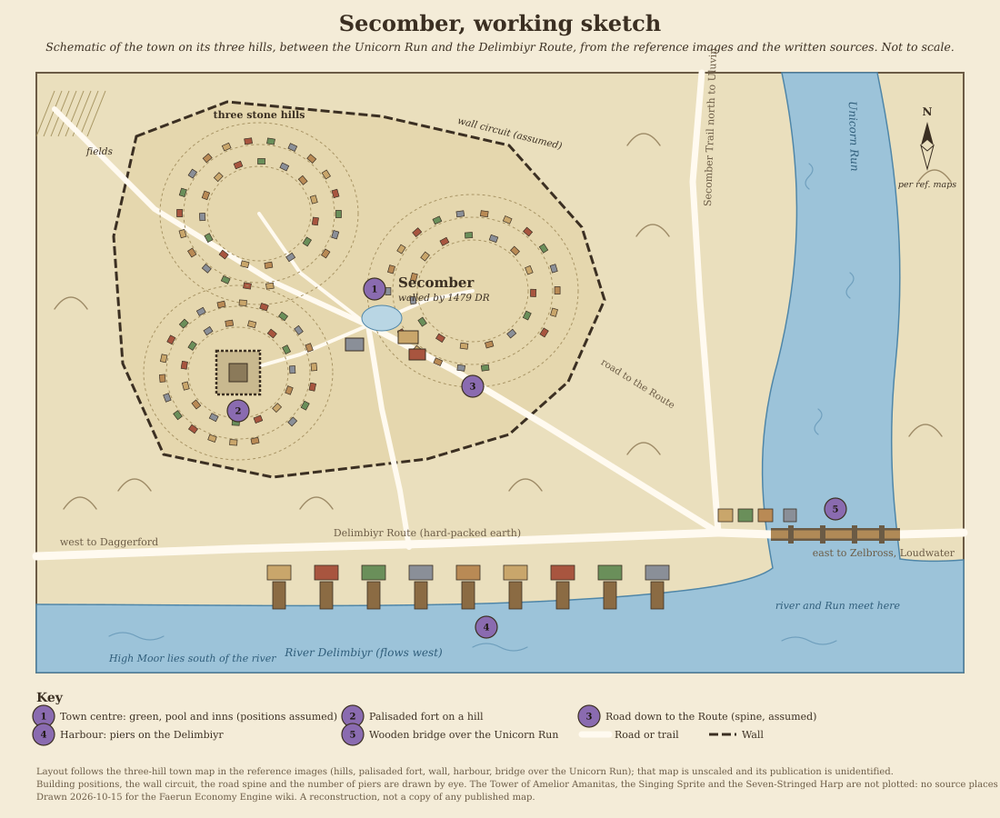

# Secomber

[Location index](../../README.md)

**Region:** Delimbiyr Vale, on the north bank of the River Delimbiyr where the Unicorn Run joins it, with the High Moor to the south (engine region `Delimbiyr Vale` from 2026-10-14, previously `Sword Coast`; zone `waterdeep`)  
**Settlement type:** Small walled town and river stop on the Delimbiyr Route; ruled by a Lord in the 14th century DR  
**Reference period:** 1358 to 1372 DR lore (2nd and 3rd-edition sources); 1479 DR snapshot (4th edition); circa 1491 DR note (5th edition); 1492 DR planning baseline, not verified  
**Evidence reviewed:** 2026-10-14; climate, businesses and people 2026-10-15  
**Engine ID:** `secomber`  
**Structured metadata:** [secomber.json](secomber.json) (identity, periods, engine record, map position, area geography, town-plan layout, reference images, sketch, map and source links; regenerate it when this entry changes)

This entry paraphrases the [Forgotten Realms Wiki article][frwiki] (a secondary
source, read 2026-10-14 through the browser; a direct fetch returned the text
but withheld the infobox and references) and the wiki's person, place, food,
road and map pages linked below. The article draws on 2nd-edition books (*The
Savage Frontier*, 1988; *Volo's Guide to the Sword Coast*, 1994; *The North:
Guide to the Savage Frontier*, 1996), the 3rd-edition *Forgotten Realms Campaign
Setting* (2001) and *Lost Empires of Faerun* (2005), the 4th-edition *Forgotten
Realms Campaign Guide* (2008, set in 1479 DR), *Ed Greenwood Presents
Elminster's Forgotten Realms* (2012) and the 5th-edition *Storm King's Thunder*
(2016) and *Sword Coast Adventurer's Guide* (2015). Publications named below are
the wiki's references and were not independently consulted. Nothing here is
verified for 1492 DR unless stated.

## Overview

Secomber is a small, peaceful town that the wiki describes as the practical
border between the Western Heartlands and the wilder North along the Sword
Coast. It stands on three stone hills where the Unicorn Run meets the River
Delimbiyr, on the western ruins of Hastarl, the ancient capital of Athalantar,
and was settled in 516 DR by halflings of the Delimbiyr Vale and humans of
Delimbiyran. Its people farm, fish and cut stone, and serve the caravans and
adventurers who pass along the Delimbiyr Route or explore the High Moor and the
High Forest. By 1479 DR it lived under constant threat of hobgoblin raids and
paid tribute to the Urshani clan; a later source says the tribute left it
poverty-stricken. [Source][frwiki], citing *The North*, pp. 63, 76; *Forgotten
Realms Campaign Setting* (3rd edition), p. 228; *Lost Empires of Faerun*, p.
138; *Forgotten Realms Campaign Guide*, p. 37; *Storm King's Thunder*, p. 107.

## Geography

- On three stone hills on the north banks of the south-flowing Unicorn Run and
  the west-flowing River Delimbiyr; the High Moor lies directly south. The town
  had a number of colourful gardens (*The North*, p. 63; *Forgotten Realms
  Campaign Setting*, 3rd edition, p. 228).
- Roads: a stop on the Delimbiyr Route (also called the Delimbiyr Road or
  Shining Trail), a hard-packed earth trail about 20 feet wide that follows the
  north bank of the Delimbiyr from Loudwater through Zelbross (about halfway)
  and Secomber to the Trade Way near Julkoun, with a short trail south to
  Daggerford ([Delimbiyr Route][route], citing *The North* "Map of Interior";
  *Forgotten Realms Campaign Setting*, 3rd edition; *Storm King's Thunder*, pp.
  81, 94, 115). The Secomber Trail runs north-west to Uluvin on the Iron Road
  ([Secomber Trail][strail], citing the *Forgotten Realms Interactive Atlas*,
  1999; [Uluvin][uluvin]).
- River: rivermen carried passengers from Daggerford down to Secomber (already
  recorded on the [Daggerford](../daggerford/README.md) page); the Three Crabs
  dish at the Singing Sprite used green river crabs from the Delimbiyr
  (*Volo's Guide to the Sword Coast*, p. 83).
- Nearby: Snowhills Farm (north-west, Klaeverdar family, circa 1370 DR); the
  halfling vineyards north-west of town (sour vinegar); the Moon Mountain
  Brewery, two days north on the Unicorn Run near the High Forest (circa 1372
  DR); Uluvin (Secomber Trail); Zelbross (east, on the Delimbiyr Route);
  Mishka's Warren, lair of the Urshani hobgoblins (1479 DR). None is in the
  engine.
- Engine route map (SE7, 2026-10-15): the existing traced west leg joins the
  Trade Way at the renamed Delimbiyr Route/Trade Way Junction; the saved Trade
  Way and its Daggerford connector already provide a Daggerford–Secomber land
  path (223.8 mapped miles). The traced Secomber–Loudwater (125.3 mapped miles)
  and Loudwater–Llorkh legs now bear the Delimbiyr Route name. These three
  preserved geometries are classified as established `trail` rather than
  `track`; their lengths were not reassigned. The Red Larch connector remains
  separate. Uluvin, Zelbross and a defensible river-course trace are not
  available as saved route anchors; no Secomber Trail or Delimbiyr river lane
  was drawn. The named-route catalog contains older broad routes, including
  a river+portage Delimbiyr entry, but the edited map graph suppresses its
  deleted river legs; that entry does not create a navigable lane.

## Climate

*The North: Guide to the Savage Frontier* (1996), Weather, p. 5 (read directly
on 2026-10-15 from a hosted scan) divides the North into three climates: arctic
beyond the Spine of the World, subarctic from the Spine to Waterdeep (the
majority of the North), and true temperate only from south of Waterdeep, with
the coast as far north as Port Llast warmed by ocean currents. It does not place
Secomber in a band. These are regional figures, not readings specific to
Secomber.

| Season | Conditions (subarctic North) |
| --- | --- |
| Summer | Short and warm, highs up to 80°F / 27°C, humid with warm breezes from the southern seas; rain is usual but hail, sleet and snow are common; cloud cover is almost unbroken; unpredictable, even magical, "wizard weather" occurs near the High Forest |
| Winter (mid Marpenoth to late Tarsakh) | Lows to -30°F / -34°C, highs rarely above 40°F / 4°C; storms off the western ocean drop heavy snow across the midlands; frequent blizzards leave drifts often 10 feet deep that isolate communities; rivers freeze thick enough to carry wagons and draft teams between Uktar and early Ches |

The book describes no separate spring or autumn, so none is shown. Table 1 on
the inside front cover (average temperature by month and region) did not
extract legibly from the scan and was not read.

Local, sourced: the Singing Sprite, a stone inn, is cold and damp in winter and
warmer and damp in summer (*Volo's Guide to the Sword Coast*, 1994, p. 83). The
Unicorn Run is described as a cool, clear river from the High Forest (*Volo's
Guide to the Sword Coast*, p. 79).

Inference, not sourced for Secomber: the town lies inland and, on the engine map
(y 1194.4 against Waterdeep's 1200), level with Waterdeep, so the book's
subarctic description is the closest fit. If the Delimbiyr freezes in the book's
window, river traffic past the town, including the rivermen from Daggerford,
would likely halt or move onto the ice.

The engine shows this under **Climate** on the location page
(`faerun/data/climate.py`, entry `SETTLEMENT_CLIMATES["secomber"]`, added
2026-10-15; the `waterdeep` zone it shares with Waterdeep and Daggerford stays
unresearched). The text is descriptive only. The engine's own climate class for
Secomber is `temperate`; see SE16.

## Population

| Figure | Scope | Year | Source cited by the wiki |
| --- | --- | --- | --- |
| 900 | Town | 1358 DR | *The Savage Frontier* (1988), p. 32 |
| 900 | Town | 1367 DR | *Volo's Guide to the Sword Coast* (1994), p. 79 |
| 900 (about 200 in the village and 700 in surrounding hamlets) | Village and hamlets | Not dated here (*The North* is a 1996 book) | *The North*, p. 63, read directly 2026-10-15 |
| 1,417 | Town | 1372 DR | *Forgotten Realms Campaign Setting*, 3rd edition (2001), p. 228 |
| No figure | Town | 1479 DR and circa 1491 DR | Hobgoblin raids and tribute; impoverished (*Forgotten Realms Campaign Guide*, p. 37; *Storm King's Thunder*, p. 107) |

Humans are the majority, with almost as many halflings (some said halflings
dominated the town), a small group of Ironeater clan dwarves, and a few gnomes
and moon elves (*Volo's Guide to the Sword Coast*, p. 79; *Dragon* #269, p. 84;
*Sword Coast Adventurer's Guide*, p. 88). A Lords' Alliance garrison of about
30 and a militia of over 100 are recorded for 1996 (*The North*, p. 63).

**Illustrative racial share (1492 DR planning scenario, not sourced):** human
49%, halfling 45%, dwarf (including the Ironeater clan) 3%, gnome 2%, moon elf
1%. These sum to 100%, but no source gives numerical shares or confirms this
mix for 1492 DR. The split represents one possible near-even human–halfling
mix, not a measured population; historical descriptions also disagree over which
of the two groups predominated. It is displayed as `estimated_share_pct` in
[demographics.py](../../../faerun/data/demographics.py), not as a sourced
`share_pct`, and has no effect on the economic model.

**Engine:** 1,300 residents, retained as an undated modeled estimate for the
1492 DR planning scenario, not a census or a measured decline. The
[population basis](../../../faerun/data/populations.py) records the historical
900 comparison (including the village/hamlet split), the separate 1,417 in
1372 DR and the lack of a known late-15th-century count without changing
economic demand. See SE4 and SE17.

## Economy and Trade

The article has no infobox import or export list.

| Period | Trade and production | Source cited by the wiki |
| --- | --- | --- |
| 1358 to 1372 DR | Farming, fishing and stone-cutting the main occupations; many locals know the High Forest and hire out as guides or guards for caravans | *The North*, p. 63; *Forgotten Realms Campaign Setting* (3rd edition), p. 228 |
| 1372 DR | Town welcomes and caters to travellers, caravans and adventurers who base themselves there to explore the High Moor and High Forest | *Forgotten Realms Campaign Setting* (3rd edition), p. 228 |
| 1358 to 1396 DR | Stop on the Delimbiyr Route between Waterdeep and Llorkh; Secomber Trail to Uluvin | *The North*, "Map of Interior" |
| Circa 1372 DR | Moon Mountain Ale, the main product of the Moon Mountain Brewery two days north, sold by the keg in Daggerford, Llorkh, Loudwater and Secomber; Moon Rum (distilled from sugar beets) sold in hand kegs only at the brewery or in Secomber | [Moon Mountain Ale][mmale], [Moon Rum][moonrum], citing *Dragon* #299 (2002) |
| Undated (published 2013) | Samril's Fine Blades, a halfling workshop, finished raw blades from the Arthane Furnace in Beliard (sharpened, polished, fitted with grips of local duskwood and blueleaf, leather wraps and copper wire) and sent them to the Arthane Armory in Waterdeep; Gleskur's Finemetals, a dwarf workshop, supplied braided copper wire; local woodcutters such as Maraszymo Darluth cut grip wood in the High Forest | [Samril's Fine Blades][samril], [Gleskur's Finemetals][gleskur], citing Ed Greenwood, "Thaelon Morgyr's Map", *Forging the Realms* (2013) |
| Undated (recipe published 2020) | Halfling vineyards north-west of town make Secomber sour vinegar from unripe dry white grapes; served at the Yawning Portal in Waterdeep | [Secomber sour vinegar][vinegar], citing *Heroes' Feast* (2020) and an Ed Greenwood post (2022) |
| 1479 DR | Constant hobgoblin raids; tribute left at Mishka's Warren | *Forgotten Realms Campaign Guide*, p. 37 |
| Circa 1491 DR | Regular tribute to the hobgoblins had left the town poverty-stricken | *Storm King's Thunder*, p. 107 (the wiki says "twenty years later" than 1479 DR, which does not fit a book set about 1491 DR) |

These describe trade character, not volumes, prices or workforce. No source
read names gems, agate or moonstone, or any mine near Secomber.

## Government

- Circa 1367 DR: Lord Traskar Selarn, a ranger well liked by the townsfolk, who
  kept watch over the town for the Lords' Alliance, intervening only when needed,
  and sent adventurers to unlooted ruins (*The North*, p. 76).
- Justice (described in 2012, no year): Secomber's laws, based on Waterdeep's
  without the "crimes against Lords", were a model for most Western Heartlands
  settlements. Six to nine Rods of Justice, respected elders elected every four
  years, preside; each case has a jury of nine landowners drawn by lot; trials
  are public, fines unpaid are taken from property or worked off, and appeals
  give way to informal retrials on new evidence. Civic bylaws carry fines
  (*Ed Greenwood Presents Elminster's Forgotten Realms*, pp. 53 to 54, 56).
- Defence: a palisaded fort on one hill held about 30 Lords' Alliance soldiers,
  and the militia numbered over 100 (*The North*, p. 63). By 1479 DR the town had
  a wall (*Forgotten Realms Campaign Guide*, p. 37).
- No ruler is named for the late 15th century DR.

## Notable Inhabitants

From the wiki's [Category: Inhabitants of Secomber][inh] (17 pages, all read
2026-10-14) with related place and food pages. Paraphrased; sources are those
the wiki cites, not independently checked. Nearest to 1492 DR first.

### Undated or late 15th century DR (closest to the 1492 baseline)

| Person | Role | Dated | Source cited by the wiki |
| --- | --- | --- | --- |
| Maraszymo Darluth | Woodcutter in the High Forest, reliable and cheap supplier of raw lumber; sold duskwood and blueleaf to Samril's Fine Blades | Undated (published 2013) | "Thaelon Morgyr's Map", *Forging the Realms* (2013) |
| Andannas Dalkur | Native of Secomber who moved to Tharsult and then Candlekeep; killed and impersonated before 1487 DR | Before 1487 DR (no longer in Secomber) | *The Herald* (2014), page not given |
| Ganather | Resident who acted as a lure to help Elminster capture the Sword of Savras and died doing so | Circa 1454 DR | "Eye on the Realms: The Sword of Spells" (2012) |

### 14th century DR (historical)

| Person | Role | Dated | Source cited by the wiki |
| --- | --- | --- | --- |
| Traskar Selarn | Lord of Secomber, ranger, keeps watch for the Lords' Alliance | Circa 1367 DR | *The North*, p. 76 |
| Amelior Amanitas | Sage of Secomber, alchemist, former priest of Mystra; his tower is a town landmark | Circa 1358 DR onward | *The North*, p. 76; *Gateway to the Savage Frontier* (video game, 1358 DR) |
| Keldeln Klaeverdar | Farmer heading a Klaeverdar branch at Snowhills Farm north-west of town | Circa 1370 DR | *Secrets of the Magister* (2000), pp. 80 to 81 |
| Oblar Minstrelwish | Halfling adventurer and brewmaster of the Moon Mountain Brewery | Circa 1372 DR | *Dragon* #299 (2002) |
| Rundkrist Tolstone | Gnome painter, plasterer and carpenter; retired adventurer (Masters of Monsters) | After 1345 DR | *Dragon*, "The New Adventures of Volo: The Ardeep" (2000) |
| Skimmerhorn | Explorer who reported illithid signs in the Endless Caverns of the High Forest | Circa 1358 DR | *The Savage Frontier*, p. 52 |
| Jhastar Belnold | Human ranger of the Secomber area who drove off sport hunters and careless woodcutters | Circa 1360s DR (not checked) | *Dragon* #168, "Harpers Bold" (1991) |
| Loren Kenither | Sage | Circa 1360s DR (not checked) | *Dungeon*, "A Wizard's Fate" (1992) |
| Agwain | Baron of Secomber, cavalier who kidnapped Bronwyn Daggerford | Circa 1347 DR | *Under Illefarn* (1987), pp. 29, 31 |
| Heverseer Windfeather and three brothers | Gnome innkeepers of the Singing Sprite, working in shifts; their family owns it | 1367 DR | *Volo's Guide to the Sword Coast*, pp. 83 to 85; *The North*, p. 64 (read directly 2026-10-15) |
| Ganatharas; Lathiril Shrune | Human wizard who built the Singing Sprite; his sprite wife, long dead, who sang atop its tables | Long before 1367 DR | *Volo's Guide to the Sword Coast*, p. 83; *The North*, p. 64 |
| Talanthe Truesilver | Half-elven bard who first sang the Ballad of the Dream Weaver at the Stag (now the Seven-Stringed Harp) | About 40 winters before 1367 DR | *Volo's Guide to the Sword Coast*, p. 82 |
| Nindil Jalbuck | Lightfoot halfling, formerly of Secomber; grocer in Waterdeep | Died 1371 DR | *City of Splendors: Waterdeep* (2005), pp. 54, 75 |
| Marcus | Half-elf, former priest of Chauntea in Secomber; later a potter and ducal agent in Daggerford | 14th century DR | *The North*, Daggerford chapter |
| Allessia Faithhammer | Adventurer and follower of Helm from Secomber | Circa 1370s DR (not checked) | *Baldur's Gate: Dark Alliance II* (video game only) |

The Windfeather, Ganatharas and Lathiril Shrune, and Talanthe Truesilver rows come
from the two books read directly (the wiki's Inhabitants category was not
rechecked for them) and are the people modeled in the Singing Sprite and
Seven-Stringed Harp records.

### Legendary and loosely tied

| Person | Note |
| --- | --- |
| Erek | Bodyguard listed under Secomber but whose home is Silverymoon (*The Savage Frontier*; *Gateway to the Savage Frontier*); tie not checked |

### Families and organizations

The Rods of Justice (elected judges); the Lords' Alliance garrison and the town
militia (1996); the Klaeverdar family of Snowhills Farm (circa 1370 DR); the
Samril halfling family (Samril's Fine Blades); the Ironeater dwarf clan; the
Urshani hobgoblin clan of Mishka's Warren (1479 DR). Linked to the Moon Mountain
Brewery: its owners Yarimmur Borulglar, Kelter and Nurvala Minstrelwish, and a
Zhentarim (Black Network) contact, Tarth Brallowgath (circa 1372 DR, *Dragon*
#299). Sources as above.

## Businesses

### In the live market (engine `businesses.json`)

Added 2026-10-15 at the user's request. The two inns come from *Volo's Guide to
the Sword Coast* (1994, set 1367 DR) and *The North* (1996), both read directly;
the two workshops come from the Forgotten Realms Wiki pages and are undated
(published 2013). The inns are 14th century houses and the workshops have no
date; operation in 1492 DR is not verified for any of them, and each description
says so. The two workshops were added after the research package
[secomber-economy-engine-research.json](secomber-economy-engine-research.json)
recommended recording them as historical or undated (SE10).

| Business | Kind | People | Offers (quality) | Staff |
| --- | --- | --- | --- | --- |
| `singing_sprite` (Singing Sprite) | Stone inn facing the Harp; meeting rooms, a copper bathtub in every room, a dining room that never closes | Gnome Windfeather family: Heverseer Windfeather or one of his three brothers is innkeeper on duty; builder the human wizard Ganatharas, named for his late sprite wife Lathiril Shrune | `ale`, `mead`, `wine_common`, `bread`, `meat_fresh`, `fish_fresh` (river crabs), `cheese` | 10: Manager 5 x1 (Heverseer), Manager 3 x3 (his brothers), Artisan 2 x4 (cooks, servers; assumed), Laborer 2 x2 (assumed) |
| `samrils_fine_blades` (Samril's Fine Blades) | Halfling workshop finishing raw blades from the Arthane Furnace in Beliard (sharpening, polishing, duskwood and blueleaf grips, leather wraps, copper wire) for the Arthane Armory in Waterdeep | Halfling Samril family; woodcutters such as Maraszymo Darluth supply grip wood | `sword` (`fine`) | 5: Manager 5 x1, Artisan 3 x3, Laborer 2 x1 (all assumed) |
| `gleskurs_finemetals` (Gleskur's Finemetals of Secomber) | Dwarf metal workshop supplying braided copper wire for sword grips and fine metalwork | Named for Gleskur; no individual is described | None (copper wire is not a commodity; service `braided copper wire`) | 4: Manager 5 x1, Blacksmith 3 x2, Laborer 2 x1 (all assumed) |
| `seven_stringed_harp` (Seven-Stringed Harp) | Ramshackle tavern beside the horse pond; bards play for free; where the Ballad of the Dream Weaver was first heard | Owner not named; young would-be harpists serve; the bard Talanthe Truesilver sang the Ballad here about 40 winters before 1367 DR, when it was called the Stag | `ale`, `wine_common`, `bread` (biscuits), `fish_salt` (small fish), `cheese` | 7: Manager 5 x1, Manager 3 x1, Artisan 2 x4, Laborer 2 x1 (all assumed) |

Prices in the sources (not modeled; both price modifiers stay 1.0): Sprite rooms
10 to 17 gp a night with baths, mending and stabling, ale 6 cp a tankard, mead,
milk and wine 2 gp a tallglass, platters and stew bowls 7 gp including two
drinks; Harp ale 3 cp a tankard, stout 5 cp, minty white wine 6 cp a tallglass,
plates 1 sp. Lodging is not modeled. The offers are inferred from the menus:
there is no snail, mushroom, milk or stout commodity, river crabs stand in as
`fish_fresh`, and flatbread and biscuits as `bread`. Both houses use the default
10 ability scores and invented zip codes in the engine's FA-48-nnn pattern;
their street and district
names ("Pond crossing", "The Bowl") are taken from the descriptions of the
horse pond and the bowl between the hills, not from a published address. All
offers were checked against `commodities.json`. The staff counts beyond the four
Windfeather brothers are assumed, not sourced, and the four houses add capacity
that was not in the model before (no double count: no earlier Secomber business
existed). `get_city_directory` reports no historical directory for Secomber
(it covers Waterdeep only).

### Named in the source, not in the market

Operation in 1492 DR is not verified for any of these. The Singing Sprite, the
Seven-Stringed Harp, Samril's Fine Blades and Gleskur's Finemetals are now in the
market (above).

| Name | Kind | Dated | Modeled goods it suggests |
| --- | --- | --- | --- |
| Tower of Amelior Amanitas | Home of the alchemist and sage | Circa 1358 to 1367 DR | Services only |
| Snowhills Farm | Klaeverdar family farm north-west of town | Circa 1370 DR | `farm` (already present) |
| Halfling vineyards | Vineyards north-west of town making sour vinegar | Undated (published 2020 and 2022) | `vint`; vinegar is not a commodity |
| The Dancing Dwarf | Satirical chapbook, popular in Secomber and, in the late 15th century DR, in Waterdeep | Late 15th century DR (*So Saith Ed*, 2006) | `book` stands in |
| Moon Mountain Brewery (outside town, two days north) | Halfling brewery and distillery: Moon Mountain Ale, Moon Mountain Dark, Moon Rum, moonslake cider, barrels | Circa 1372 DR | `ale`, `brew`, `distill`; see SE9 |

Linked suppliers outside Secomber named on the same 2013 merchants' map:
Anastur's Abrasives (Llorkh), House of Yarthin whetstones, Falthryn and
Daughters Tannery, Sorkryn's Soft Hides (Scornubel), Galdegut's Boneyard, the
Arthane Furnace (Beliard) and the Arthane Armory (Waterdeep).

## Maps and Village Layout

### Maps

Preferred edition: 2nd. No 2nd-edition town plan was found on the wiki; the
article's only image is a 4th-edition area map, and there is no interactive
Map:Secomber page (checked 2026-10-14). The 2nd-edition "Map of Interior" poster
in *The North* (1996) shows Secomber on the Delimbiyr Route and Secomber Trail
(cited by the article) but was not viewed. Published images are linked, not
stored in the repo, except the reference images listed below. From [Category: Maps of Secomber][mapcat]:

| Map | Edition and date | Shows | Where |
| --- | --- | --- | --- |
| Secomber and surrounding area | 4th edition era; 1479 DR (caption); publication not identified | Town and area | [File:Secomber.jpg][mapsec] |
| Unicorn Run, from *The North* | Probably 2nd edition (1996), from the file name; not checked | Unicorn Run to its meeting with the Delimbiyr at Secomber | [File:UnicornRun-TheNorth.png][mapurnorth] |
| Unicorn Run | Edition not checked | River | [File:UnicornRun.jpg][mapur] |
| Delimbiyr Route highlighted | Edition not checked | Route from the Trade Way to Loudwater | [File:DelimbiyrRoute.PNG][maproute] |
| Delimbiyr Vale | 5th edition; *Scourge of the Sword Coast*, p. 10, circa 1485 DR (per the [Daggerford](../daggerford/README.md) page) | Vale from Daggerford eastward | [File:DelimbiyrVale.png][mapvale] |
| High Moor in 1479 DR | 4th edition era | Moor south of the town | [File:High Moor.jpg][mapmoor] |
| Moon Mountain Brewery, approximate location | 3rd edition era; *Dragon* #299 (2002), circa 1372 DR | Brewery north of Secomber | [File:MoonMountainBrewery-map.png][mapmmb] |
| Lost Princess Road, Unicorn Run section | Circa 1370 DR; source not read | Portal sites | [File:LostPrincessRoad-UnicornRun.png][maplpr] |
| Forlorn Hills; Firehammer Hold; Zelbross; Daggerford; Dessarin River | Editions not checked | Neighbouring areas in which Secomber appears | [Forlorn Hills][mapforlorn], [Firehammer Hold][mapfire], [Zelbross][mapzel], [Daggerford][mapdag], [Dessarin River][mapdess] |
| Northwest Faerun | *Sword Coast Legends* (video game, 2015) | Region | [File:SCL map Northwest Faerun][mapscl] |

No marker coordinates exist. Layout facts from the written sources: three stone
hills, a palisaded fort on one hill, a wall by 1479 DR, gardens, the Tower of
Amelior Amanitas, the Singing Sprite and the Seven-Stringed Harp.

**Reference images in this folder**, in [reference_maps/](reference_maps/) (added
2026-10-15):
[caa1e0862716ef40c7b66b7c3409eff2.png](reference_maps/caa1e0862716ef40c7b66b7c3409eff2.png),
[9966bc80353646297704ac0f85c03cc0.png](reference_maps/9966bc80353646297704ac0f85c03cc0.png) and
[OIP(1).webp](<reference_maps/OIP(1).webp>) are the same three-hill town plan (the
likely File:Secomber.jpg above; unscaled, compass north up, probably 4th-edition
era; authorship not verified) in parchment, green-wash and small versions. It is
the primary reference for the sketch.
[240201 - secomber - 23 - secomber.jpg](<reference_maps/240201 - secomber - 23 - secomber.jpg>)
is a hand-drawn grid-paper map of a larger town (marked not to scale). Its labels
(Skipper's Ave, Rumble Market, The Dip, Winterstay, Goodhill, Lord's Hill,
Harbour Hill, the Flanks) match the section headings of the NineLizards fan
page [Secomber (II)][nine] (a campaign text its author says was written about
1992), so it is probably from that fan project; the match is by labels, not by
a published credit. [ca156e05bab08b559a9ff518b5e5674b.jpg](reference_maps/ca156e05bab08b559a9ff518b5e5674b.jpg)
is a numbered digital map (nine sites, no legend) of unidentified origin. Neither
is canon and neither is merged with the three-hill plan. District names such as
High Hill, Goodhill, Lord's Hill, the Green, the Flanks and the Harbour come
from these alternate maps and are not confirmed labels for the three-hill plan.
The NineLizards page's own population and race shares (about 300 in the town,
800 in hamlets, 45% human, 40% halfling) are fan material and were not used.

[generated_maps/](generated_maps/) holds ten AI-generated Secomber map plates and
scenes kept for visual comparison only. They are illustrative, not evidence: their
250-ft grid, 50-ft contours, stone bridge, oversized port, signs, plots and tall
buildings are invented, and nothing from them enters the market records. The
engine has `port` null and `river` true, so illustrated wharves do not make
Secomber a port.

**Wall status by period:** a palisaded hill fort is recorded for the 14th
century and a wall by 1479 DR. A later claim that the walls were removed has not
been read in its source, so the wall in 1492 DR is unresolved; the sketch draws
the 1479 DR wall as assumed.

**Working sketch:** [secomber-sketch.svg](secomber-sketch.svg), drawn
2026-10-15, one schematic panel; not a copy of a published map. It follows the
three-hill plan: three stone hills as contour rings with house markers, the
palisaded fort on the south-west hill, the wall round the hills, the pool and
inns where the hills meet, the Delimbiyr Route along the north bank (Daggerford
west, Zelbross and Loudwater east over a wooden bridge across the Unicorn Run),
the Secomber Trail north to Uluvin, and piers along the Delimbiyr. The wall
circuit, building positions, road spine and number of piers are assumed; the
Tower of Amelior Amanitas, Singing Sprite and Seven-Stringed Harp are not
plotted because no source places them. North is taken from the reference
compass.

## Engine Record

| Field | Value |
| --- | --- |
| Population | 1,300 (gazetteer estimate, no year) |
| Wealth / tax / security | 0.85 / 0.04 / 0.55 |
| Port / river | None / yes |
| Terrain | Hills |
| Position | x 848, y 1194.4 (stored and `coords.json` control point agree) |
| Region / zone | `Delimbiyr Vale` (set 2026-10-14; was `Sword Coast`) / `waterdeep` |
| Traits | `frontier`, `arcane` (`mining` removed 2026-10-15) |
| Industries | `fish` 1, `farm` 1, `craft` 1, `quarry` 1 (`mine_gem` removed 2026-10-15) |
| Specialties | None (`gem_agate` and `gem_moonstone` removed 2026-10-15) |
| Shortages | None |
| Ruler | Blank |
| Businesses | `singing_sprite` and `seven_stringed_harp` (added 2026-10-15) |
| Climate | Class `temperate` (model); sourced description from *The North* (subarctic), shown under Climate on the location page |
| Size category | Small town |
| Guilds (inferred) | Recompute after removing `mine_gem`; no guild inferred from that industry remains |

Observed 2026-10-14 before this run's changes (`get_trade_summary`): gross local
product 850.8 gp a day (about 239 gp per resident a year); goods exports 247.9
gp a day against imports of 59,799 gp a day (about 241 times); 10,132 gp a day of
inbound freight assigned to no carrier. Leading exports by volume are vegetables
(43.6 crates a day), fruit (39.7 crates), tea and herbal infusions (18.3 pounds)
and nuts and dried fruit (1.9 sacks); fresh fish shows 6.65 barrels a day of
surplus. Cotton (0.7 bales a day) and iron ore (0.33 loads) are in surplus with
no `textile` or `mine_iron`. Gem output is small: agate and quartz 1.1 stones a
day, moonstone 0.33, with traces of diamond, emerald and ruby. The import list
is led by unavailable goods (pineapple, pears, citrus, longship, llama, yak,
clockwork mechanism, duergar grey ale, deep rothe cheese) each with a flat
2.6-a-day need.

After this run's changes: gross local product 1,013.6 gp a day (about 285 gp per
resident a year), exports 296.5 gp a day, imports 59,795 gp a day; the new
`quarry` 1 yields about 0.18 marble blocks a day of surplus. Fruit and vegetable
exports also rose (47.2 and 52.6 crates a day) and visitor receipts of 13.1 gp a
day appeared; these were not traced to the change and may reflect the region
relabel or recalculation.

SE13 follow-up (2026-10-15, default expanded-requirements model): the 2.6/day
fallback had also ordered war galleys and trade galleons for households. Those
two actual imports alone cost 52,416 gp/day at producer-gate prices; they had no
explicit replacement or construction demand. Excluding ship hulls from the
unmodeled-consumption fallback, while retaining explicit fishing-boat
replacement, yields about 7,376 gp/day of imports against 269 gp/day of exports
in a fresh calculation. These figures are model outputs, not historical trade
volumes; other 2.6/day orders (for example flying carpets), estimated farm/herb
production and common rocky-hill ore remain open for separate evidence-based
review. Cotton has modeled capacity but no shipped export in the current run.

## Discrepancies and Proposed Engine Changes

| # | Issue | Proposal | Status |
| --- | --- | --- | --- |
| SE1 | Stone-cutting is one of the three main occupations (*The North*, p. 63; *Forgotten Realms Campaign Setting*, 3rd edition, p. 228); no quarry industry | Add `quarry` 1 | Applied 2026-10-14 |
| SE2 | Description was blank | Set description from the sources (three hills at the Delimbiyr and Unicorn Run, Hastarl ruins, Delimbiyr Route and Secomber Trail, farming, fishing, stone-cutting, guides, Rods of Justice, garrison, hobgoblin tribute) | Applied 2026-10-14 |
| SE3 | Region `Sword Coast`; wiki place and road pages place Secomber in the Delimbiyr Vale (Delimbiyr Route article; Gleskur's Finemetals and Maraszymo Darluth pages), and Daggerford, Loudwater and Llorkh already use `Delimbiyr Vale` | Set region `Delimbiyr Vale`; zone unchanged | Applied 2026-10-14 |
| SE4 | Engine 1,300 had no year or evidence; sources give 900 (1358 and 1367 DR) and 1,417 (1372 DR), while no late-15th-century count is known | Keep 1,300 as an explicitly undated engine estimate for the 1492 DR planning scenario; record the dated 900 (including the 200 village/700 hamlets split) and 1,417 separately in the population report. This is not a measured decline. | Applied 2026-10-15 (provenance only; economic population unchanged) |
| SE5 | Ruler blank; Lord Traskar Selarn is recorded circa 1367 DR only | Set ruler to "Lord Traskar Selarn (circa 1367 DR)" or leave blank until a late 15th century ruler is found | Proposed |
| SE6 | `mine_gem` 2, specialties `gem_agate` 2 and `gem_moonstone` 1, trait `mining` and the inferred guild lacked Secomber evidence; stone-cutting has separate `quarry` 1 | Removed the unsupported gem industry, both specialties and `mining` trait while retaining `quarry`. This removes local gem production, not access to imported gems; no claim is made that mining is impossible. | Applied 2026-10-15 |
| SE7 | Saved map legs west to the Trade Way, east to Loudwater and on to Llorkh were mislabelled "The Black Road" and classified as wilderness tracks; the catalog's river entry has deleted map legs. The Delimbiyr Route follows the north bank; Uluvin and Zelbross are not saved settlements | Renamed the three existing traced legs to the Delimbiyr Route, classified them as trails without changing geometry, and renamed/repaired the Trade Way junction; the existing Daggerford connector supplies the western path. No ungrounded Zelbross/Uluvin stops or Delimbiyr river trace added; Secomber Trail and D12 lane await anchored geometry and navigability evidence | Partially applied 2026-10-15 (mapped road connections; river and missing stops blocked) |
| SE8 | Hobgoblin raids and tribute by 1479 DR and poverty by circa 1491 DR (*Forgotten Realms Campaign Guide*, p. 37; *Storm King's Thunder*, p. 107) | Record the dated disruption in runtime lore and this wiki, without changing prices, wealth, security or production; no tribute amount or calibrated 1492 effect is known. A quantitative model remains a separate proposal. | Applied 2026-10-15 (qualitative only, per user choice) |
| SE9 | Moon Mountain Brewery, two days north, sold ale by the keg in Secomber and Moon Rum only there (circa 1372 DR, *Dragon* #299); Secomber has no `brew` and no ale supplier | Add the brewery as a production site or settlement north of Secomber (with `brew` and `distill`), or a business supplying Secomber, once a source shows it operating near 1492 DR | Proposed |
| SE10 | Samril's Fine Blades and Gleskur's Finemetals are named workshops (undated, 2013) | Added as undated historical businesses `samrils_fine_blades` and `gleskurs_finemetals` (1492 DR operation unverified); a `weapon` specialty is still not added | Applied 2026-10-15 (business records; specialty proposed) |
| SE11 | Halfling vineyards north-west of town (sour vinegar; 2020 and 2022 sources, undated) | Add `vint` 1 if a dated source confirms the vineyards | Proposed (low confidence) |
| SE12 | The Singing Sprite and the Seven-Stringed Harp (1367 and 1396 DR) and adventurer and caravan custom | Added both as businesses with the Windfeather innkeepers, assumed staff and the 1492 DR caveat; a late source is still wanted, and lodging and caravan custom remain unmodeled | Applied 2026-10-15 (user request; 1492 DR unverified) |
| SE13 | Baseline: 59,795 gp/day imports against 296.5 exports. The generic final-use fallback ordered 2.6 **ships of each type per day** for Secomber, including 2.6 war galleys and 2.6 trade galleons actually imported (52,416 gp/day at producer-gate prices); this is not a supported household use. Separate 2.6/day fallback needs remain for other goods, including flying carpets and unavailable foods/animals. Tea and fruit are inferred from shared herb/farm acreage despite no `herb`/`orchard`; `cotton` lists `farm` as producer but has no inferred raw floor, and the iron-ore floor assumes common iron in rocky hills without `mine_iron`. | Ship-hull fallback excluded; explicit fishing-boat replacement demand retained. No blanket deletion of the remaining fallback or changes to inferred acreage/mining without a justified model rule. Review residual demand and extraction with W5, W6, Y12, N5, N6, D18, A10. | Partial engine fix 2026-10-15; residual open |
| SE14 | Engine position x 848, y 1194.4 is about 161 miles from Daggerford (x 703.7, y 1266.2) by straight line; Zelbross should lie about halfway between Secomber and Loudwater | Check the position against the 2nd-edition "Map of Interior" and the 5th-edition Delimbiyr Vale map | Proposed (map) |
| SE15 | `reload_catalog` after this run moved Amphail again (A12, twelfth time; x 621.7, y 1126, no neighbours); Secomber unaffected because its stored position equals its control point | Restored Amphail by hand to x 648.5289, y 1161.7169; decide L12 | Historical observation; local fix validated 2026-10-15, live server pending |
| SE16 | The North puts the inland area from the Spine of the World to Waterdeep in a subarctic climate (rivers frozen Uktar to early Ches, winters mid Marpenoth to late Tarsakh), but the model's class for Secomber is `temperate`; Secomber's position relative to the band is an inference | Review whether Secomber, Loudwater and Llorkh should carry a `cold` trait (the class selects seasonal production calendars); no change without a model rule, and the Daggerford end of the vale may be temperate | Proposed |
| SE17 | *The North* gives 900 as about 200 in the village and 700 in surrounding hamlets; the engine's 1,300 is one number for the settlement | Keep SE4 for the total; record the village and hamlet split if the model gains a hinterland | Proposed |
| SE18 | No Secomber person records exist beyond business staff; Lord Traskar Selarn, Amelior Amanitas and Keldeln Klaeverdar have no business or office | Model them only if a late 15th century source and a model slot (ruler, sage, farm) exist | Proposed |

## Proposed New Commodities

| Candidate | Evidence | Producers |
| --- | --- | --- |
| Rum (beet rum) | Moon Rum, distilled from sugar beets, sold only at the Moon Mountain Brewery and in Secomber (circa 1372 DR, *Dragon* #299) | `distill` |
| Cider (existing candidate) | Moonslake, Moon Mountain's apple cider mixed with water and mint, popular in Waterdeep in the early 1370s DR (*Dragon* #299) | `brew`, `orchard` |
| Vinegar | Secomber sour vinegar from halfling vineyards (*Heroes' Feast*, 2020) | `vint` |
| Copper wire | Gleskur's Finemetals' braided copper wire for sword grips (2013) | `smith` |
| Abrasive polish; whetstones | Anastur's Abrasives (Llorkh) and House of Yarthin whetstones used by Samril's Fine Blades (2013) | `quarry`, `mine_iron` |
| Crabs and eels (existing candidate) | Green river crabs from the Delimbiyr in the Singing Sprite's Three Crabs (*Volo's Guide to the Sword Coast*, p. 83) | `fish` |
| Chapbooks | *The Dancing Dwarf*, a periodical sold in Secomber and Waterdeep (late 15th century DR, *So Saith Ed*, 2006); `book` stands in | `paper`, `craft` |

## Lore Follow-ups

1. **Late 15th century state.** Read *Storm King's Thunder*, p. 107, and the
   *Forgotten Realms Campaign Guide*, p. 37, for the 1479 to 1491 DR town: wall,
   tribute, poverty, population and ruler (SE4, SE5, SE8). The wiki's "twenty
   years later" does not match a book set about 1491 DR.
2. **2nd-edition town plan.** The text of *Volo's Guide to the Sword Coast*, pp.
   79 to 85, and *The North*, pp. 63 to 64, was read on 2026-10-15 and refers to
   no town plan; the scans' images were not inspected. Identify the source of
   File:Secomber.jpg (1479 DR) and of the other reference images in this folder.
3. **Gems.** Whether any source names gem or agate workings near Secomber or in
   the High Moor (SE6).
4. **Moon Mountain Brewery.** Whether it still operated near 1492 DR and its
   distance on the engine map (SE9); its Zhentarim link (circa 1372 DR).
5. **Merchants' map date.** The in-world date of "Thaelon Morgyr's Map" (2013),
   which decides SE10 and the linked Beliard and Llorkh suppliers.
6. **Uluvin and Zelbross.** Uluvin was destroyed in 1373 DR, refounded before
   1491 DR and sacked by hill giants around 1491 DR (*Storm King's Thunder*, pp.
   74, 112); Zelbross was a hamlet of 120 exporting pottery and pipes circa
   1365 DR. Neither is in the engine.
7. **Rods of Justice.** The 2012 description is undated; check whether it
   applies to the 1490s DR town.
8. **Walls in 1492 DR.** Find the later source said to record Secomber's walls as
   removed, and read it before drawing or omitting the wall for 1492 DR.

## Sources

**Directly consulted, secondary:** [Forgotten Realms Wiki: Secomber][frwiki],
accessed 2026-10-14 by direct fetch (summary only) and through the browser (full
text, infobox and references); also [Category: Inhabitants of Secomber][inh]
(all 17 person pages read), [Category: Maps of Secomber][mapcat], [Category:
Food and drink from Secomber][food], [Category: Locations in Secomber][loccat],
[Delimbiyr Route][route], [Secomber Trail][strail], [Uluvin][uluvin], [Moon
Mountain Brewery][mmb], [Moon Mountain Ale][mmale], [Moon Rum][moonrum],
[Samril's Fine Blades][samril], [Gleskur's Finemetals of Secomber][gleskur],
[Anastur's Abrasives][anastur], [Snowhills Farm][snow], [Secomber sour
vinegar][vinegar], [The Dancing Dwarf][dwarf] and the Singing Sprite dish pages
([Three Crabs][crabs], [Hungry Knight][knight]), all accessed 2026-10-14;
Map:Secomber does not exist. Publications named above are the wiki's
references, not independently checked: *Under Illefarn* (1987), pp. 29, 31;
*The Savage Frontier* (1988), pp. 32, 52; *Dragon* #168 (1991); *Dungeon*, "A
Wizard's Fate" (1992); *Volo's Guide to the North* (1993), p. 195; *Volo's Guide
to the Sword Coast* (1994), pp. 79, 83 to 84; *The North: Guide to the Savage
Frontier* (1996), pp. 63, 64, 76 and the "Map of Interior"; *Dragon* #228
(1996), p. 26; *Secrets of the Magister* (2000), pp. 80 to 81; *Dragon* #269
(2000), p. 84; *Dragon*, "The New Adventures of Volo: The Ardeep" (2000);
*Forgotten Realms Campaign Setting*, 3rd edition (2001), p. 228; *Dragon* #299
(2002); *Lost Empires of Faerun* (2005), pp. 88, 138; *City of Splendors:
Waterdeep* (2005), pp. 54, 75; *So Saith Ed* (2006); *The Grand History of the
Realms* (2007), p. 90; *Forgotten Realms Campaign Guide* (2008), pp. 17, 37;
*Ed Greenwood Presents Elminster's Forgotten Realms* (2012), pp. 53 to 54, 56;
"Eye on the Realms: The Sword of Spells" (2012); "Thaelon Morgyr's Map",
*Forging the Realms* (2013); *The Herald* (2014); *Sword Coast Adventurer's
Guide* (2015), p. 88; *Storm King's Thunder* (2016), pp. 74, 81, 94, 107, 112,
115; *Heroes' Feast* (2020); *Forgotten Realms Interactive Atlas* (1999); video
games *Gateway to the Savage Frontier* (1991) and *Baldur's Gate: Dark Alliance
II* (2004).

**Directly consulted, primary:** *Volo's Guide to the Sword Coast* (1994), pp.
79 to 85, and *The North: Guide to the Savage Frontier* (1996), pp. 5, 63 to 64,
76, text extracted from hosted scans on 2026-10-15 ([Volo's][volo], [The
North][north]; the host also supplies the *Vilhon Reach* scan used for Arrabar).
Used for the climate, the Windfeather family, the inns' prices and menus, the
hamlet split and Traskar Selarn and Amelior Amanitas. The scans are of
unverified provenance.

**Research package (2026-10-15):** [secomber-economy-engine-research.json](secomber-economy-engine-research.json)
and [Secomber_Consolidated_Research.md](Secomber_Consolidated_Research.md) restate
this entry's evidence and proposals with confidence labels; they add no new
primary evidence. Their cautions are adopted: undated or 14th century businesses
stay labelled as such, the 1,300 population stays an undated model estimate with
the dated 900 and 1,417 figures kept beside it (SE4), Traskar Selarn is a
historical label only (SE5), and AI-generated maps and fan-map names are not
evidence. The NineLizards page was opened on 2026-10-15 to check the attribution
of the hand-drawn map; it is a fan campaign text, not canon.

**Searched, not used:** a web search for the *Storm King's Thunder* passage
(2026-10-14) returned only a World Anvil campaign page and shop listings; not
used as evidence.

**Engine:** `get_settlement`, `get_trade_summary` (before and after the change),
`get_city_directory`, `update_settlement`,
[settlements.json](../../../faerun/data/store/settlements.json),
[businesses.json](../../../faerun/data/store/businesses.json),
[commodities.json](../../../faerun/data/store/commodities.json) and
[coords.json](../../../faerun/data/coords.json), observed 2026-10-14.

[frwiki]: https://forgottenrealms.fandom.com/wiki/Secomber
[nine]: https://www.ninelizards.com/archive/secomber%202.htm
[volo]: https://housegriffon.com/RPG/Games/DnD/add2/ForgottenRealms/Volo%27s%20Guide%20to%20the%20Sword%20Coast.pdf
[north]: https://housegriffon.com/RPG/Games/DnD/add2/ForgottenRealms/The%20North%20-%20Guide%20to%20the%20Savage%20Frontier.pdf
[inh]: https://forgottenrealms.fandom.com/wiki/Category:Inhabitants_of_Secomber
[mapcat]: https://forgottenrealms.fandom.com/wiki/Category:Maps_of_Secomber
[food]: https://forgottenrealms.fandom.com/wiki/Category:Food_and_drink_from_Secomber
[loccat]: https://forgottenrealms.fandom.com/wiki/Category:Locations_in_Secomber
[route]: https://forgottenrealms.fandom.com/wiki/Delimbiyr_Route
[strail]: https://forgottenrealms.fandom.com/wiki/Secomber_Trail
[uluvin]: https://forgottenrealms.fandom.com/wiki/Uluvin
[mmb]: https://forgottenrealms.fandom.com/wiki/Moon_Mountain_Brewery
[mmale]: https://forgottenrealms.fandom.com/wiki/Moon_Mountain_Ale
[moonrum]: https://forgottenrealms.fandom.com/wiki/Moon_Rum
[samril]: https://forgottenrealms.fandom.com/wiki/Samril%27s_Fine_Blades
[gleskur]: https://forgottenrealms.fandom.com/wiki/Gleskur%27s_Finemetals_of_Secomber
[anastur]: https://forgottenrealms.fandom.com/wiki/Anastur%27s_Abrasives
[snow]: https://forgottenrealms.fandom.com/wiki/Snowhills_Farm
[vinegar]: https://forgottenrealms.fandom.com/wiki/Secomber_sour_vinegar
[dwarf]: https://forgottenrealms.fandom.com/wiki/The_Dancing_Dwarf
[crabs]: https://forgottenrealms.fandom.com/wiki/Three_Crabs
[knight]: https://forgottenrealms.fandom.com/wiki/Hungry_Knight
[mapsec]: https://forgottenrealms.fandom.com/wiki/File:Secomber.jpg
[mapurnorth]: https://forgottenrealms.fandom.com/wiki/File:UnicornRun-TheNorth.png
[mapur]: https://forgottenrealms.fandom.com/wiki/File:UnicornRun.jpg
[maproute]: https://forgottenrealms.fandom.com/wiki/File:DelimbiyrRoute.PNG
[mapvale]: https://forgottenrealms.fandom.com/wiki/File:DelimbiyrVale.png
[mapmoor]: https://forgottenrealms.fandom.com/wiki/File:High_Moor.jpg
[mapmmb]: https://forgottenrealms.fandom.com/wiki/File:MoonMountainBrewery-map.png
[maplpr]: https://forgottenrealms.fandom.com/wiki/File:LostPrincessRoad-UnicornRun.png
[mapforlorn]: https://forgottenrealms.fandom.com/wiki/File:ForlornHills.png
[mapfire]: https://forgottenrealms.fandom.com/wiki/File:FirehammerHold.jpg
[mapzel]: https://forgottenrealms.fandom.com/wiki/File:Zelbross.jpg
[mapdag]: https://forgottenrealms.fandom.com/wiki/File:Daggerford.jpg
[mapdess]: https://forgottenrealms.fandom.com/wiki/File:DessarinRiver.jpg
[mapscl]: https://forgottenrealms.fandom.com/wiki/File:SCL_map_Northwest_Faer%C3%BBn.jpeg
