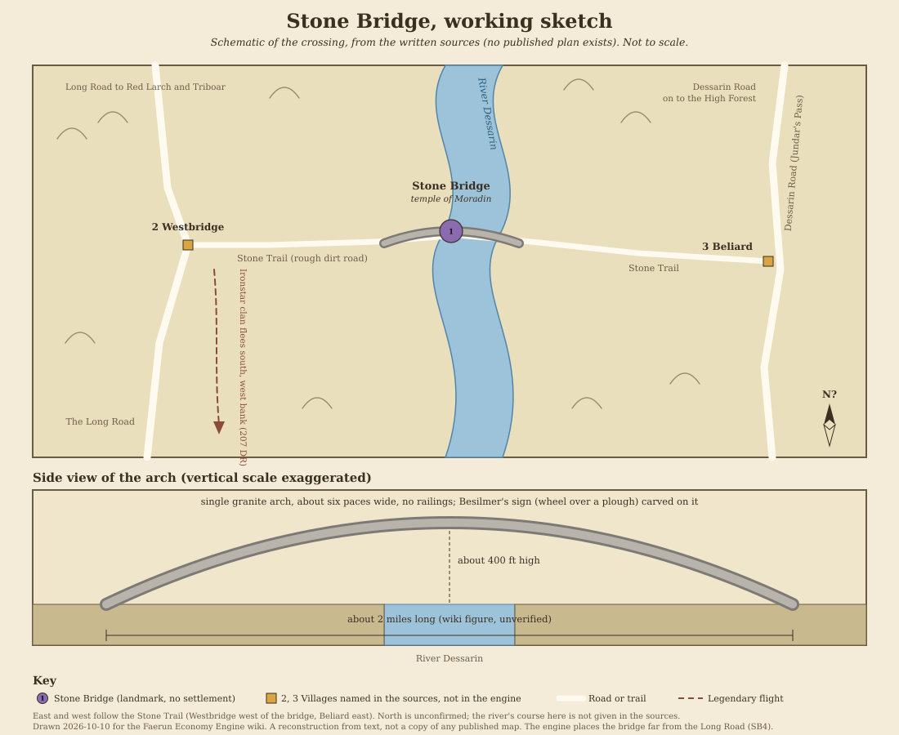

# Stone Bridge

[Location index](../../README.md)

**Region:** Dessarin Valley, Savage Frontier; on the River Dessarin where the Stone Trail crosses it (engine region `Dessarin Valley`, zone `dessarin`)  
**Settlement type:** Landmark, not a settlement: an ancient dwarven bridge that is also a temple to Moradin. The engine treats it as a surveyed (auto-generated) market  
**Reference period:** Dwarves Deep (1990), circa 1368 DR, for the description; 5th-edition mentions in *Princes of the Apocalypse* (2015, circa 1491 DR) and *Storm King's Thunder* (2016); 1492 DR unverified  
**Evidence reviewed:** 2026-10-10  
**Engine ID:** `stone_bridge`

This entry paraphrases the [Forgotten Realms Wiki article][frwiki] (a secondary
source), read 2026-10-10 through the browser because a direct fetch of the
article's source text failed. Most of its detail comes from *Dwarves Deep*
(1990) and *The North: Guide to the Savage Frontier* (1996). The two
5th-edition books are cited only for the bridge's size and location. Nothing
here is verified for 1492 DR.

## Overview

Stone Bridge is a single granite arch over the River Dessarin, built by the
dwarves of Besilmer to join the two halves of their realm. It is also a
temple to Moradin and, as of 1368 DR, a place of pilgrimage for dwarves of a
lawful good outlook. It is one of only two works of Besilmer still standing
in 1368 DR (the other is the Halls of the Hunting Axe). [Source][frwiki],
citing *Dwarves Deep*, p. 53; [Besilmer][besilmer], same page.

No village, population, ruler, trade or business is recorded at the bridge.
The nearest settlements are Westbridge at its western end and Beliard a few
miles to its east.

## Geography

- Crosses the River Dessarin and carries the Stone Trail, a rough dirt road
  running east to west from Westbridge (on the Long Road) to Beliard (where
  the Stone Trail meets the Dessarin Road, on Jundar's Pass). The route links
  Red Larch and the Long Road with Beliard and the High Forest.
  [Source][frwiki], citing the 3rd-edition poster map and *The North* map of
  the Interior; [Stone Trail][trail], citing *Storm King's Thunder*, pp. 74
  and 110; [Beliard][beliard], citing *Volo's Guide to the North*, p. 36.
- Westbridge takes its name from standing at the west side of the bridge
  ([Westbridge][westbridge], citing *The North*, p. 38, and *Storm King's
  Thunder*, p. 113).
- Size: the wiki gives a single arch 2 miles (3.2 km) long and 400 feet high,
  about six paces wide, with no railings, built wide enough for the river's
  greatest floods (*Dwarves Deep*, pp. 53 to 54; *Storm King's Thunder*,
  p. 109). A 2-mile single arch is very large; the figure has not been checked
  against the books and is flagged for a follow-up.
- Besilmer's sign, a wheel over a plough, is carved on the bridge
  ([Besilmer][besilmer]).

## Population

No population is recorded for the bridge in any source read. The infobox
has no population field filled, and the wiki has no "Inhabitants of Stone
Bridge" category.

Demographics standard update (2026-10-15): no resident racial or ethnic
breakdown was found because Stone Bridge is documented as a bridge and temple
site rather than a settlement. Runtime demographics remains `unresearched` with
that checked-source note in `faerun/data/demographics.py`.

**Engine:** 80 residents. This is the surveyed-market floor: the generator
copies the nearest established city (Red Larch, 1,100) at 1/25 of its
population (44) and raises it to the minimum of 80. It has no source
(SB3).

## Economy and Trade

No imports, exports, industries or trade are recorded for the bridge. Its
economic role in the sources is as a river crossing on the Stone Trail and a
pilgrimage site. Nearby trade belongs to its neighbours:

- **Westbridge** (west end): a farming village of 450 in 1365 DR whose market,
  stockyard and warehouses were all owned by the halfling Ghaliver
  Longstocking; residents hunted in Kryptgarden Forest; a wainwright, an inn,
  a restaurant and Westbridge Brewers (middling wines, strong ale) are named
  for the 14th century DR, and the Harvest Inn for the 15th century DR
  (*Volo's Guide to the North*, p. 89; *The North*, p. 38; *Storm King's
  Thunder*, p. 114) ([Westbridge][westbridge]).
- **Beliard** (east): a small trading village and meeting place for cattle
  ranchers who drove herds over the nearby hills, with Halamar's Horses
  (stables), Milshoun's Stronghouses (three warehouses) and the Watchful
  Knight hostel circa 1365 DR; hill giants raided its animal pens after about
  1485 DR (*Volo's Guide to the North*, pp. 36 to 37; *The North*, p. 36;
  *Storm King's Thunder*, p. 76) ([Beliard][beliard]).

## Government

None recorded. The bridge belonged to the long-fallen dwarven realm of
Besilmer.

## Notable Inhabitants

The wiki has no inhabitants category for Stone Bridge. The people below are
tied to it by the bridge's own article and the linked person articles,
read 2026-10-10. Publications are those the wiki cites, not independently
checked. No person is recorded at the bridge in the 14th or 15th century DR.

### Late 15th century DR

None found.

### Historical

| Person | Role | Dated | Source cited by the wiki |
| --- | --- | --- | --- |
| Daurvos Frostbeard | King of the Ironstar clan; cut down by orcs on the bridge while covering his clan's flight south; Moradin's avatar then appeared and routed the orcs, leaving his crown and hammer | 207 DR (fall of the Ironstar clan) | *Dwarves Deep*, pp. 53 to 54; *The Grand History of the Realms*, p. 67 |
| Tammas Forkbeard | Daurvos's daughter, who led the clan's women and children south and turned to fight at the bridge | 207 DR | *Dwarves Deep*, p. 53 |

### Legendary and loosely tied

| Person | Note |
| --- | --- |
| Torhild Flametongue | Founder of Besilmer (founded -4420 DR); killed in single combat with a hill giant on the bridge, which led to the realm's fall (*Dwarves Deep*, p. 53; *The Grand History of the Realms*, p. 26) |
| Avatar of Moradin | A 20-foot armoured dwarf that rescued the Ironstar clan here; legend also says the avatar landed on the bridge at the start of the Time of Troubles and guarded it to keep hostile gods from the Celestial Stairway in Waterdeep (*The North*, "The Wilderness", p. 50) |

### Families and organizations

- **Besilmer:** the dwarven farming realm in the Dessarin hills that built the
  bridge and the Halls of the Hunting Axe.
- **Ironstar clan:** dwarves of Ironstar Mountain who fled south along the
  Dessarin's west bank, crossing the bridge.
- **Dwarven pilgrims:** visitors to the temple of Moradin as of 1368 DR.

## Businesses

### In the live market (engine `businesses.json`)

None. No business in `businesses.json` lists `stone_bridge`, so there were
no offers to check against `commodities.json`.

### Named in the source

None at the bridge. Businesses of Westbridge and Beliard are listed under
Economy and Trade; neither village is in the engine.

## Maps and Village Layout

Preferred edition: 2nd. Published images are linked, not stored in the repo.
There is no village plan, because there is no village, and no interactive
`Map:Stone Bridge` page exists.

**Working sketch:** [stone-bridge-sketch.svg](stone-bridge-sketch.svg), drawn
2026-10-10 from the written sources only. It shows the Stone Trail running east
to west over the river from Westbridge to Beliard, with a side view of the arch.
Positions are schematic, North and the river's course are unconfirmed, and the
2-mile length is the wiki's unchecked figure. A reconstruction to work from, not
a copy of a published map.

| Map or image | Edition and date | Shows | Where |
| --- | --- | --- | --- |
| Interior fold-out map, cropped (Talntower area) | 2nd edition, *The North: Guide to the Savage Frontier* (1996); circa 1370 DR | The Stone Trail over the bridge to Beliard, with Westbridge, Triboar, Yartar and the Long Road | [File:Talntower-map.png][maptaln] |
| Kryptgarden Forest map | 2nd edition; circa 1367 DR (wiki gallery caption) | Regional; not opened | [File:Kryptgarden Forest2e.jpg][mapkrypt] |
| Map of Faerun excerpt | 3rd edition poster map (2001) | Bridge position | [File:Stonebridge3e.jpg][map3e] |
| Dessarin Valley maps | 5th edition, *Princes of the Apocalypse* (2015); 1491 DR | Regional; not opened | [File:Dessarin Valley Map.jpg][mapdv1]; [File:Dessarin Valley-5e.jpg][mapdv2] |
| Red Larch area map | 5th edition | Regional; not opened | [File:Red-larch-5e.jpg][maprl] |
| Other regional maps | Not checked | Regional; not opened | [File:DessarinRiver.jpg][mapriver]; [File:Leilon.jpg][mapleilon]; [File:Sumber Hills-Mike Schley.png][mapsumber] |
| Illustration of the bridge | 5th edition, *Princes of the Apocalypse*, p. 37 | Picture, not a map | [File:Stone bridge-5e.jpg][img5e] |

All listed from the wiki's [Category: Maps of the Stone Bridge][mapcat],
read 2026-10-10. Only the Talntower crop, the 3rd-edition excerpt and the
illustration were opened; the others were not.

## Engine Record

| Field | Value |
| --- | --- |
| Population | 80 (surveyed-market floor; no source) |
| Wealth / tax / security | 0.85 / 0.04 / 0.6 (copied from Red Larch) |
| Port / river | None / no |
| Terrain | Hills |
| Position | x 697.3, y 1073.2 |
| Traits | `agrarian`, `frontier`, `surveyed_market` |
| Industries / specialties / shortages | None |
| Ruler | None |
| Size category | Hamlet |
| Neighbours | Triboar by trail, 65.3 miles, 4.9 days ("Red Larch and Goldenfields branch toward Secomber"); Beliard by trail, 19.3 miles, 1.5 days ("Beliard Trail") |
| Description | Generic surveyed-market text until 2026-10-10; replaced from the source (SB1) |

Observed 2026-10-10 (`get_trade_summary`, top 15): gross local product about
33 gp a day (12,030 gp a year, 150 gp per resident). Goods exports about
15.4 gp a day against imports of about 3,687 gp a day, plus about 561 gp a
day of inbound freight assigned to no carrier. Exports are small amounts of
grain (9 bushels a day), vegetables, fruit, cheese, tea, spices, timber
(1 load a day), iron ore (0.2 a day) and dressed granite (0.1 block a day),
although the record has no industries. The import list is the usual set of
unavailable goods (pineapple, pears, citrus, longship, woolly mammoth,
sleigh, clockwork mechanism, masterwork warhammer and others), each with a
flat 0.16-a-day need.

Positions: Red Larch is at x 646.2, y 1101.1 and Triboar at x 641.5,
y 1050.1, so the Long Road runs near x 641 to 646 here. The engine puts the
bridge about 51 to 56 miles east of that line. The sources put Westbridge on
the Long Road at the bridge's west end and Beliard a few miles east of it.
Beliard appears as a neighbour but has no record in `settlements.json`.

## Discrepancies and Proposed Engine Changes

| # | Issue | Proposal | Status |
| --- | --- | --- | --- |
| SB1 | Description was the generic surveyed-market text | Set description from the source: dwarven bridge and temple to Moradin on the Stone Trail between Westbridge and Beliard; no settlement recorded | Applied 2026-10-10 |
| SB2 | The sources describe a bridge and temple with no residents, yet the engine runs it as an 80-person agrarian market copied from Red Larch | Replace the surveyed market with a sourced village: Westbridge (450 in 1365 DR, market and stockyard, Harvest Inn in the 15th century DR) at the west end, or Beliard (cattle-ranchers' trading village) to the east; keep Stone Bridge as a map landmark and route node | Proposed |
| SB3 | Population 80 has no source; it is the surveyed-market floor | Treat as unknown; set to the minimum the engine allows, or remove with SB2 | Proposed |
| SB4 | Engine position is about 51 to 56 miles east of the Long Road; sources put the bridge between Westbridge (on the Long Road) and Beliard, a few miles east | Re-check position against the 2nd-edition Interior map and the 5th-edition Dessarin Valley map; no coordinates proposed | Proposed (map) |
| SB5 | Engine links: a 65.3-mile trail to Triboar labelled as a Red Larch and Goldenfields branch toward Secomber, and a 19.3-mile Beliard Trail. Sources give the Stone Trail from Westbridge (Long Road) over the bridge to Beliard (Dessarin Road) | Model the Stone Trail Westbridge to Stone Bridge to Beliard; review the Triboar trail | Proposed (routes phase) |
| SB6 | Bridge over the River Dessarin, but `river` is false | Set `river` true if the market stays, with SB5 | Proposed (routes phase) |
| SB7 | The temple to Moradin and dwarven pilgrimage are the only recorded activity | Add `temple` 1 or a pilgrimage visitor flow if the market stays; 1368 DR evidence only | Proposed |
| SB8 | Exports timber, iron ore and dressed granite with no industries, and imports about 3,687 gp a day (about 110 times local output) through flat 0.16-a-day needs for unavailable goods such as longships and woolly mammoths | Review with W4, W5, W6, R14 and T15 | Proposed (engine-wide) |
| SB9 | Beliard is a route neighbour but has no settlement record | Trace where the Beliard node comes from (map junction or survey place) | Proposed |

## Lore Follow-ups

1. **Size.** Confirm the 2-mile, 400-foot single arch in *Dwarves Deep*,
   pp. 53 to 54, and *Storm King's Thunder*, p. 109.
2. **5th-edition state.** Read *Princes of the Apocalypse*, pp. 36 to 37, and
   *Storm King's Thunder*, pp. 109 to 110, for anything at the bridge around
   1491 DR (keepers of the temple, pilgrims, giants).
3. **Westbridge and Beliard.** Both are sourced villages next to the bridge
   and missing from the engine; review them if SB2 goes ahead.
4. **Halls of the Hunting Axe.** Besilmer's other surviving work, in ruins by
   1491 DR (*Princes of the Apocalypse*, pp. 180 to 181); a map-only site.

## Sources

**Directly consulted, secondary:** [Forgotten Realms Wiki: Stone
Bridge][frwiki] (article and source text, through the browser after a direct
fetch failed), [Stone Trail][trail], [Beliard][beliard],
[Westbridge][westbridge], [Besilmer][besilmer], [Torhild
Flametongue][torhild], [Daurvos Frostbeard][daurvos], the [Maps of the Stone
Bridge category][mapcat] and the file pages for the Talntower map, the
3rd-edition excerpt and the 5th-edition illustration, all accessed
2026-10-10. Publications named above are the wiki's references, not
independently checked: *Dwarves Deep* (1990), pp. 53 to 54; *The North: Guide
to the Savage Frontier* (1996), "Cities & Civilization" pp. 36 and 38, "The
Wilderness" pp. 35, 50, and the Interior map; *Volo's Guide to the North*
(1993), pp. 36, 37, 89; *The Grand History of the Realms* (2007), pp. 26,
67; *Princes of the Apocalypse* (2015), pp. 19, 36, 37; *Storm King's
Thunder* (2016), pp. 74, 76, 109, 110, 113, 114.

**Alternatives tried:** a World Anvil page on Stone Bridge (states that it
copies the Forgotten Realms Wiki, so it is not independent; not used) and
D&D Beyond's *Storm King's Thunder* chapter (redirected to the store; not
accessible). No independent source was found.

**Engine:** `get_settlement`, `get_trade_summary`,
[settlements.json](../../../faerun/data/store/settlements.json),
[businesses.json](../../../faerun/data/store/businesses.json) and the
surveyed-market generator in [world.py](../../../faerun/world.py), observed
2026-10-10. No city directory exists for Stone Bridge.

[frwiki]: https://forgottenrealms.fandom.com/wiki/Stone_Bridge
[trail]: https://forgottenrealms.fandom.com/wiki/Stone_Trail
[beliard]: https://forgottenrealms.fandom.com/wiki/Beliard
[westbridge]: https://forgottenrealms.fandom.com/wiki/Westbridge
[besilmer]: https://forgottenrealms.fandom.com/wiki/Besilmer
[torhild]: https://forgottenrealms.fandom.com/wiki/Torhild_Flametongue
[daurvos]: https://forgottenrealms.fandom.com/wiki/Daurvos_Frostbeard
[mapcat]: https://forgottenrealms.fandom.com/wiki/Category:Maps_of_the_Stone_Bridge
[maptaln]: https://forgottenrealms.fandom.com/wiki/File:Talntower-map.png
[mapkrypt]: https://forgottenrealms.fandom.com/wiki/File:Kryptgarden_Forest2e.jpg
[map3e]: https://forgottenrealms.fandom.com/wiki/File:Stonebridge3e.jpg
[mapdv1]: https://forgottenrealms.fandom.com/wiki/File:Dessarin_Valley_Map.jpg
[mapdv2]: https://forgottenrealms.fandom.com/wiki/File:Dessarin_Valley-5e.jpg
[maprl]: https://forgottenrealms.fandom.com/wiki/File:Red-larch-5e.jpg
[mapriver]: https://forgottenrealms.fandom.com/wiki/File:DessarinRiver.jpg
[mapleilon]: https://forgottenrealms.fandom.com/wiki/File:Leilon.jpg
[mapsumber]: https://forgottenrealms.fandom.com/wiki/File:Sumber_Hills-Mike_Schley.png
[img5e]: https://forgottenrealms.fandom.com/wiki/File:Stone_bridge-5e.jpg
