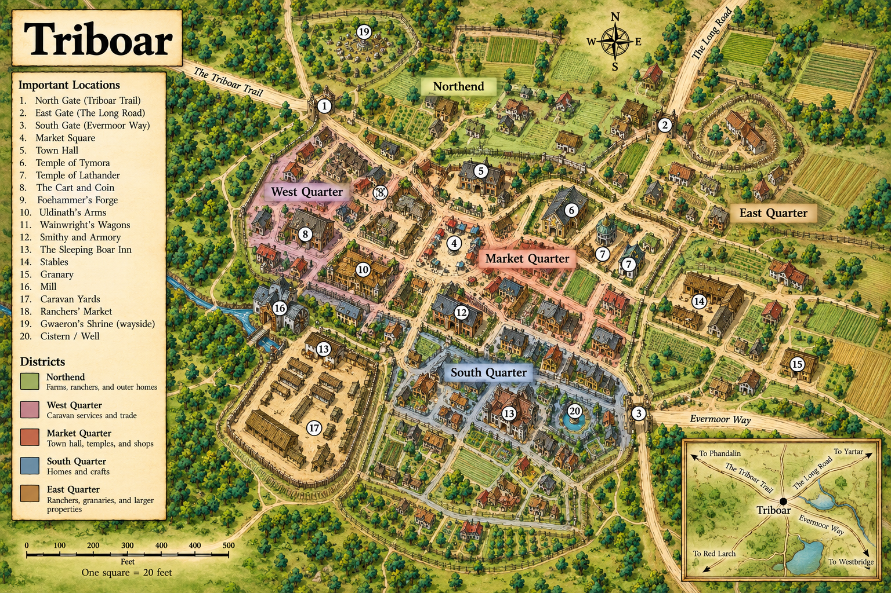
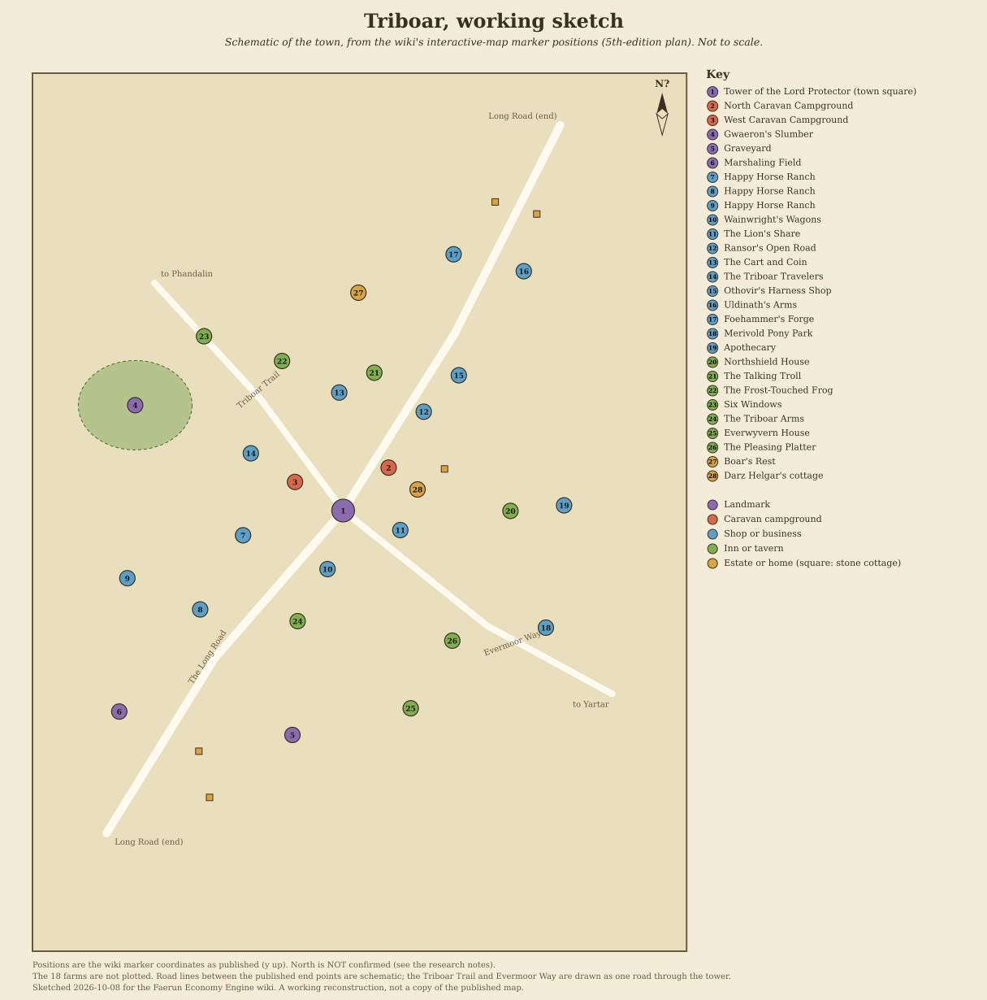

# Triboar

[Location index](../../README.md)

**Region:** Dessarin Valley, where the Evermoor Way crosses the Long Road (engine region `Dessarin Valley`, zone `dessarin`)  
**Settlement type:** Large town (wiki infobox); trading town and caravan crossroads  
**Reference period:** 1357 to 1370 DR lore (1st- and 2nd-edition sources) and a snapshot after 1485 DR (5th edition, *Storm King's Thunder*); Lord Protector dated 1491 DR; 1492 DR planning baseline  
**Evidence reviewed:** 2026-10-08 (first limited review 2026-10-01)  
**Engine ID:** `triboar`

This entry paraphrases the [Forgotten Realms Wiki article][frwiki] (a secondary
source), its interactive map, and the wiki's articles on Triboar businesses and
people, read 2026-10-08. The 14th-century detail comes mainly from *Waterdeep
and the North* (1987), *The Savage Frontier* (1988), *Volo's Guide to the North*
(1993) and *The North: Guide to the Savage Frontier* (1996). The late 15th-century
detail comes from *Princes of the Apocalypse* (2015, set in 1491 DR) and *Storm
King's Thunder* (2016, set after 1485 DR). Publications are those the wiki cites;
none was independently consulted. The 2026-10-01 review, which could not reach
the wiki and relied on an unofficial guide, is superseded; its sources are kept
under Sources.

## Overview

Triboar is a prosperous trading town and frontier crossroads, nicknamed "the
Town Where Only Gwaeron Sleeps"; some locals call it the Gateway to the North,
a title other towns also claim. Merchants, caravanners and travellers pass
through constantly. Its trade rests on wagons, caravan services and guides,
horse and cattle dealing, forged ironware and leather goods. The name comes from
a legend of a traveller who killed three boars there in one day in the mid 11th
century DR. [Source][frwiki]

## Geography

- In the Dessarin Valley, on flat, fertile land with a few rises, where the
  Evermoor Way crosses the Long Road. The infobox gives the broad region as the
  Savage Frontier; the article text places it in the Dessarin Valley, which
  the engine already uses (no change).
- Distances given by the wiki: about 225 miles east of Phandalin by the
  Triboar Trail, 60 miles west of Yartar, 80 miles north of Westbridge and 200
  miles north of Red Larch. The Red Larch figure conflicts with the engine's
  51.2-mile road and with the Westbridge figure, and needs checking (T13).
- Travel by wagon in 1358 DR: about 13 days to Waterdeep, 2 to Yartar, 15 to
  Everlund and about 20 to Silverymoon.
- Gwaeron's Slumber, a grove west of town where the god of rangers is said to
  sleep; woodcutting and hunting there are forbidden.
- Engine: road links to Red Larch (51.2 miles, 2.5 days), Yartar (66 miles, 3.2
  days) and Longsaddle (137.8 miles, 6.8 days), and a trail to Stone Bridge
  (65.3 miles). No link to Phandalin by the Triboar Trail (T13, routes phase).

## Population

| Figure | Scope | Year | Source cited by the wiki |
| --- | --- | --- | --- |
| About 2,500 | Town | 1357 DR | Infobox; cited to two of the article's 1st- and 2nd-edition references |
| About 2,500 | Town | 1368 DR | Infobox; two further references |
| About 2,500 | Town | 1370 DR | Infobox; one reference |
| Not given | Nearly half of residents live on outlying farms and ranches, mostly north and east | Late 15th century DR | Article text, citing *Storm King's Thunder* |

The reference numbers on each infobox figure were read, but which book each
number points to was not captured, so the exact book per year is unconfirmed.
In the mid to late 14th century the militia could raise about 50 fighters
overnight and about 300 by the next highsun.

Demographics standard update (2026-10-15): no settlement-level racial or ethnic
breakdown was found in the reviewed Triboar sources. Runtime demographics
remains `unresearched` with a checked-source note in `faerun/data/demographics.py`.

**Engine:** 2,500 residents retained as a 1492 DR planning estimate, not a
census. The earlier approximately 2,500-person references are documented in
[populations.py](../../../faerun/data/populations.py); no late-15th-century
count was found (T8).

**Cross-check against the cadastral map (visual estimate, 2026-10-08).** From
the scale bar, the walled core is about 1,400 by 1,400 feet (roughly 44 acres),
of which the caravan yards take about 6. I count by eye roughly 350 to 450
buildings inside the walls, about three quarters residential or mixed shop and
home, and 20 to 30 farmsteads outside. At 4 to 6 people per household (the
engine's `census.py` scenarios) and about 1.3 households per town building, the
core holds about 1,400 to 2,600 people (central about 2,000), with 100 to 200
more on the outlying farmsteads. That is consistent with 2,500 for the town and
its near farms. It does not support "nearly half live on outlying farms and
ranches": the map shows too few farmsteads for that (T19). The count is not a
footprint survey; the scale is read from an unsourced illustration, so
`census.py` would not accept it.

## Economy and Trade

| Item | Evidence | Period |
| --- | --- | --- |
| Exports (infobox) | Caravan supplies, horses, leatherwork, ironware, wagons | Infobox, cited to 1st- to 5th-edition sources together |
| Imports | None listed | None |
| Wagons | Wainwright's Wagons: Skulner Wainwright built the finest and most innovative wagons in the Dessarin Valley, from about 175 gp; managed by Tosker Wainwright after 1485 DR | *Volo's Guide to the North*, pp. 86 to 87; *Storm King's Thunder*, pp. 54 to 55 |
| Horses, mules and ponies | Ranches west of town bred riding horses, draft horses, mules and mountain ponies. Happy Horse Ranch (Karnveller family) bred, reared and housed horses for sale; Merivold Pony Park bred and trained ponies as halfling steeds | 14th century DR; after 1485 DR (*Storm King's Thunder*, pp. 54 to 57) |
| Cattle | Horse and cattle dealing is named as a mainstay of the economy | Article text; period not separated |
| Ironware | Foehammer's Forge (Ghelryn Foehammer) and Uldinath's Arms sold metalwork across the North and the Sword Coast; Aldenar Uldinath's eyebolts, latches, nails and pins supported Wainwright's wagons | *Volo's*, p. 86; *The North*, p. 37 (14th century DR); *Storm King's Thunder*, p. 57 (after 1485 DR) |
| Leather goods | Traded along the Long Road; Othovir made engraved elk-skin harness | Article text; *Storm King's Thunder*, p. 56 |
| Caravan outfitting | The Cart and Coin sold caravan gear, supplies and animal feed, traded horses and draft animals and hired out caravan guards; Ransor's Open Road did the same but fell to ruin in the 15th century DR | *Volo's*, p. 86; *The North*, p. 37; *Storm King's Thunder*, pp. 54, 56 |
| Caravan companies | The Triboar Travelers rented wagons to merchants for trips to Waterdeep, Everlund and other towns, with set return-trip prices; The Lion's Share was the Lionshield Coster's branch from Yartar | *Storm King's Thunder*, p. 54 and following |
| Guides | Expert guides charged 7 gp a day plus expenses with a 77 gp deposit; four named guides in the mid 14th century DR | *Volo's*, pp. 83 to 84 |
| Farming | Fertile land; local farms harvested wild grain | Article text |
| Lodging | Everwyvern House (luxury inn for Waterdhavian nobles), Northshield House, Six Windows boarding house, caravan campgrounds | *Storm King's Thunder*, pp. 54 to 58 |

These describe trade character, not output volumes or prices.

## Government

- An elected Lord Protector commands the militia, settles disputes and rules by
  the Lord's Decrees, which can be changed at will. Most sources give elections
  every seven years in winter; *Volo's Guide to the North*, p. 218, implies
  yearly elections, which the wiki treats as an error.
- Lords Protector: Faurael Blackhammer (about three decades, recorded 1357 DR;
  killed 1369 DR); Jalimin Frindos (1370 DR); Darathra Shendrel, a retired
  adventurer and secret Harper, by 1491 DR (*Princes of the Apocalypse*, pp. 15,
  37; *Storm King's Thunder*, pp. 53, 253). Alfonse "Big Al" Kalazorn was
  sheriff until about 1481 DR.
- "The Twelve", a mounted patrol, guard the town, police the roads and enforce
  the decrees. A town wall recorded around 1356 DR was gone by 1365 DR.
- The banner shows three black boars on red; emissaries carry a platinum badge
  worth 50 gp.
- Organizations recorded: Harpers (cell around 1491 DR), Zhentarim (purged
  around 1370 DR, back by 1491 DR), Kraken Society, Shadow Thieves (around 1368
  DR), Moonstars (around 1370 DR), Lionshield Coster.
- Events after 1485 DR: fire giants attacked the town to recover a buried piece
  of the relic Vonindod and were driven off. In 1491 DR an elemental cult
  attacked a Zhentarim-guarded caravan.

## Notable Inhabitants

From the wiki's [Category: Inhabitants of Triboar][inh] (40 entries) and the
linked articles, read 2026-10-08. Paraphrased; publications are those the wiki
cites, not independently checked. Nearest to 1492 DR first.

### Late 15th century DR (closest to the 1492 baseline)

*Storm King's Thunder* (2016), set after 1485 DR, unless stated.

| Person | Role | Dated | Source cited by the wiki |
| --- | --- | --- | --- |
| Darathra Shendrel | Lord Protector; retired adventurer and secret Harper | 1491 DR | *Princes of the Apocalypse*, pp. 15, 37; *Storm King's Thunder*, pp. 53, 253 |
| Sedina Wolfpaw | Half-elf scout | 1491 DR | *Princes of the Apocalypse*, p. 113 |
| Janele Karnveller; Aldo, Hingo and Rasko Karnveller | Rancher at Happy Horse Ranch; her sons, ranchers and militia soldiers | After 1485 DR | p. 54 |
| Tosker Wainwright | Manages Wainwright's Wagons | After 1485 DR | p. 54 |
| Arn and Syreen Widdens | Owners of the Cart and Coin caravan outfitter | After 1485 DR | p. 54 |
| Narth Tezrin; Alaestra Ulgar | Lionshield Coster members running The Lion's Share; harassed by some locals | After 1485 DR | pp. 32, 54, 254 |
| Urlam Stockspool; Valken Naspeer | Caravan-company owner and Zhentarim recruiter; his half-elf bodyguard | After 1485 DR | p. 54 |
| Othovir | Harness-maker (engraved elk-skin harness) and hunter | After 1485 DR | pp. 56, 255 |
| Ghelryn Foehammer | Shield dwarf smith, Foehammer's Forge; also Royal Armorer of Citadel Felbarr | 14th century DR to after 1485 DR | *Volo's*, p. 86; *The North*, p. 37; *Storm King's Thunder*, pp. 5, 57 |
| Harriet Uldinath | Blacksmith and swordsmith, Uldinath's Arms | After 1485 DR | p. 57 |
| Urgala Meltimer | Innkeeper, Northshield House | After 1485 DR | pp. 6, 56; *Waterdeep: Dungeon of the Mad Mage*, pp. 62 to 63 |
| Dlukasz Phorndyl | Innkeeper | 14th century DR and after 1485 DR | *Volo's*, p. 88; p. 56 |
| Kaelen Sarssir | Tavern owner and actor | After 1485 DR | p. 56 |
| Draven Millovyr | Innkeeper | Sometime after 1385 DR | p. 58 |
| Tarmock Felaskur | Apothecary | After 1485 DR | p. 58 |
| Silvarren Loomshank | Priest | After 1485 DR | pp. 56, 232 |
| Darz Helgar | Paid by the Lord Protector to keep the caravan campgrounds and latrines clean | After 1485 DR | pp. 54, 253 |
| Hyuth Kolstaag | Retired adventurer living at the Boar's Rest manor | After 1485 DR | p. 57 |
| Tolmara Hysstryn | Deranged townswoman | After 1485 DR | pp. 56 to 57 |
| Alfonse "Big Al" Kalazorn | Sheriff until about 1481 DR, later a farmer at Butterskull Ranch near Phandalin | To about 1481 DR | *Dragon of Icespire Peak* (2019), pp. 16 to 17 |
| Ivor Bakovski | Villager trading flour and common goods | Late 15th century DR | *Idle Champions of the Forgotten Realms* (2017 video game) |

### Mid to late 14th century DR (historical)

| Person | Role | Dated | Source cited by the wiki |
| --- | --- | --- | --- |
| Faurael Blackhammer | Lord Protector for about three decades; died 1369 DR | 1357 DR | *Waterdeep and the North*, p. 10; *The Savage Frontier*, p. 33; *Volo's*, p. 218 |
| Jalimin Frindos | Retired adventurer, Faurael's aide, then Lord Protector | 1370 DR | *The North*, pp. 11 to 12, 36 |
| Skulner Wainwright | Wagonmaker, Wainwright's Wagons | Mid 14th century DR | *Volo's*, p. 222; *The North*, pp. 38, 78 |
| Aldenar Uldinath | Swordsmith and smith whose fittings supplied Wainwright's wagons | Mid 14th century DR | *Volo's*, p. 86; *The North*, p. 37; *Storm King's Thunder*, p. 57 |
| Borth Jhandelspar; Ilrin Sharadin; Morth Fartheen; Zandever Eyredanus | Hired guides | Mid 14th century DR | *Volo's*, pp. 83 to 84; *The North*, p. 78 |
| Gondyl Ilitheeum | Doppelganger living in the town | 1370 DR | *The North*, p. 78 |
| Hargun Tamaraith; Fythuera | Smith and weaponsmith; his wife; parents of Narm Tamaraith | 14th century DR | An Ed Greenwood publication of 1989 (title not captured) |

### Legendary and loosely tied

| Person | Note |
| --- | --- |
| Gwaeron Windstrom | God of rangers, said to sleep in Gwaeron's Slumber west of town |
| Simon Aumar | Half-elf sorcerer and stage magician caught working magic at the playhouse, late 1490s DR (*Honor Among Thieves*, 2023 film and tie-ins; after the baseline) |
| Toblen Stonehill | Innkeeper from Triboar who moved to Phandalin (*Lost Mine of Phandelver*, 2014, pp. 15 to 16) |

### Families and organizations

The Karnveller family (Happy Horse Ranch), the Merivold sisters (pony park),
the Wainwright family (wagons, both eras), the Uldinath family (smithy, both
eras). Organizations: the Twelve (mounted patrol), Harpers, Zhentarim,
Lionshield Coster, Kraken Society, Shadow Thieves and Moonstars.

## Businesses

### In the live market (engine `businesses.json`)

None existed before this run. Added 2026-10-08 (T6), each shown operating after
1485 DR by *Storm King's Thunder*:

| Business | Type | Offers | Note |
| --- | --- | --- | --- |
| Wainwright's Wagons (`wainwrights_wagons`) | Wagonworks | Wagons (fine), carts | Wagons about 175 gp in the 14th century DR against the engine's 35 gp catalogue price (with R16) |
| Othovir's Harness Shop (`othovirs_harness_shop`) | Harness-maker | Harness (fine), saddle and tack | Harness is made only by `tag_harness`, so the shop sells imports (R15) |
| Foehammer's Forge (`foehammers_forge`) | Smithy | Nails, horseshoes, carpenter's tools (fine) | General metalwork; no weapons named |
| Uldinath's Arms (`uldinaths_arms`) | Smithy | Swords (fine), nails | Swordsmith; wagon fittings in the 14th century DR |
| Happy Horse Ranch (`happy_horse_ranch`) | Horse ranch and stables | Riding horses, draft horses | Karnveller family |
| Merivold Pony Park (`merivold_pony_park`) | Pony farm | Ponies (fine) | Ponies trained as halfling steeds |
| The Cart and Coin (`cart_and_coin`) | Caravan outfitter | Draft horses, mules, oxen, grain (for feed) | No caravan gear or animal feed commodity exists; grain stands in for feed |

Generated addresses ("High Road", "Trade Quarter") are placeholders. All seven
start with generated stock (14 to 21 head of each animal), which ignores value
(D21).

Added 2026-10-08 (T12, T14), all shown operating after 1485 DR by *Storm King's
Thunder*; offers marked "inferred" are not listed in the source:

| Business | Type | Offers | Note |
| --- | --- | --- | --- |
| The Lion's Share (`lions_share`) | General goods, Lionshield Coster branch | Caravan supplies, rope, lanterns | Offers inferred |
| Triboar Apothecary (`triboar_apothecary`) | Apothecary (Tarmock Felaskur) | Healing potions, healing herbs | Nothing on sale: Triboar makes neither (no `herb` or `alch` industry) |
| The Talking Troll (`talking_troll`) | Bar | Ale, table wine | |
| The Triboar Arms (`triboar_arms`) | Tavern | Ale, bread, fresh meat | Food inferred |
| The Pleasing Platter (`pleasing_platter`) | Restaurant | Bread, fresh meat, table wine | Menu inferred |
| Everwyvern House (`everwyvern_house`) | Luxury inn | Fine wine, ale, fine bread | Lodging not modeled |
| Northshield House (`northshield_house`); Six Windows (`six_windows`) | Inn; boarding house | Ale, bread | Lodging not modeled |
| The Triboar Travelers, Waterdeep Run (`carrier_triboar_travelers_waterdeep`) | Carrier | 10 horse freight wagons, 40,000 lb | On The Long Road; fleet size estimated |
| The Triboar Travelers, Everlund Run (`carrier_triboar_travelers_everlund`) | Carrier | 8 horse freight wagons, 32,000 lb | On The Evermoor Way; fleet size estimated |

The carriers needed two service entries in `MULTILEG_CARRIER_SERVICES`
(`faerun/world.py`). Each replaces the generic horse freight wagon on every leg
of its named route, not only the Triboar legs, as the Trade Way service does.
The Cart and Coin now sells animal feed and caravan supplies in place of the
grain stand-in; Foehammer's Forge and Uldinath's Arms sell wagon fittings.

### Named in the source, not in the market

| Name | Kind | Operating | Modeled goods it suggests |
| --- | --- | --- | --- |
| Triboar Playhouse | Small theatre | Late 15th century DR | None |
| Caravan campgrounds | Fenced fields for wagons and oxen, kept for the Lord Protector | After 1485 DR | None |
| Ransor's Open Road | Caravan outfitter | 14th century DR; ruined in the 15th century DR | None (closed) |
| The Frost-Touched Frog | Inn, once run by Alatha Riversword | Abandoned by the late 15th century DR | None (closed) |
| Boar's Rest; Home of the Boars | Manor; Harper refuge lodge (late 15th century DR) | After 1485 DR | None |

## Maps and Village Layout

### Maps

Preferred edition: 2nd. No 2nd-edition town plan was found on the wiki; the
only street plan is 5th edition. Published images are linked, not stored in the
repo.

**Official reference map (from 2026-10-08):** [Triboar - Cadastral
Map.png](Triboar%20-%20Cadastral%20Map.png), the "Historical Cadastral Map"
supplied by the project owner. It adds land-use colours (residential,
commercial, crafts, religious, civic, agricultural, ranching, storage), property
boundaries and building footprints, with a 500-foot scale bar (one square = 20
feet). Like the earlier map it names no publisher or artist, but the project
owner has designated it the reference for housing and population work.

**Earlier display map:** [Triboar.png](Triboar.png), also supplied by the project
owner; superseded by the cadastral map above and kept for comparison.

Provenance caution (earlier map): the image names no publisher, artist, edition or date and is
not any map listed below. It is a painted illustration with a 20-item legend,
and it disagrees with the wiki's markers in several places, so treat it as
illustrative, not as a source. What it shows: north at the top (compass rose); a
walled core with North Gate (Triboar Trail), East Gate (Long Road) and South
Gate (Evermoor Way); five districts (Northend, West, Market, South, East
Quarters); Market Square, Town Hall, temples of Tymora and Lathander, a mill on
a stream, caravan yards west of the core, a granary and stables in the east,
Gwaeron's wayside shrine north-west and a cistern in the south. Scale bar to
500 feet.

| Point | Display map | Wiki markers and lore |
| --- | --- | --- |
| Landmarks | Market Square and Town Hall at the centre; no Tower of the Lord Protector | Tower of the Lord Protector is the town square |
| Gwaeron's Slumber | "Gwaeron's Shrine (wayside)" at the north-west edge | A grove west of town where woodcutting and hunting are forbidden |
| Inns and shops | The Sleeping Boar Inn, The Cart and Coin, Foehammer's Forge, Uldinath's Arms, Wainwright's Wagons, Smithy and Armory | Different inns (Northshield House, The Talking Troll and others); the shops named here are in the wiki but at other positions |
| Roads | Triboar Trail leaves the north gate to the north-west; Long Road leaves the east gate to the north-east; Evermoor Way leaves the south gate to the east | Trail and Evermoor Way read as one road in the wiki markers, with the Long Road crossing it |
| Ranches | "Ranchers' Market" only; horse ranches are not shown | Happy Horse Ranch and Merivold Pony Park west and south of town |

Its inset locator puts Red Larch to the south-west and Westbridge to the south-east
of Triboar, which the research notes' distance conflicts (T13) do not settle.

**Working sketch:** [triboar-sketch.svg](triboar-sketch.svg), drawn 2026-10-08
from the marker positions below, as published (y up). North is unconfirmed, the
road lines between the published end points are schematic (the Triboar Trail
and Evermoor Way are drawn as one road through the tower), and the 18 farms are
not plotted. A reconstruction to work from, not a copy of the published map.

| Map | Edition and date | Shows | Where |
| --- | --- | --- | --- |
| Dessarin River | 3rd-edition map excerpt (infobox image) | Triboar and environs | [File:DessarinRiver.jpg][mapdriver] |
| Map of Triboar | 5th edition, late 1480s DR; probably *Storm King's Thunder* (page not captured) | Town plan; base of the interactive map | [File:Triboar 5e.png][map5e] |
| Interactive map | Wiki [Map:Triboar (15th Century DR)][imap], drawn on the 5th-edition plan | 61 markers: inns, landmarks, homes, 18 farms, roads, shops | Marker positions below |
| Dessarin Valley regional maps | 2nd- to 5th-edition maps listed on the [Red Larch](../red-larch/README.md) page | Regional; whether each shows Triboar was not checked | See that page |

### Interactive map markers

Map bounds are x 0 to 2013 and y 0 to 2700 (map units, coordinate order x then
y, origin bottom-left, so y rises toward the top of the image). **Orientation
is not confirmed.** Read with north at the top, Gwaeron's Slumber and the
horse ranches fall west of the Tower of the Lord Protector, as the text says,
but the Triboar Trail (to Phandalin, south-west) leaves to the north-west and
the Evermoor Way (to Yartar, east) to the south-east. Read with north at the
bottom, the trail and the Evermoor Way fit but the Long Road's two ends fit
less well. Positions are recorded as published.

| Place | x | y | Category |
| --- | --- | --- | --- |
| Tower of the Lord Protector (town square) | 956 | 1355 | Landmark |
| North Caravan Campground | 1096 | 1487 | Landmark |
| West Caravan Campground | 808 | 1443 | Landmark |
| Gwaeron's Slumber | 316 | 1679 | Landmark |
| Graveyard | 800 | 665 | Landmark |
| Marshaling Field | 267 | 737 | Landmark |
| Happy Horse Ranch (three markers) | 648; 516; 292 | 1279; 1051; 1147 | Shop or business |
| Wainwright's Wagons | 908 | 1175 | Shop or business |
| The Lion's Share | 1132 | 1295 | Shop or business |
| Ransor's Open Road | 1204 | 1659 | Shop or business |
| The Cart and Coin | 944 | 1718 | Shop or business |
| The Triboar Travelers | 672 | 1531 | Shop or business |
| Othovir's Harness Shop | 1312 | 1771 | Shop or business |
| Uldinath's Arms | 1512 | 2091 | Shop or business |
| Foehammer's Forge | 1296 | 2143 | Shop or business |
| Merivold Pony Park | 1580 | 995 | Shop or business |
| Apothecary | 1636 | 1371 | Shop or business |
| Northshield House | 1471 | 1354 | Inn or tavern |
| The Talking Troll | 1052 | 1779 | Inn or tavern |
| The Frost-Touched Frog | 768 | 1815 | Inn or tavern |
| Six Windows | 528 | 1891 | Inn or tavern |
| The Triboar Arms | 816 | 1015 | Inn or tavern |
| Everwyvern House | 1164 | 747 | Inn or tavern |
| The Pleasing Platter | 1292 | 955 | Inn or tavern |
| Boar's Rest | 1003 | 2025 | Estate or home |
| Darz Helgar's cottage | 1185 | 1420 | Estate or home |
| Stone cottages (five) | 1424, 1552, 1268, 512, 545 | 2304, 2267, 1483, 615, 473 | Estate or home |
| The Long Road (two ends) | 1624; 228 | 2540; 363 | Road |
| The Triboar Trail | 375 | 2055 | Road |
| Evermoor Way | 1784 | 791 | Road |
| Farms (18 markers) | 530 to 1797 | 914 to 2198 | Farm; nine above and nine below the tower's y |

## Engine Record

| Field | Value |
| --- | --- |
| Population | 2,500 (planning scenario for 1492 DR with an evidence entry, T8; was a gazetteer estimate) |
| Wealth / tax / security | 0.95 / 0.05 / 0.65 |
| Port / river | None / no |
| Terrain | Plains |
| Traits | `mercantile`, `agrarian`, `frontier` |
| Industries | `farm` 2, `trade` 2, `cattle` 2, `horse` 2, `smith` 2, `craft` 1, `tan` 1 (`horse` and `tan` added 2026-10-08; `cattle` 3 to 2, `horse` 1 to 2 and `smith` 1 to 2 on 2026-10-08, T9 to T11) |
| Specialties | `cow` 2, `wagon` 1, `saddle` 1, `horse_riding` 1, `pony` 1, `nails` 1 (last five added 2026-10-08; `meat_salt` 1 removed, T9) |
| Shortages | None |
| Ruler | Lord Protector Darathra Shendrel (set 2026-10-08, T7) |
| Size category | Small town |
| Guilds (inferred) | Merchant Guild; Farmers' and Millers' Guild |

Observed 2026-10-08 before this run's changes (`get_trade_summary`): gross
local product 3,662,914 gp a year (1,465 gp per resident); goods exports 3,638
gp a day against imports of 115,115 gp a day; 16,577 gp a day of inbound
freight assigned to no carrier. Leading exports by volume: vegetables (217 a
day), fruit (187), medicinal herbs (30.6), nuts and dried fruit (9.1), leather
(7.9) and corn (5.1). Corn, cotton, oxen, hemp rope, tin and copper sat as
uncommitted surplus; wagons and carts were exported at near zero. Imports were
the usual unavailable goods (pears, citrus, pineapple, yak, llama, longship,
clockwork) at a flat 5 a day each.

After the changes and `reload_catalog`: gross local product 8,102,123 gp a year
(3,241 gp per resident); exports 9,521 gp a day. New exports: ponies (174 a day
against a stock of 15 a tenday), draft horses (130 a day against 25 a tenday;
no draft-horse specialty was added), riding horses (32 a tenday in stock, 3.2 a
day spare) and warhorses (near zero). Leather rose to 10.2 a day. Wagons are
still near zero. Exports far above stock repeat G13 and R14 (T10, T15).

**Live server note (2026-10-08):** this run's `reload_catalog` again moved
Amphail to x 621.7, y 1126 with no neighbours (A12, fifth time). Its stored
position (x 648.5289, y 1161.7169) was passed back through `update_settlement`.
Triboar kept its position.

## Discrepancies and Proposed Engine Changes

| # | Issue | Proposal | Status |
| --- | --- | --- | --- |
| T1 | Horses are a named export; ranches west of town breed riding and draft horses, mules and ponies (14th century DR); Happy Horse Ranch and Merivold Pony Park operate after 1485 DR. No `horse` industry | Add `horse` 1 and specialties `horse_riding` 1 and `pony` 1 | Applied 2026-10-08 |
| T2 | Leatherwork is a named export; Othovir's elk-skin harness; no `tan` industry | Add `tan` 1 and specialty `saddle` 1 (nearest locally made tack, as R2) | Applied 2026-10-08 |
| T3 | Wagons are a named export (Wainwright's Wagons, both eras) | Add specialty `wagon` 1 | Applied 2026-10-08 |
| T4 | Ironware is a named export; Uldinath's nails and fittings for wagons | Add specialty `nails` 1 | Applied 2026-10-08 |
| T5 | Description blank | Set description from the sources | Applied 2026-10-08 |
| T6 | No business in the market | Add Wainwright's Wagons, Othovir's Harness Shop, Foehammer's Forge, Uldinath's Arms, Happy Horse Ranch, Merivold Pony Park and the Cart and Coin (all after 1485 DR, *Storm King's Thunder*) | Applied 2026-10-08 |
| T7 | Ruler blank | Set "Lord Protector Darathra Shendrel" (1491 DR) | Applied 2026-10-08 |
| T8 | Engine 2,500 has no evidence entry; the infobox gives about 2,500 for 1357, 1368 and 1370 DR; nearly half live outside town in the late 15th century | Keep 2,500 and add a `populations.py` entry (scope: town and outlying farms and ranches, 14th-century count, no later census) | Applied 2026-10-08 (`TRIBOAR_POPULATION`; model status now `scenario_estimate`, 1492 DR) |
| T9 | `cattle` 3 and specialty `cow` 2 are the highest levels in the record, but sources rank horses and wagons at least as high; `meat_salt` 1 has no source | Review `cattle` 3 against `horse` 1 and remove or source `meat_salt` | Applied 2026-10-08: `cattle` 3 to 2; `meat_salt` removed (no source); `cow` 2 kept |
| T10 | Horses are Triboar's first named export but `horse` was added only at level 1 because of A9a and A9b; the new pony and draft-horse exports already far exceed stock | Raise `horse` to 2 after A9a, A9b and G13 are traced | Applied 2026-10-08: `horse` 2 (A9a, A9b and G13 not traced; draft-horse output doubled, see results) |
| T11 | Two smithies sell ironware across the North in both eras, against `smith` 1 | Raise `smith` to 2 | Applied 2026-10-08: `smith` 2 |
| T12 | Caravan services and guides are central (the Triboar Travelers rent wagons with set prices; guides charge 7 gp a day); no service is modeled | Model the Triboar Travelers as a carrier with Waterdeep and Everlund services | Applied 2026-10-08: two carrier businesses and services (Waterdeep, Everlund) |
| T13 | Routes: Triboar Trail to Phandalin (about 225 miles) missing; engine Yartar road 66 miles against 60; the wiki's "200 miles north of Red Larch" conflicts with the engine's 51.2 miles; 13 wagon days to Waterdeep in 1358 DR | Add the Triboar Trail; check the Red Larch distance in the sources | Part applied 2026-10-08: Phandalin to Triboar trail added (86.5 engine miles against 225 in the sources); Yartar road (66 miles) and Red Larch distance left, see results |
| T14 | Further businesses after 1485 DR (The Lion's Share, apothecary, inns, taverns) | Add in a later pass, starting with the apothecary (healing potions) and The Lion's Share | Applied 2026-10-08: eight businesses added (see Businesses) |
| T15 | Medicinal herbs exported (30.6 a day) with no `herb` industry; tin and copper ingots from `smith` without ore; cotton on a northern plain; pony and draft-horse exports far above stock | Review with D17, D18, A10, G13 and W4 | Accepted, not resolvable here: engine-wide; T11 doubled tin and copper output (see results) |

### Results of accepting T7 to T15 and the three commodities (2026-10-08)

Compared with the server restarted from the stored catalog just before the
changes (`/api/market`, both 6 Marpenoth 1492 DR):

| Measure | Before | After | Change |
| --- | --- | --- | --- |
| Gross local product, gp a year | 8,102,123 | 10,490,565 | +29.5% |
| Per resident, gp a year | 3,241 | 4,196 | +29.5% |
| Goods output, gp a day | 22,523 | 28,942 | +28.5% |
| Goods exports, gp a day | 9,556 | 12,392 | +29.7% |
| Goods imports, gp a day | 115,029 | 115,022 | none |
| Businesses in the market | 7 | 17 | +10 |
| Commodities in the catalogue | 278 | 281 | +3 |

- **The gain is almost all horses.** Draft-horse output rose from 133 to 256 a
  day (exports 130 to 253), ponies 175 to 216. Those rates dwarf the stock held
  (T10, T15 already flagged exports far above stock), so the GLP rise is mostly
  the herd-turnover problem getting worse, not a better economy.
- **Cattle fell.** Cattle output 736 to 666 a day, fresh meat 195 to 131, salt
  meat 36 to 12 (`meat_salt` removed), butter 58 to 39 and leather 10.4 to 7.7.
  Fresh meat is now abundant and cheaper (1.68 to 1.43 gp).
- **Smith 2 doubled the ore-less metals.** Tin 0.63 to 1.26 a day, copper 0.90
  to 1.79 and wrought iron 2.1 to 3.1 with no mine nearby, adding to D17.
- **New goods.** Animal feed makes 7.6 sacks a day against 1.5 demand (6.1
  exported; 0.36 gp, abundant). Caravan supplies and wagon fittings are made and
  used locally in tiny amounts (0.25 and 0.50 a day; 14.2 and 5.0 gp, common).
  Caravan kits draw on lanterns, whose output fell from 1.5 to 0.45 a day and
  whose supply went from common to rare.
- **Businesses.** The apothecary lists no on-sale offers (no healing potions or
  herbs are made at Triboar), and neither did Wainwright's Wagons before the
  changes. The new inns, taverns and restaurant sell only ale, wine, bread and
  meat.
- **Population basis.** The model now reports a scenario estimate for 1492 DR
  instead of a gazetteer estimate; the 2,500 is unchanged.
- **Routes.** Phandalin is now reachable from Triboar by a new trail leg: 86.5
  engine miles, 6.5 days, 3.6 by caravan, 1.48 gp per 100 lb. The sources say
  about 225 miles, so either the leg should be redrawn long or the engine's
  Phandalin position is off (T16). Triboar to Waterdeep (161 miles, 7.9 days),
  Yartar (66, 3.2) and Everlund (308, 15.1) are unchanged. The carriers appear
  in `/api/carriers`.
- **Left alone.** Yartar's road (66 against 60 miles) is the map's geometry, so
  it was not edited; the Red Larch distance conflict needs the sources, not the
  engine (T13).

| # | Issue | Proposal | Status |
| --- | --- | --- | --- |
| T16 | The new Phandalin to Triboar trail is a straight 86.5-mile line; the sources give about 225 miles by the Triboar Trail | Check the engine positions of Phandalin and Triboar and the trail's course before relying on it | Proposed |
| T17 | Draft-horse and pony exports (253 and 188 a day) far exceed stock; `horse` 2 made it worse | Trace A9a, A9b and G13 and cap herd turnover | Applied 2026-10-08: see the follow-up below |
| T18 | Triboar Apothecary lists offers the market cannot supply | Add an `alch` or `herb` industry, or choose goods Triboar can make | Proposed |
| T19 | The cadastral map supports about 2,000 (range 1,400 to 2,600) in the walled town plus 100 to 200 on farms, but the wiki says nearly half live outside; the 14th-century sources say 2,500 for the town; the 40-year Lord Protector tenure in *City of Splendors* (against three decades here) | Keep 2,500; treat the farm share as unconfirmed; trace building footprints on the cadastral map for a real count | Proposed |

**Follow-up: the herd fix (T17, A9a), 2026-10-08.** The cause of the horse
exports was not Triboar's herds. Only four towns had the `horse` tag
(Triboar, Longsaddle, Amphail, Arabel), and source-district calibration scales
the producers of a good so that together they meet world demand: draft horses
carried a hinterland multiplier of about 124 and ponies about 71. A direct
cap on that multiplier (8) was tried and rejected: it cut world draft-horse
output from 3,389 to 219 a day and left 303 of 325 towns with none (93
before). Instead `horse_draft` and `pony` now list `farm` as a producer, as
`mule` and `ox` already do, which spreads the same world demand over 50 towns.
Afterwards (market read on a restarted server):

| Measure | After T7 to T15 | After the herd fix |
| --- | --- | --- |
| Triboar draft horses, a day | 256 | 24 (exports 21) |
| Triboar ponies, a day | 216 | 24 (exports 22) |
| Amphail draft horses, a day | 57 | 4 |
| Triboar gross local product, gp a year | 10,490,565 | 4,148,192 |
| Per resident, gp a year | 4,196 | 1,659 |
| Goods exports, gp a day | 12,392 | 4,102 |

Waterdeep still imports 200 draft horses and 120 ponies a day at 39 and 22 gp,
with no unmet demand. Triboar's gross local product is now below the
8,102,123 gp it showed before this round, because the earlier horse output was
inflated too. Cattle are unchanged (665 a day, 381 exported) and carry the same
multiplier problem (G13).## Proposed New Commodities

| Candidate | Evidence | Producers |
| --- | --- | --- |
| Caravan gear and supplies | Infobox export; the Cart and Coin and Ransor's Open Road (14th century DR and after 1485 DR) | `craft`, `tan` (`trade` is not a producer tag). **Created 2026-10-08** as `caravan_supplies`: kit, 40 lb, 12 gp, from rope 2, lantern 1, leather 1 |
| Animal feed (hay, oats) | The Cart and Coin and Ransor's Open Road sold animal feed | `farm`. **Created 2026-10-08** as `animal_feed`: sack, 50 lb, 0.5 gp |
| Wagon fittings (eyebolts, latches, pins) | Aldenar Uldinath (14th century DR); see Locks and fastenings | `smith`. **Created 2026-10-08** as `wagon_fittings`: set, 15 lb, 4 gp, from iron ingot 1.5 |

## Lore Follow-ups

1. **Population books.** Match the infobox reference numbers to books for the
   1357, 1368 and 1370 DR figures (T8).
2. **Red Larch distance.** The wiki's 200 miles conflicts with the 80 miles to
   Westbridge and with Red Larch's own article; check *Volo's Guide to the
   North* or *The North* (T13).
3. **Map orientation.** View the 5th-edition plan to fix which way is north
   before using the marker positions.
4. **Storm King's Thunder page for the town map** and whether a 2nd-edition
   plan exists in *Volo's Guide to the North* or *The North*.
5. **Fire giant attack and the githyanki raid** (late 15th century DR): any
   damage to businesses that bears on 1492 DR.
6. **Hargun Tamaraith and Fythuera.** Identify the 1989 source.
7. **Runtime lore.** The `triboar` entry in `lore.py` was rewritten on
   2026-10-08 from the wiki article.

## Sources

**Directly consulted, secondary:** [Forgotten Realms Wiki: Triboar][frwiki],
accessed 2026-10-08 by WebFetch (text without infobox) and through the browser
(infobox, image list and reference list; direct raw fetch returned HTTP 402);
[Map:Triboar (15th Century DR)][imap]; [Category: Inhabitants of Triboar][inh]
and the 40 linked person articles; the business articles Cart and Coin,
Foehammer's Forge, Happy Horse Ranch, Merivold Pony Park, Othovir's Harness
Shop, Wainwright's Wagons, Uldinath's Arms, Lion's Share, Triboar Travelers and
Ransor's Open Road. All accessed 2026-10-08.

Publications named above are the wiki's references, not independently checked:
*Waterdeep and the North* (1987), pp. 3, 10; *The Savage Frontier* (1988), pp.
4, 7, 9 to 10, 33, 47; *Volo's Guide to the North* (1993), pp. 83 to 88, 218,
222; *City of Splendors* (1994), pp. 23, 86; *The North: Guide to the Savage
Frontier* (1996), pp. 11 to 12, 36 to 38, 78; *Princes of the Apocalypse*
(2015), pp. 15 to 19, 37, 113, 166 to 182; *Storm King's Thunder* (2016), pp.
5, 6, 32, 53 to 60, 111, 232, 253 to 255; *Dragon of Icespire Peak* (2019), pp.
16 to 17; *Waterdeep: Dungeon of the Mad Mage* (2018), pp. 62 to 63; *Lost Mine
of Phandelver* (2014), pp. 15 to 16; *Honor Among Thieves* (2023);
*Idle Champions of the Forgotten Realms* (2017 video game).

**Earlier review (2026-10-01), kept for provenance:** [Power Score: A Guide to
Storm King's Thunder][guide] (Sean McGovern, 2016; unofficial guide, used
because the wiki was then unreachable); [Sly Flourish][sly] (discovery only);
[World Anvil: Triboar][worldanvil] (derivative fan compilation, not adopted as
canon). The guide's names (Othovir, Urgala Meltimer, Narth Tezrin, Darathra
Shendrel) are now confirmed by the wiki; its "Shenrel" spelling is a variant.

**Engine:** `get_settlement`, `get_trade_summary`, `get_city_directory` (no
directory for Triboar) and [businesses.json](../../../faerun/data/store/businesses.json),
observed 2026-10-08.

[frwiki]: https://forgottenrealms.fandom.com/wiki/Triboar
[imap]: https://forgottenrealms.fandom.com/wiki/Map:Triboar_(15th_Century_DR)
[inh]: https://forgottenrealms.fandom.com/wiki/Category:Inhabitants_of_Triboar
[mapdriver]: https://forgottenrealms.fandom.com/wiki/File:DessarinRiver.jpg
[map5e]: https://forgottenrealms.fandom.com/wiki/File:Triboar_5e.png
[guide]: https://thecampaign20xx.blogspot.com/2016/08/dungeons-dragons-guide-to-storm-kings.html
[sly]: https://slyflourish.com/getting_the_most_out_of_skt.html
[worldanvil]: https://www.worldanvil.com/w/the-forgotten-realms---old-version-theaaronw0/a/triboar-settlement
