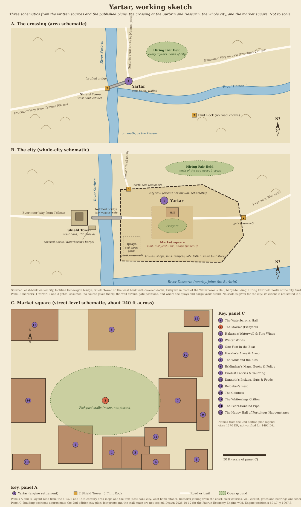

# Yartar

[Location index](../../README.md)

**Region:** Dessarin Valley, Savage Frontier; on the east bank of the River Surbrin near the Dessarin (engine region `Dessarin Valley`, zone `dessarin`)  
**Settlement type:** Small fortified city; baronry ruled by an elected Waterbaron  
**Reference period:** 1361 to 1372 DR lore (2nd-edition sources); circa 1491 DR snapshot (5th-edition sources); 1492 DR noted from a video game; 1492 DR planning baseline  
**Evidence reviewed:** 2026-10-12  
**Engine ID:** `yartar`  
**Structured metadata:** [yartar.json](yartar.json) (identity, periods, engine record, map position, area geography, market-square plan labels and approximate positions, sketch, map and source links; regenerate it when this entry changes)

This entry paraphrases the [Forgotten Realms Wiki article][frwiki] (a secondary
source, rated a Good Article) and the wiki's person and location articles. The
article mixes 2nd-edition material (*Volo's Guide to the North*, 1993; *The North:
Guide to the Savage Frontier*, 1996) with 5th-edition books set around 1491 DR
(*Princes of the Apocalypse*, 2015; *Sword Coast Adventurer's Guide*, 2015;
*Storm King's Thunder*, 2016). Publications named below are the wiki's
references and were not independently consulted. Nothing here is verified for
1492 DR unless stated.

## Overview

Yartar is a prosperous, increasingly crowded walled city in the Dessarin Valley
and a member of the Lords' Alliance. It is a crossroads trading town: rival
caravans and loaded river barges pass through its walls day and night. A strong
criminal element (thieves, smugglers and spies) is said to hold it back from
becoming one of the great city-states. [Source][frwiki], citing *Sword Coast
Adventurer's Guide*, pp. 57 to 58, and *Princes of the Apocalypse*, p. 39.

## Geography

- On the Evermoor Way, on the east bank of the River Surbrin, overlooking the
  nearby River Dessarin (*Princes of the Apocalypse*, pp. 32, 39).
- A fortified bridge, wide enough for two wagons with room to spare, links the
  city to a citadel on the west bank, where the Evermoor Way (Triboar to
  Silverymoon) crosses the Surbrin (*Volo's Guide to the North*, p. 93;
  *Princes of the Apocalypse*, p. 39).
- The Surbrin Trail runs north from the city along the east bank of the Surbrin
  toward the ruins of Nesme, patrolled by Yartaran soldiers (*Storm King's
  Thunder*, p. 110).
- Road distances on the Evermoor Way: Silverymoon to Yartar 320 miles, Everlund
  to Yartar 270 miles ([Evermoor Way][ew], citing *Silver Marches*, 2002, p. 85).
- By the late 15th century DR older buildings were being torn down for taller
  ones of up to four storeys (*Princes of the Apocalypse*, p. 39).
- Engine: neighbours are Triboar by road (66 miles, 3.2 days) and the Yartar to
  Everlund Road junction (84 miles). No river link is modelled although
  `river` is true.

## Population

| Figure | Scope | Year | Source cited by the wiki |
| --- | --- | --- | --- |
| 6,000 | City | 1366 DR | Infobox; history references *Volo's Guide to the North* (1993) and *The North* (1996) |
| No figure; "increasingly crowded", buildings rebuilt taller | City | Late 15th century DR | *Princes of the Apocalypse* (2015), p. 39 |

The only number is 6,000 in 1366 DR. The 5th-edition text implies growth since,
but gives no count. Unknown is not zero; no later figure was found.

Demographics standard update (2026-10-15): no settlement-level racial or ethnic
breakdown was found in the reviewed Yartar sources. Runtime demographics
remains `unresearched` with a checked-source note in `faerun/data/demographics.py`.

**Engine:** 3,800 residents, an undated estimate retained for 1492 DR planning,
not a census. [populations.py](../../../faerun/data/populations.py) now
records the 1366 DR 6,000-person comparison separately; no model change (Y4).

## Economy and Trade

| Direction | Goods (wiki infobox, citing *Sword Coast Adventurer's Guide*, p. 57) |
| --- | --- |
| Imports | Food |
| Exports | Barges |

- **Fishing:** a thriving fishing community thanks to the crossing of rivers,
  with plentiful crab, eel and other catch (*Sword Coast Adventurer's Guide*,
  p. 58). The Fishyard market always has fish from the Three Rivers, brought in
  by ice fishermen even in deep winter; catfish, coldwater crabs, eels and
  shalass are named (*Volo's Guide to the North*, pp. 93, 96).
- **Barge-building:** the city is known for it (*Sword Coast Adventurer's
  Guide*, p. 58), and barges are its listed export.
- **Caravan trade:** an important way stop between Silverymoon and Waterdeep,
  with many businesses serving caravaneers and travellers (*Sword Coast
  Adventurer's Guide*, p. 58). Merchants, smugglers, mercenaries and spies from
  across the North meet here (*Princes of the Apocalypse*, p. 175).
- **Food:** a trade agreement with Goldenfields brings grain and produce to the
  city (*Princes of the Apocalypse*, p. 33), consistent with food as the listed
  import.
- **Fishyard market:** a maze of stalls in front of the Waterbaron's Hall,
  selling fish and also imported curios, jewellery, potions and rare spell
  components from as far as Calimshan and Mulhorand ([Fishyard][fy], citing
  *Volo's Guide to the North*, pp. 95 to 96, and *The North*).
- **Hiring Fair:** in the three years between Shieldmeets a fair on a field
  north of the city draws thousands of wanderers, barbarians, outcasts and
  adventurers selling their labour to farmers, merchants and nobles; adventuring
  bands often form there (*Sword Coast Adventurer's Guide*, p. 57; *Volo's Guide
  to the North*, p. 96).
- **Shieldmeet festival:** sponsored by the temple of Tymora, with drinking,
  wrestling and gambling (*Sword Coast Adventurer's Guide*, p. 57).

## Government

- Ruled by a Waterbaron, elected for life. Alahar Khaumfros (in office 1361 DR,
  having inherited it from his father; secretly head of the Kraken Society) was
  murdered by illithids around 1366 DR. Belleethe Kheldorna held the post in
  1366 DR. Nestra Ruthiol, a Tethyrian noblewoman in her fifties, held it around
  1491 DR; she backs the Lords' Alliance and tolerates the Harpers and
  Zhentarim unless citizens are at risk (*Volo's Guide to the North*, pp. 94,
  217; *Princes of the Apocalypse*, p. 39).
- Defence: the Shields of Yartar, a mounted force of 150 based in the Shield
  Tower on the west bank, which has covered docks for the Waterbaron's barge
  (*Sword Coast Adventurer's Guide*, p. 58; *Volo's Guide to the North*, p. 94).
- Relations: Lords' Alliance member; an old, mostly good-natured rivalry with
  Triboar, said to date from the disappearance of the Lost Guide, a caravaneer
  carrying gold between the two (*Volo's Guide to the North*, p. 84; *The
  North*, p. 37).
- Chronology to 1492 DR: Khaumfros's 1361 DR plot to set the Lords' Alliance
  against Ruathym for the Kraken Society and Luskan was foiled (*Tangled Webs*,
  1998); in 1491 DR the elemental cults abducted poor Yartarans, the Hand of
  Yartar stole a devastation orb and tried to auction it, and Lord Khaspere
  Drylund sought to bribe his way to becoming Waterbaron (*Princes of the
  Apocalypse*, p. 175; *Storm King's Thunder*, p. 115). In 1492 DR a mind
  flayer nautiloid destroyed one of the tallest buildings and seized citizens
  before githyanki on red dragons drove it off (*Baldur's Gate III*, video game
  only).

## Notable Inhabitants

From the wiki's [Category: Inhabitants of Yartar][inh] (25 entries) and the linked
person articles, read 2026-10-12. Paraphrased; sources are those the wiki cites,
not independently checked. Nearest to 1492 DR first.

### Late 15th century DR (closest to the 1492 baseline)

| Person | Role | Dated | Source cited by the wiki |
| --- | --- | --- | --- |
| Nestra Ruthiol | Waterbaron; Tethyrian noblewoman, cunning and vindictive, accused of murdering a former lover | Circa 1491 DR | *Princes of the Apocalypse*, p. 39; *Storm King's Thunder*; *Sword Coast Adventurer's Guide* |
| Khaspere Drylund | Lord; owner of the riverboat *Grand Dame* and its Golden Goose Casino; high-ranking Kraken Society member plotting to become Waterbaron | Late 1480s or early 1490s DR | *Storm King's Thunder*, pp. 115, 216 to 219 |
| Pow Ming | Security chief of the *Grand Dame*; hoping to join the Arcane Brotherhood | Same | *Storm King's Thunder* |
| Tholzar Brenner | Corrupt figure with so many enemies he keeps eight guards; the Waterbaron hopes someone kills him. Office not stated in the article lead | Same | *Storm King's Thunder* |
| Kolbaz | Old Calishite mage and Harper guarding the teleportation circle at the Harpers' villa | Same | *Storm King's Thunder*, p. 118 |
| Oboth Thornsteel | Zhentarim mercenary in Yartar; later occupied Mornbryn's Shield after a giant attack | Same | *Storm King's Thunder* |
| Nareen Dhest | Spy of the Hand of Yartar who stole the devastation orb from the city vaults | 1491 DR | *Princes of the Apocalypse* |
| Haliyra Ravenfast | Assassin tied to the orb auction; died 1491 DR | 1491 DR | *Princes of the Apocalypse* |
| Ghald; Unferth | Sahuagin and human priest, the Kraken Society's chief operatives in the area; Ghald hid beneath the docks; both died 1491 DR | 1491 DR | *Princes of the Apocalypse* |
| Erned Stoutblade | Yartaran who helped defend the Dellmon farm against Iceshield orcs | 1491 DR | *Princes of the Apocalypse* |

### Mid to late 14th century DR (historical)

| Person | Role | Dated | Source cited by the wiki |
| --- | --- | --- | --- |
| Belleethe Kheldorna | Waterbaron; oversaw the city's trade, protected Tymora's worshippers and expelled foreign agents | 1366 DR | *Volo's Guide to the North*, p. 217 |
| Alahar Khaumfros | Waterbaron and secret Kraken Society leader; killed by illithids for misusing the society's funds | 1361 to 1366 DR | *Waterdeep and the North* (1987), p. 10; *The Savage Frontier* (1988), p. 34; *The North* |
| Alukk Dannath | Proprietor of Dannath's Pickles, Nuts, & Foods, selling travel food; his three daughters are Harpers | Circa 1370 DR | *Volo's Guide to the North*, p. 100; *The North* |
| Esklindrar Iol | Elderly sage, master of Esklindrar's Maps, Books, & Folios; friend of Alustriel | Circa 1370 DR | *The North*; *Silver Marches* (2002), p. 63 |
| Elladuth Myristar | Innkeeper of the Pearl-Handled Pipe, collector of furnishings | Circa 1370 DR | *Volo's Guide to the North*, p. 104; *The North* |
| Tanataskar Moonwind | Former adventurer cursed by Tempus; owner of the Cointoss tavern | Circa 1370 DR | *The North* |
| Velantha Waerdar | High priestess of the temple of Tymora | Circa 1370 DR | *The North* |
| Beldabar Yarryn | Former Hawks of the North adventurer running Beldabar's Rest | Circa 1370 DR | *The North* |
| Semmonemily | Doppelganger informer of the Kraken Society | Circa 1361 DR | *Tangled Webs* (1998), p. 126 |
| Nalynaul | Alhoon crime lord who left Gauntlgrym around 1340 DR | 14th century DR | *Cloak & Dagger* (2000) |
| Krevish | Lords' Alliance agent, born about 1326 DR | Circa 1360s DR | *Gateway to the Savage Frontier* (video game, 1991) only |

### Legendary and loosely tied

| Person | Note |
| --- | --- |
| Pox (lich); Saurglyce | Lich and her white dracolich mount who founded a Cult of the Dragon cell in Yartar (*Cult of the Dragon*, 1998, pp. 36 to 37; *Dragons of Faerun*, 2006); date not checked |
| Wiston | Apothecary whose shop is in Daggerford (*The North*); listed under Yartar, tie not checked |

### Families and organizations

Shields of Yartar (mounted city force); the Hand of Yartar (an all-woman thieves'
guild, large but split by infighting, working with the Zhentarim when useful);
the Kraken Society (Three Rivers Festhall a front); the Lionshield Coster (merchant
company based here); the Smiling Company (adventurers who donated to the temple);
the Harpers (the Villa safehouse); the Zhentarim; a Cult of the Dragon cell. Sources
as in the article; dates range from 1361 to 1491 DR.

## Businesses

### In the live market (engine `businesses.json`)

| Business | Type | Offers | Note |
| --- | --- | --- | --- |
| Lionshield Coster (`lionshield_coster`) | Merchant company (HQ Yartar) | Leather armour, shields, swords, spears, short bows, arrows | Added 2026-10-12 (Y3). Sourced: based in Yartar, operating across the Dessarin Valley in the 15th century DR, shipping finished goods such as arms and armour; posts at Phandalin (1491 DR), Nightstone and Triboar (*Lost Mine of Phandelver*, pp. 16 to 17; *Storm King's Thunder*, pp. 25, 54). Offers inferred from the Phandalin post. The existing `lionshield_coster_phandalin` and `lions_share` (Triboar) records are its branches; they are not linked in the engine |
| Golden Sheaf Provisions | Provisions (HQ Goldenfields) | Grain, flour, bread, salted meat, ale | Engine-authored; loosely matches the Goldenfields food agreement. Offers valid |
| Amphail Remount Company | Horses (HQ Amphail) | Riding, war and draft horses, saddles | Engine-authored. Offers valid |

All offers were checked against `commodities.json`; none names a missing
commodity.

### Named in the source, not in the market

Volo's businesses (1993) are 14th-century material and not verified for 1492 DR.

| Name | Kind | Dated | Modeled goods it suggests |
| --- | --- | --- | --- |
| Wink and Kiss | Large tavern protected by the Hand of Yartar | 1491 DR (*Princes of the Apocalypse*, p. 176) | `ale` |
| *Grand Dame* (Golden Goose Casino) | Riverboat gambling hall | Late 1480s to early 1490s DR (*Storm King's Thunder*) | None (service) |
| Fishyard | Central market of stalls | 1370 DR and later | `fish_fresh` |
| Dannath's Pickles, Nuts, & Foods | Food shop, high prices, well stocked | Circa 1370 DR | `nuts`, pickled goods (no commodity) |
| Esklindrar's Maps, Books, & Folios | Maps (many treasure maps) and books | Circa 1370 DR | `book`; maps (no commodity) |
| Firelust Fabrics & Tailoring | Family tailors | Circa 1370 DR | `cloth`, clothing |
| Halassa's Waterwell & Fine Wines | Water, local and imported wines and spirits | Circa 1370 DR | `wine_common`, `wine_fine` |
| Hasklar's Arms & Armor | Arms shop (guarded by ghosts) | Circa 1370 DR | arms and armour |
| Winter Winds | Expensive clothing shop run by two brothers from Baldur's Gate | Circa 1370 DR | clothing |
| Pearl-Handled Pipe | Best inn, over 600 guests | Circa 1370 DR | Lodging |
| Beldabar's Rest; Inn of the Glowing Gem; One Foot in the Boat; Cointoss; White-Winged Griffon; Three Rivers Festhall | Inns, taverns, festhall | Circa 1370 DR (Glowing Gem and Festhall from video games) | Lodging, `ale` |
| Happy Hall of Fortuitous Happenstance | Temple of Tymora; lodges and feeds adventurers for up to nine nights | Circa 1370 DR | None |

## Maps and Village Layout

### Maps

Preferred edition: 2nd. Published images are linked, not stored in the repo. No
interactive map exists (`Map:Yartar` returned "not found", 2026-10-12).

| Map | Edition and date | Shows | Where |
| --- | --- | --- | --- |
| Yartar city map | 2nd edition, *The North: Guide to the Savage Frontier* (1996), gallery caption "Yartar - The North - City Map"; circa 1370 DR | City plan | [File:Yartar - The North.jpg][mapcity] |
| Area surrounding Yartar | Gallery caption "c.1372 DR"; edition not stated | Surroundings | [File:Yartar.JPG][maparea] |
| Area surrounding Yartar in the 15th century DR | Probably 5th edition (*Princes of the Apocalypse* era); not confirmed | Rivers and roads around the city | [File:YartarSurroundings15thCDR.png][map15] |
| Overview image | Infobox caption "An Overview of Yartar c. 1492 DR"; source not stated | View of the city | [File:Yartary.png][mapover] |
| Skyline | Gallery caption "c.1492 DR"; *Baldur's Gate III* (video game) | Illustration, not a map | [File:Yartar2.png][mapsky] |

No marker positions are available. The Fishyard sits in front of the Waterbaron's
Hall, ringed by shops and inns, and Beldabar's Rest lies beneath the central
market (*Volo's Guide to the North*, pp. 95, 97).

**Working sketch:** [yartar-sketch.svg](yartar-sketch.svg), drawn 2026-10-12,
in three panels. None is a copy of a published map.

- **A. The crossing:** the east-bank city, the west-bank Shield Tower and
  fortified bridge, Evermoor Way, Surbrin Trail and Hiring Fair field, from the
  text and the area maps. River courses and bearings are schematic; north is
  unconfirmed.
- **B. The city:** the whole walled city. Sourced: the east-bank city, the
  two-wagon fortified bridge, the Shield Tower with its covered docks, the
  Fishyard in front of the Waterbaron's Hall, barge-building, the Hiring Fair
  field north of the city and the Surbrin Trail along the east bank. Assumed,
  because no source gives them: the wall circuit, the gate positions and where
  the quays and barge yards stand. No wards, streets or scale are drawn; the
  city's extent is not stated in the sources.
- **C. Market square:** the 15 numbered buildings of the 2nd-edition plan (a
  close-up about 240 feet across, circa 1370 DR) at approximate relative
  positions, with the stall maze left unplotted.

## Engine Record

| Field | Value |
| --- | --- |
| Population | 3,800 (gazetteer estimate, no year) |
| Wealth / tax / security | 1.0 / 0.07 / 0.6 |
| Port / river | None / yes |
| Terrain | Plains |
| Position | x 691.7, y 1007.8 (stored and `coords.json` control point agree) |
| Traits | `mercantile`, `frontier` |
| Industries | `trade` 3, `fish` 2, `farm` 2, `craft` 1, `ship` 1 (added 2026-10-12) |
| Specialties | `barrel` 1, `ship_boat` 1 (added 2026-10-12) |
| Shortages | None |
| Ruler | Blank |
| Size category | Small town |
| Guilds (inferred) | Merchant; Farmers' and Millers'; Fishers' and Watermen's |

Observed 2026-10-12 before this run's changes (`get_trade_summary`, 11
Marpenoth 1492 DR): gross local product 1.50 million gp a year (395 gp per
resident); goods exports 1,949 gp a day against imports of 174,925 gp a day
(about 90 times); 26,051 gp a day of inbound freight assigned to no carrier.
Leading exports by volume are grain (690 bushels a day), vegetables (237 crates),
fruit (208 crates), cheese (82 wheels), eggs (72 crates), fresh meat (59 sides)
and medicinal herbs (32 bundles). Grain output is about 864 bushels a day with a
hinterland capacity multiplier of about 4.15. The import list is led by
unavailable goods (pineapple, pears, citrus, longship, masterwork warhammer,
remorhaz plate, llama) each with a flat 7.6-a-day need (0.2% of residents).

After this run's changes the totals were unchanged to the nearest gp; river boats
are made at about 0.0028 a day (about one a year) from planks, nails, rope and
sailcloth (Y13).

## Discrepancies and Proposed Engine Changes

| # | Issue | Proposal | Status |
| --- | --- | --- | --- |
| Y1 | Barge-building is a named industry and barges the listed export (*Sword Coast Adventurer's Guide*, p. 58), but there was no `ship` industry | Add `ship` 1 and specialty `ship_boat` 1 (river boat, the nearest commodity to a barge) | Applied 2026-10-12 |
| Y2 | Description was blank | Set description from the sources (Surbrin crossing, caravans and barges, fishing, barge-building, food imports, Waterbaron, Lords' Alliance) | Applied 2026-10-12 |
| Y3 | The Lionshield Coster is based in Yartar and operating in 1491 DR, but only its Phandalin and Triboar branches were in the market | Add `lionshield_coster` (HQ Yartar) with offers matching the Phandalin post | Applied 2026-10-12 |
| Y4 | Engine 3,800 has no sourced count; the only figure is 6,000 in 1366 DR, and 5th-edition text calls the city increasingly crowded | `populations.py` records the historical 6,000 separately; retain 3,800 until a separately validated economic recalibration is authorized | Evidence applied 2026-10-15; recalibration proposed |
| Y5 | Ruler blank; Waterbaron Nestra Ruthiol in 1491 DR | Set ruler to "Waterbaron Nestra Ruthiol" as a dated snapshot; Khaspere Drylund's bid and 1492 succession remain open | Applied 2026-10-15; 1492 DR unverified |
| Y6 | Source lists food as the import and a Goldenfields grain and produce agreement, but `farm` 2 exports 690 bushels of grain, 237 crates of vegetables and 208 of fruit a day, helped by a hinterland multiplier of about 4.15 | Lower `farm` to 1 and consider a `grain` shortage; trace the grain hinterland multiplier with A9a | Proposed |
| Y7 | Specialty `barrel` 1 has no source | Review; keep only if barge and river trade justify cooperage | Proposed |
| Y8 | Temple of Tymora (Happy Hall), the Shieldmeet festival and the Hiring Fair (every three years between Shieldmeets, thousands of visitors) are not modelled | Add `temple` 1; model the Hiring Fair as a periodic visitor or labour event | Proposed |
| Y9 | River city with docks, the Waterbaron's barge, a riverboat casino and barge export, but no river lane; `port` only names sea basins | Model a Surbrin and Dessarin river lane (with D12) | Proposed (routes phase) |
| Y10 | Evermoor Way distances (Silverymoon 320 miles, Everlund 270) and the Surbrin Trail north to Nesme are not reflected; Triboar road is 66 miles (see T13) | Review Evermoor Way stops (Calling Horns, Olostin's Hold, Noanar's Hold) and the Surbrin Trail | Proposed (routes phase) |
| Y11 | Further 1491 DR businesses | Add Wink and Kiss (tavern, `ale`) and possibly the *Grand Dame* once services are modelled | Proposed |
| Y12 | Imports about 90 times exports, driven by the flat 7.6-a-day need for unavailable exotic goods; cotton and medicinal herbs exported with no `herb` or `textile` | Review with W5, W6, L14, A10, D18 | Proposed (engine-wide) |
| Y13 | After Y1, river boat output is about one a year, too little to make barges an export | Check `ship` capacity scaling and whether a barge commodity is needed; review with D21 | Proposed |
| Y14 | Lionshield Coster's three records (Yartar, Phandalin, Triboar) are separate businesses | Consider one multi-location business when branches can carry their own offers | Proposed |
| Y15 | Golden Sheaf Provisions and Amphail Remount Company are engine-authored | Leave | No change |
| Y16 | `reload_catalog` moved Amphail again (A12, tenth time; x 621.7, y 1126, no neighbours); Yartar unaffected because its stored position equals its control point | Restored Amphail by hand to x 648.5289, y 1161.7169; decide L12 | Historical observation; local fix validated 2026-10-15, live server pending |

## Proposed New Commodities

| Candidate | Evidence | Producers |
| --- | --- | --- |
| River barge | Listed export; barge-building (*Sword Coast Adventurer's Guide*, p. 58); `ship_boat` stands in | `ship` |
| Crabs and eels (shellfish, river catch) | Fishyard catfish, coldwater crabs, eels, shalass (*Volo's Guide to the North*, p. 93); crab and eel (*Sword Coast Adventurer's Guide*, p. 58); `fish_fresh` nearest | `fish` |
| Pickles | Dannath's Pickles, Nuts, & Foods (circa 1370 DR, *Volo's Guide to the North*, p. 100) | `farm`, `craft` |
| Maps and sea charts (existing candidate) | Esklindrar's treasure maps (circa 1370 DR, *Volo's Guide to the North*, p. 101) | `paper` |

## Lore Follow-ups

1. **1492 DR state.** Whether Nestra Ruthiol was still Waterbaron in 1492 DR, and
   whether Khaspere Drylund's bid succeeded; read *Storm King's Thunder*, p. 115.
2. **Population.** No count after 1366 DR; check *Princes of the Apocalypse*,
   p. 39, and *Sword Coast Adventurer's Guide*, p. 57, for any figure (Y4).
3. **Barges.** How many barges and boats the yards build and for whom; whether
   barge traffic runs down the Dessarin to Goldenfields and Waterdeep (Y1, Y9,
   Y13).
4. **City map.** Only the market-square close-up of the 2nd-edition plan in
   *The North* was read. Find a whole-city plan (walls, gates, wards, docks) to
   replace the assumed positions in panel B of the sketch; identify the edition
   of the c.1372 DR area map.
5. **Mornbryn's Shield and Nightstone.** Both tie to Yartar in *Storm King's
   Thunder* (Zhentarim from Yartar; Lionshield post); not in the engine.
6. **Tholzar Brenner.** Read his article for his office in the city.

## Sources

**Directly consulted, secondary:** [Forgotten Realms Wiki: Yartar][frwiki],
accessed 2026-10-12 through the browser (direct fetch failed with a client error).
Also [Category: Inhabitants of Yartar][inh] and the 25 linked person articles,
[Category: Locations in Yartar][loc], [Lionshield Coster][lc], [Fishyard][fy] and
[Evermoor Way][ew], all accessed 2026-10-12. Publications named above are the
wiki's references, not independently checked: *Volo's Guide to the North* (1993),
pp. 84, 93 to 105, 217; *The North: Guide to the Savage Frontier* (1996), pp. 37,
38, 46, 79; *The Savage Frontier* (1988), p. 34; *Waterdeep and the North* (1987),
p. 10; *Tangled Webs* (1998), pp. 125 to 126; *Silver Marches* (2002), pp. 63, 85;
*Princes of the Apocalypse* (2015), pp. 16, 32, 33, 39, 175, 176; *Sword Coast
Adventurer's Guide* (2015), pp. 57 to 58; *Storm King's Thunder* (2016), pp. 25,
54, 110, 115, 118, 216 to 219; *Lost Mine of Phandelver* (2014), pp. 16 to 17;
*Gateway to the Savage Frontier* (1991) and *Baldur's Gate III* (2020 to 2023),
video games.

**Engine:** `get_settlement`, `get_trade_summary`, `get_price` (grain,
`ship_boat`), [businesses.json](../../../faerun/data/store/businesses.json) and
[commodities.json](../../../faerun/data/store/commodities.json), observed
2026-10-12. `get_city_directory` reports no historical directory for Yartar.

[frwiki]: https://forgottenrealms.fandom.com/wiki/Yartar
[inh]: https://forgottenrealms.fandom.com/wiki/Category:Inhabitants_of_Yartar
[loc]: https://forgottenrealms.fandom.com/wiki/Category:Locations_in_Yartar
[lc]: https://forgottenrealms.fandom.com/wiki/Lionshield_Coster
[fy]: https://forgottenrealms.fandom.com/wiki/Fishyard
[ew]: https://forgottenrealms.fandom.com/wiki/Evermoor_Way
[mapcity]: https://forgottenrealms.fandom.com/wiki/File:Yartar_-_The_North.jpg
[maparea]: https://forgottenrealms.fandom.com/wiki/File:Yartar.JPG
[map15]: https://forgottenrealms.fandom.com/wiki/File:YartarSurroundings15thCDR.png
[mapover]: https://forgottenrealms.fandom.com/wiki/File:Yartary.png
[mapsky]: https://forgottenrealms.fandom.com/wiki/File:Yartar2.png
